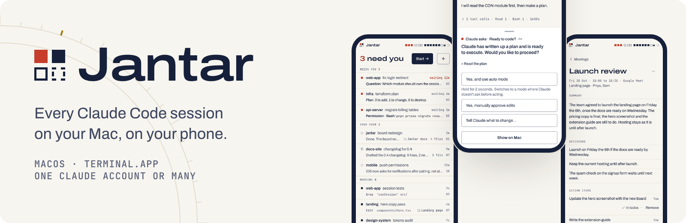
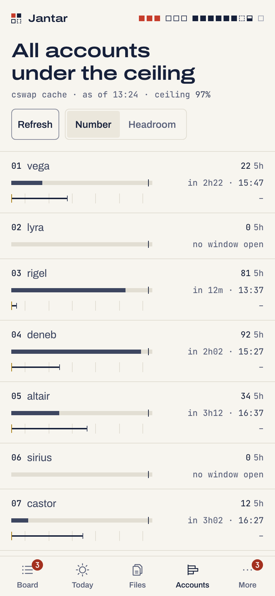
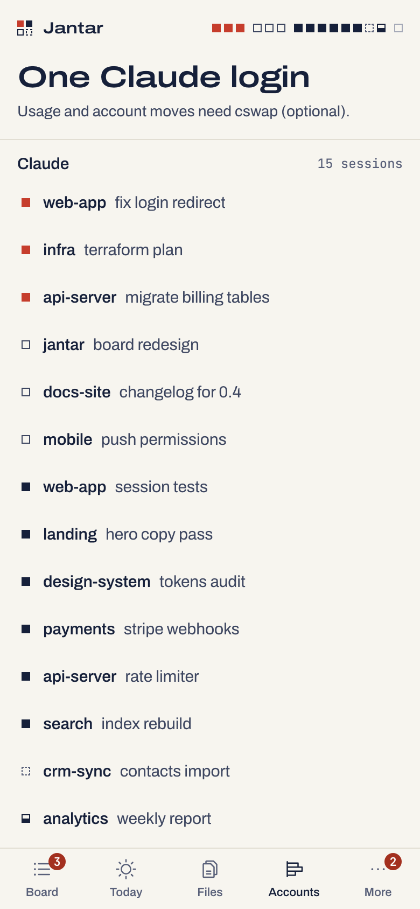
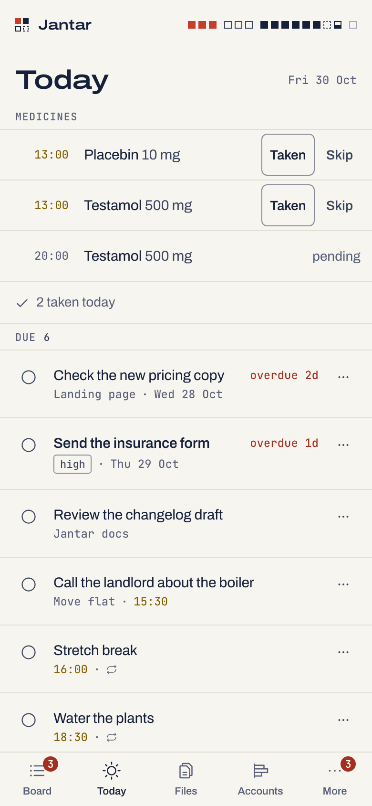
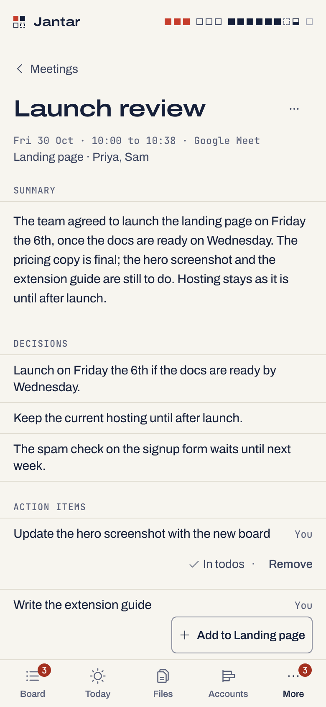

<p align="center">
  <picture>
    <source media="(prefers-color-scheme: dark)" srcset="docs/brand/banner-dark.png">
    
  </picture>
</p>

# Jantar

Every Claude Code session on your Mac on one board, on the Mac and on your
phone. See which session is waiting on you and answer it from the phone.
You can also send it a prompt or a photo, or start the next one in any
folder you allow. It is for anyone who runs several Claude Code sessions at
once in Terminal on a Mac, on one Claude account or many. Jantar runs on
your Mac and your phone reaches it through your own tunnel: there is no
Jantar server and no Jantar account.

**v0.5.1, early** · macOS and Terminal.app · source-available
(FSL-1.1-MIT) · not affiliated with Anthropic

[Install](docs/install.md) · [Your phone](docs/install.md#reach-it-from-your-phone) ·
[All docs](docs/README.md) · [Changelog](CHANGELOG.md) · [Security](SECURITY.md)

## What it does

### See every session

The Board lists every Claude Code session in Terminal.app, the ones that
need you first. Each row shows the question, plan or command it waits on,
the tool it is running, or its last reply. On a Mac, the Desk beside it
shows the cards to answer and the next usage resets.

<picture><source media="(prefers-color-scheme: dark)" srcset="docs/img/board-desktop-dark.png"></picture>

More: [the app, screen by screen](docs/phone-app.md).

### Answer from your phone

Permission prompts, plans and questions show as buttons in Claude's own
words. With Jantar's hooks, a card answers through Claude Code itself.
Without them, Jantar reads the dialog off the Terminal screen and types
your choice only while the Mac still shows exactly what you tapped. Rows
that save a rule or switch mode need a 2-second hold.

<p align="center">
  <picture><source media="(prefers-color-scheme: dark)" srcset="docs/img/card-phone-dark.png"></picture>
  <picture><source media="(prefers-color-scheme: dark)" srcset="docs/img/dialog-plan-phone-dark.png"></picture>
  <picture><source media="(prefers-color-scheme: dark)" srcset="docs/img/dialog-permission-phone-dark.png"></picture>
</p>

More: [answering prompts from the phone](docs/phone-control.md).

### Prompts, photos and new sessions

A prompt counts as delivered only when the session's transcript shows it
arrived. Attach photos and files from the phone; they go to the Mac and
Claude reads them from there. Start a new session in any folder you allow,
or resume the last one, and see the exact command line first.

<p align="center">
  <picture><source media="(prefers-color-scheme: dark)" srcset="docs/img/attach-phone-dark.png"></picture>
  <picture><source media="(prefers-color-scheme: dark)" srcset="docs/img/start-phone-dark.png"></picture>
</p>

More: [the app](docs/phone-app.md#new-session-and-resume).

### One account or many

One Claude login is enough. With [cswap](https://github.com/realiti4/claude-swap)
and several accounts, Jantar shows each account's 5-hour and weekly usage
and when it resets. Accounts you keep for other work are never picked by
Auto, Rewrite, Ask Claude or Ask, and an opt-in primer can start an idle
account's 5-hour window early. Jantar does not switch accounts by itself.

<p align="center">
  <picture><source media="(prefers-color-scheme: dark)" srcset="docs/img/accounts-phone-dark.png"></picture>
  <picture><source media="(prefers-color-scheme: dark)" srcset="docs/img/accounts-single-phone-dark.png"></picture>
</p>

More: [accounts](docs/accounts.md).

### Off until you want them

A small life list (todos, reminders, medicines, food, cafés, money), a
shelf for links your scripts save, and notes from your Google Meet and
Teams calls in Chrome (their live captions and a summary; the screenshots
you click are not yet confirmed on a real call). Each is switched on at the
Mac, one at a time, and the pictures here show them on. A fresh install
shows only Board, Accounts, Alerts and Devices. **Ask** (`jantar ask on`)
turns plain words ("remind me to stretch at 6 pm") into Life's todos,
reminders, meals and expenses, each added only when you tap it.

<p align="center">
  <picture><source media="(prefers-color-scheme: dark)" srcset="docs/img/today-phone-dark.png"></picture>
  <picture><source media="(prefers-color-scheme: dark)" srcset="docs/img/meeting-phone-dark.png"></picture>
  <picture><source media="(prefers-color-scheme: dark)" srcset="docs/img/intel-phone-dark.png"></picture>
</p>

More: [Life](docs/life.md), [Ask](docs/assistant.md),
[Meetings](docs/extension.md), [the Intel shelf](docs/intel.md).

## Requirements

- A Mac with Terminal.app (the only terminal so far)
- Node.js 22.13 or newer, and pnpm 10
- Claude Code, signed in (one account is enough)
- For the phone: [Tailscale](https://tailscale.com) (recommended) or a
  Cloudflare Tunnel
- Optional: cswap for several Claude accounts; Chrome 120 or newer for
  Meetings

## Quickstart

```sh
git clone https://github.com/Namanjain-share/jantar.git && cd jantar
pnpm install && pnpm -r build
alias jantar="node $PWD/packages/cli/bin/jantar.mjs"
jantar init            # asks a few questions, writes ~/.jantar/config.json
jantar install         # the LaunchAgent, then a health check
jantar open            # the dashboard on this Mac
jantar remote setup    # how to reach it from your phone (Tailscale or Cloudflare)
jantar pair            # a QR code for your phone, good once, for 10 minutes
```

To get approval cards on the phone, install Claude Code's hooks with
`jantar hooks install --apply`. This is opt-in, and the hooks fail open. To
try Jantar with nothing changed on your Mac, see
[Try it without touching anything](docs/install.md#try-it-without-touching-anything).

Used Jantar under its old name, up to v0.3? [Upgrading](docs/upgrading.md#from-jantars-old-name)
has the steps to bring your phones and settings along.

## How it works

- A small daemon, `jantard`, runs under launchd and listens only on
  127.0.0.1.
- It reads Claude Code's session files and transcripts and Terminal's text.
  It types into Terminal only what you send or answer.
- The phone app is a web app you add to your Home Screen. It reaches the
  Mac through [Tailscale Serve](docs/install.md#tailscale-recommended) or
  a [Cloudflare Tunnel](docs/install.md#cloudflare-tunnel-with-access),
  and you pair it once with a QR code.
- Claude Code hooks are optional. They carry the approval cards, and Claude
  behaves as usual when the daemon is not running.

What leaves the Mac: your phone's requests travel through the tunnel you
set up (with Cloudflare, TLS ends at Cloudflare). Notifications go through
Apple's or Google's push service. Rewrite, Ask Claude, Ask and meeting
summaries run Claude Code on your own account. Nothing goes to a server run
by this project. More in [How it is put together](docs/architecture.md).

## Safety, in short

- Every switch is set at the Mac; a phone can never widen its own reach.
- Pairing is a one-time QR code, and every write carries the device's
  secret.
- An answer is typed only while the Mac still shows exactly the dialog you
  tapped.
- Tests run against a synthetic Mac (fake Terminal, `claude` and `cswap`).
  Every picture here is synthetic data.
- Report problems privately through GitHub's security advisories (see
  [SECURITY.md](SECURITY.md)).

## Status and limits

- v0.5.1. Terminal.app only; tmux and iTerm2 come later
  ([roadmap](docs/roadmap.md)).
- A few answers stay at the Mac until a real Mac confirms them:
  [real-Mac checks](docs/real-mac-checks.md).
- Jantar does not switch accounts on its own. Medicine and reminder pings
  need the Mac awake. More in [the FAQ](docs/faq.md#known-limits).

## Documentation

| Page | What it holds |
|---|---|
| [Install and run](docs/install.md) | Requirements, a read-only trial, running under launchd, macOS prompts, reaching it from your phone, updating |
| [The app](docs/phone-app.md) | Every screen on the phone and the Mac, sending prompts, new sessions, Files, Rewrite, Controls |
| [Answering from the phone](docs/phone-control.md) | Hook cards, terminal dialogs, the keypad, attachments, what stays at the Mac |
| [Accounts](docs/accounts.md) and [the primer](docs/primer.md) | One login or cswap, usage, kept accounts, priming idle windows |
| [Life](docs/life.md) | Today, todos, reminders, projects, medicines, food, cafés, finance |
| [Intel shelf](docs/intel.md) | The shelf and its JSONL line format |
| [Meetings](docs/extension.md) | The Chrome extension for Meet and Teams |
| [Configuration](docs/configuration.md) | Every command, `jantard` flags, environment, `config.json`, the state folder |
| [Security overview](docs/security.md) | What Jantar can reach, in plain words; the full model is [SECURITY.md](SECURITY.md) |
| [FAQ](docs/faq.md) | Common questions and known limits |
| [All docs](docs/README.md) | Including the pages for contributors |

## The name

Named after the Jantar Mantar, the 18th-century observatories in India
whose stone instruments read the sky. Jantar reads your terminals.

## Contributing

Bug reports, ideas and pull requests are welcome. Read
[CONTRIBUTING.md](CONTRIBUTING.md) first: it covers setup, the tests (they
never touch your real Mac), the privacy rules and the contributor agreement
in [CLA.md](CLA.md), which a bot asks you to sign on your first pull
request.

## License

Jantar is **source-available (fair source)**, licensed under the
**Functional Source License, Version 1.1, with the MIT future license**
(FSL-1.1-MIT): see [LICENSE](LICENSE). In plain words: you may use it,
change it, self-host it and share it for any purpose except offering it to
others as a competing commercial product or service, and each version
becomes available under the MIT license two years after it is released.

Contributions come under the Contributor License Agreement in
[CLA.md](CLA.md). Code adapted from other projects keeps its original
license and is listed in [THIRD_PARTY_NOTICES.md](THIRD_PARTY_NOTICES.md)
and [docs/PROVENANCE.md](docs/PROVENANCE.md).

## Not affiliated

Not affiliated with or endorsed by Anthropic. "Claude" and "Claude Code" are
Anthropic's products; this is an independent tool that works with the files
and hooks Claude Code exposes. Not affiliated with Google or Microsoft
either: the extension names Google Meet and Microsoft Teams only to say
which calls it works with.
