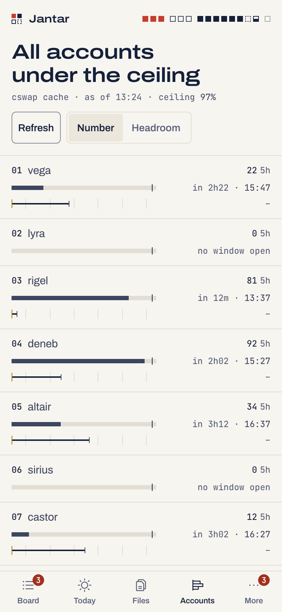
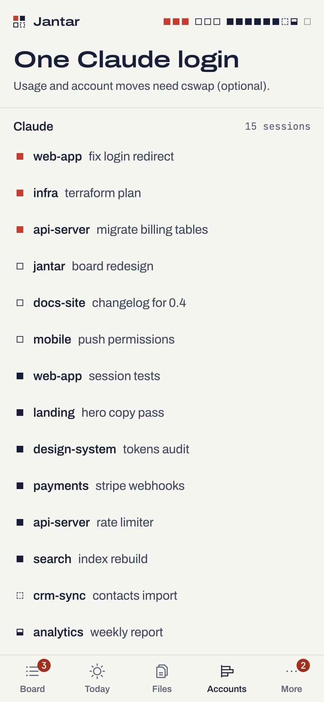
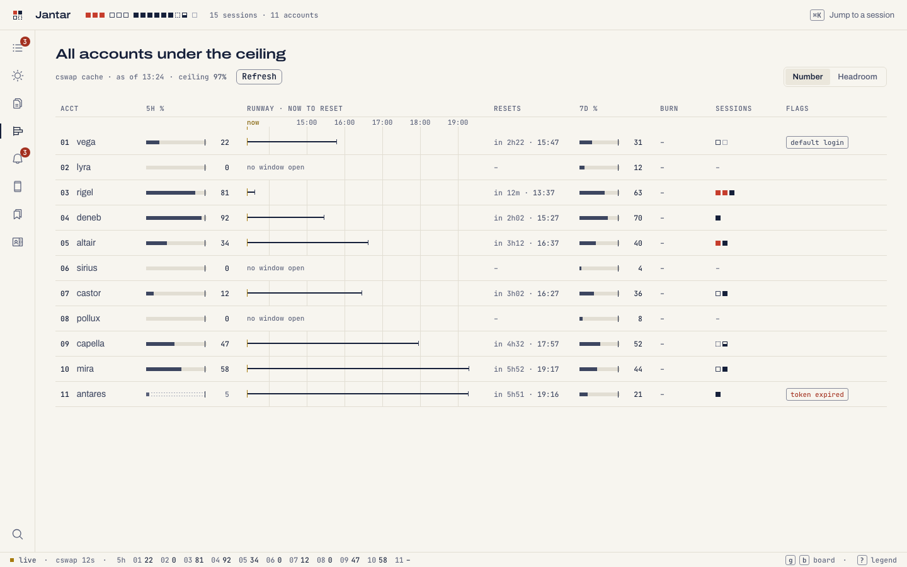

# One account or many

Jantar works with one Claude login and nothing else. With
[cswap](https://github.com/realiti4/claude-swap) and its profiles it also
shows every account's usage. It decides which at start: with cswap and its
profiles it runs on all of them, without them it runs on your one login
and leaves usage, holds and moves out. `JANTAR_ACCOUNTS=single` in the
daemon's environment forces the one-login view on a Mac that has cswap.

<p align="center">
  <picture><source media="(prefers-color-scheme: dark)" srcset="img/accounts-phone-dark.png"></picture>
  <picture><source media="(prefers-color-scheme: dark)" srcset="img/accounts-single-phone-dark.png"></picture>
</p>

## What the Accounts screen shows

With cswap:

- one line on top, such as "All accounts under the ceiling";
- where the numbers come from: the age of cswap's usage cache and the
  ceiling;
- for each account: the 5-hour bar against the ceiling, a runway to the
  reset, the reset time, weekly %, its sessions and its flags (default
  login, an expired token). Tap a row for the same in words;
- the [primer's](primer.md) line, when the primer is on.

When the legacy ccw tool also runs, its numbers join in: `next →` (the
account it would move to next), each account's burn rate, red dashes on a
runway that fills up before its reset ("1 account runs out before its
reset"), its hold list as `held` flags, and the moves it makes. Without
ccw those stay empty: nothing in Jantar moves sessions between accounts
yet.

With one login: that login and its sessions.

On a Mac the same screen is a matrix:

<picture><source media="(prefers-color-scheme: dark)" srcset="img/accounts-desktop-dark.png"></picture>

Usage comes from cswap's own cache. While the legacy ccw tool's bot keeps
that cache fresh, Jantar only reads it; it becomes the single
`cswap list --json` poller only when that bot is not running.

## Switching rules

While the legacy ccw tool runs, it moves sessions between accounts by the
rules in its `~/.config/ccw/switch.json`. **Switching rules** on the
Accounts screen (beside Refresh, on a device paired with control) shows
and changes them:

- **Hold**, per account: ccw never moves sessions onto it. Without a
  weekly cap it never moves them off it either; with one, its sessions
  leave once it passes the cap.
- **Weekly cap by day**, per account: instead of the one weekly limit, a
  cap for each day of the account's week and one for its last hour. Day 1
  starts at the account's weekly reset; in the hour before the next reset
  the last-hour cap applies. *Fill the usual week* puts in 50, 50, 50, 50,
  75, 85, 95 and 100 for the last hour: the account is kept to half its
  week early on and can use all of it at the end. When a reading is older
  than the reset, the days count on from that reset. The day in effect now
  is marked (`Day 4 · now`); with no weekly reading to count from, the
  account's cap is the weekly limit until there is one. Turn the cap off
  and the account goes back to the weekly limit.
- **5-hour limit** and **Weekly limit**: the % of each window ccw treats
  as full (50 to 100).
- **Leave … min before full**: how early a session leaves an account
  that will be full (1 to 60 minutes).

How a weekly cap is used, by ccw and by Jantar's own plan and Auto alike:

- Held or not, a capped account's sessions leave it (or are parked, when no
  account has room) once its weekly use reaches the cap for now. That is
  read from the account's weekly use, not projected from how fast its
  sessions burn: an account at 10% with a 50% cap keeps its sessions.
- A session moves onto an account with a cap (or Auto starts one there)
  only while its weekly use is at least 5 under the cap, so it doesn't
  arrive at 49% and leave at 50%. A held account never takes one.
- Weekly use, against a cap or the weekly limit, is the account's own
  weekly window, as ccw reads it: a weekly window for one model only
  doesn't count.
- An account whose usage reading has no 5-hour window has no 5-hour
  limit: it is never shown filling up, and only its weekly use (or cap)
  stops it. Where other accounts show their 5-hour use it says `no 5-hour
  limit` (`no limit` beside `5h` on a board row and in the status bar),
  never 0%, with no 5-hour burn or reset. An account with a 5-hour window
  keeps the 5-hour rules, cap or not, and one whose window hasn't started
  yet shows 0 and `no window open`.
- A held account with a cap takes no session, but its sessions leave it at
  the cap, one by one: never as part of a ccw group's move, so when you
  start a session in a group they don't say which account the group is
  on. Under Moves it reads `Held account 02: nothing moves onto it; its
  sessions leave once it passes its weekly cap (50% now).`
- In `switch.json` an account's entry is under its number as ccw writes it
  (`"2"`, never `"02"`); an entry under any other key, or one that doesn't
  fit (a value over 100, six days), is ignored and logged once, and that
  account has the weekly limit. A whole number written as `50.0` counts.

Save writes only what you changed, and only those settings: every other
key in `switch.json` stays as it was, and the file as it was before is
kept beside it as `switch.json.prev`. The new file is written whole and
then put in place, so ccw never reads half of it, and it uses the new
rules within a minute. If ccw writes the file while a save runs, ccw's
stands: nothing is saved, `switch.json.prev` is left as it was, and the
sheet says to try again. A `switch.json` that is a symlink is replaced by
a regular file with the new rules (the file it pointed to is left as it
was), as ccw's own save does. When `switch.json` doesn't read as JSON (a
typo from editing it by hand, or ccw halfway through writing it), nothing
is saved and the sheet says so; fix the file on the Mac and save again.
Without ccw, or with Jantar started `--read-only`, there is nothing to
save. On an iPad or a Mac, Save and Cancel stay at the sheet's foot, and
what Save did is said there, beside them; on a phone the sheet scrolls so
that what Save did and Save are on screen together. At every size, an
edit not saved is never thrown away without asking (`Discard what you
changed?`), whether by Esc, a tap outside the sheet or a swipe down.

An account with a weekly cap shows it on its row: `cap 50%` among its
flags (on a phone's closed row beside its first other flag, such as
`held` or `next →`), and next to its weekly use the cap now and the next
one, as `cap 50% · 75% Thu 22:30`, or `cap 95% · no weekly reading`. The
weekly bar's tick is at the cap.

## Accounts kept for other work

Some accounts belong to other work and should never be picked on their own.
Keep them at the Mac:

```sh
jantar accounts                 # the mode, the kept accounts and ccw's hold list
jantar accounts keep 3 5        # replaces the list
jantar accounts keep --none
```

A kept account is never picked by Auto (on the start sheet), Rewrite, Ask
Claude, Chat, meeting summaries or the primer. You can still start a session
on one by hand, after a confirmation (`--confirm-held` for `jantar new`).
The list is the setting `accounts.kept`; the phone cannot change it. When
the legacy ccw tool is installed, its hold list is read live on top.

## Priming idle 5-hour windows

An account's 5-hour window starts with its first message. The primer,
off by default and only with cswap, sends one tiny Haiku run to an account
with no window running, so its clock starts now and it resets sooner once
you need it. It never touches a kept or held account unless you ask, and
leaves priming to ccw when ccw does it.

```sh
jantar accounts prime           # the switch, who primes, and the last prime
jantar accounts prime on        # --kept primes kept and held accounts too
jantar accounts prime off
```

The rules and the exact run are in [the primer](primer.md).

## Hooks on every account

With cswap, every profile's `settings.json` is usually a link to
`~/.claude/settings.json`, so one `jantar hooks install` covers every
account. A profile with a file of its own gets no hooks until it is linked
or installed with `--settings` ([Hook cards](phone-control.md#hook-cards)).

## What Jantar does not do yet

Jantar does not switch a session to another account by itself, and sends
no Telegram messages or Mac banners. It shows the ceiling and `next →` that
the legacy ccw tool reads, lets you change ccw's
[switching rules](#switching-rules), and honours a ccw move in progress
when it types into a session. See [Jantar beside the legacy ccw tool](upgrading.md#jantar-beside-the-legacy-ccw-tool)
and the [roadmap](roadmap.md).
