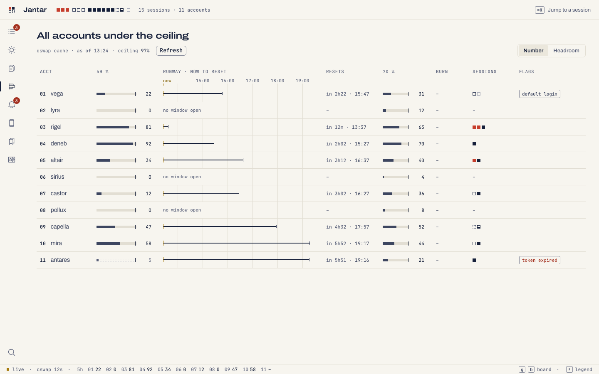

# One account or many

Jantar works with one Claude login and nothing else. With
[cswap](https://github.com/realiti4/claude-swap) and its profiles it also
shows every account's usage. It decides which at start: with cswap and its
profiles it runs on all of them, without them it runs on your one login
and leaves usage, holds and moves out. `JANTAR_ACCOUNTS=single` in the
daemon's environment forces the one-login view on a Mac that has cswap.

<p align="center">
  <picture><source media="(prefers-color-scheme: dark)" srcset="img/accounts-phone-dark.png"></picture>
  <picture><source media="(prefers-color-scheme: dark)" srcset="img/accounts-single-phone-dark.png"></picture>
</p>

## What the Accounts screen shows

With cswap:

- one line on top, such as "All accounts under the ceiling";
- where the numbers come from: the age of cswap's usage cache and the
  ceiling;
- for each account: the 5-hour bar against the ceiling, a runway to the
  reset, the reset time, weekly %, its sessions and its flags (default
  login, an expired token). Tap a row for the same in words;
- the [primer's](primer.md) line, when the primer is on.

When the legacy ccw tool also runs, its numbers join in: `next →` (the
account it would move to next), each account's burn rate, red dashes on a
runway that fills up before its reset ("1 account runs out before its
reset"), its hold list as `held` flags, and the moves it makes. Without
ccw those stay empty: nothing in Jantar moves sessions between accounts
yet.

With one login: that login and its sessions.

On a Mac the same screen is a matrix:

<picture><source media="(prefers-color-scheme: dark)" srcset="img/accounts-desktop-dark.png"></picture>

Usage comes from cswap's own cache. While the legacy ccw tool's bot keeps
that cache fresh, Jantar only reads it; it becomes the single
`cswap list --json` poller only when that bot is not running.

## Accounts kept for other work

Some accounts belong to other work and should never be picked on their own.
Keep them at the Mac:

```sh
jantar accounts                 # the mode, the kept accounts and ccw's hold list
jantar accounts keep 3 5        # replaces the list
jantar accounts keep --none
```

A kept account is never picked by Auto (on the start sheet), Rewrite, Ask
Claude, meeting summaries or the primer. You can still start a session on
one by hand, after a confirmation (`--confirm-held` for `jantar new`). The
list is the setting `accounts.kept`; the phone cannot change it. When the
legacy ccw tool is installed, its hold list is read live on top.

## Priming idle 5-hour windows

An account's 5-hour window starts with its first message. The primer,
off by default and only with cswap, sends one tiny Haiku run to an account
with no window running, so its clock starts now and it resets sooner once
you need it. It never touches a kept or held account unless you ask, and
leaves priming to ccw when ccw does it.

```sh
jantar accounts prime           # the switch, who primes, and the last prime
jantar accounts prime on        # --kept primes kept and held accounts too
jantar accounts prime off
```

The rules and the exact run are in [the primer](primer.md).

## Hooks on every account

With cswap, every profile's `settings.json` is usually a link to
`~/.claude/settings.json`, so one `jantar hooks install` covers every
account. A profile with a file of its own gets no hooks until it is linked
or installed with `--settings` ([Hook cards](phone-control.md#hook-cards)).

## What Jantar does not do yet

Jantar does not switch a session to another account by itself, and sends
no Telegram messages or Mac banners. It shows the ceiling and `next →` that
the legacy ccw tool reads, and honours a ccw move in progress when it types
into a session. See [Jantar beside the legacy ccw tool](upgrading.md#jantar-beside-the-legacy-ccw-tool)
and the [roadmap](roadmap.md).
