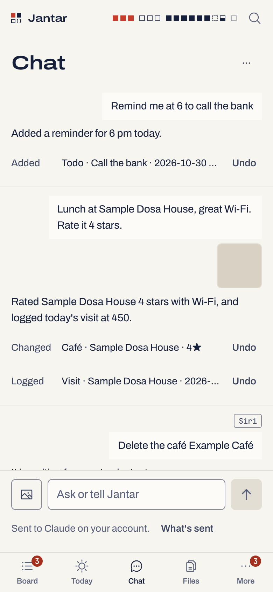

# Chat

Chat is a page on the phone, right after Today (it was Ask until 0.10).
Write to it the way you would text a friend who keeps your lists, or
send it a photo, and it does what you ask across Jantar: it adds a todo
or a reminder, logs a meal or an expense, rates a café and logs your
visit, answers "how many calories today?" or "which session is waiting
for me?". **Adds and changes happen at once and each one shows in the
chat with Undo. Chat never deletes anything without your tap, and never
types into a Claude Code session.** You can also ask it by voice:
["Hey Siri, Jantar"](shortcut.md#ask-jantar-with-siri).

Each message is one headless Claude Code run on your Mac, on your
account, the way [Rewrite](phone-app.md#rewrite) works. The run has no
file, shell or web tool at all: it can only call Jantar's own tools, one
by one, and Jantar checks every call.

<p align="center">
  <picture><source media="(prefers-color-scheme: dark)" srcset="img/chat-phone-dark.png"></picture>
</p>

## Turn it on

At the Mac:

```sh
jantar chat on                  # says what goes to Claude
jantar chat status              # the switch, the models, the history on disk, the Siri door
jantar chat keep 30             # how many days the history is kept (1 to 365, default 30)
jantar chat voice-model sonnet  # the model a Siri question runs on (opus, sonnet or haiku)
jantar chat clear               # deletes the history (asks first; --yes in scripts)
jantar chat off                 # hides it and closes the Siri door; the history stays until clear
```

Chat is off until you turn it on, and only the Mac can turn it on. It
reaches only the parts that are on (`jantar life on <part>`, `jantar
intel on`, `jantar meetings on`); with none of them on it can still read
your sessions. `jantar ask` still works and runs `jantar chat`.

A device needs the `control` scope to see Chat at all, reading included.

## What you can say

Every example here is made up:

- "Add oat milk to my list", "remind me tomorrow at 9 to call the bank",
  "mark the plumber done", "snooze the dentist to tonight".
- "How many calories today?", "I had 2 rotis and dal", "set my weight to
  71.5".
- "Rate Example Café 4 stars, great Wi-Fi, a bit pricey", "I had filter
  coffee and a dosa at Sample Dosa House, 450", "which cafés have sockets
  and are quiet?"
- "Spent 250 on lunch", "mark the broadband bill paid", "how much did I
  spend on food this month?"
- "Plan a reel for Friday 7 pm about the launch", "what's due this week
  in posts?"
- "What did I save about sourdough?", "save this: https://example.com/a-page".
- "What came out of yesterday's meeting? Add its first action item".
- "Which session is waiting for me?", "how much of my usage is left, and
  when does it reset?"

Photos: tap the photo button (up to four a message). A receipt can
become an expense, a menu a café's dishes, a whiteboard a todo list.

## Chat beside any screen

On an iPad or a Mac (0.11), the **Chat** button (in the Mac's top bar, at
the end of a screen's header on an iPad) or ⌘J opens this same thread
beside what you are looking at: a 360 px column where the screen keeps at
least 560 px beside it, otherwise over its right edge (Esc, × or ⌘J
closes it). It is closed until you open it and remembers that on this
device; its box shares the Chat page's draft, and **Open in Chat** takes
it full size. A phone's ⌘J opens the Chat tab.

Beside a café, a post, an Intel item, a meeting or a session (or a todo
or medicine a notification opened), a **Looking at** chip above the box
names it, so "rate this 4 for vibe" or "add its first action item" knows
what you mean. It goes with your message only while it shows; × takes it
off. The phone sends only the item's kind and its id (`context: { kind,
id }`, never a link or its words). Your Mac finds the item itself, drops
an id it doesn't know, and adds one line of its own outside your message
("The user is looking at Café · Sample Dosa House · 4★ (place id …)"). An
Intel item, a meeting or a session is named by its kind and id only, since
its title is someone else's text; Chat reads it with its tools, and that
read marks the turn as 0.10 does, so its writes wait as Do it cards. The
turn shows what it was about. A Mac on Jantar before 0.11 refuses the
field, so the phone puts the chip's words at the start of your message
instead.

## Changes, Undo and cards

Under Chat's answer is the list of what it did, from the Mac's own record
(never from Claude's words): "Added", "Changed", "Logged", each with
**Undo** for a day. Undo deletes what was added as it is now (not a café
that has visits by then, or a medicine with a dose logged: delete those in
their own screen), and puts back what was there before (an edit, a
todo marked done, a weight, a budget, a target, a dose) only while
nothing changed it since ("That changed after Chat's edit; change it back
by hand."). A call that would change nothing is refused, so the list
never shows a change that did not happen.

Some things wait for your tap, as a card:

- **Confirm**: every delete ("Delete café Example Café and its 3
  visits?"), stopping a medicine, and anything that spends Claude quota
  (summarizing a meeting, reading a link again). Chat has no tool that
  deletes: it can only ask.
- **Do it**: after Chat has read text someone else wrote (a saved page, a
  meeting's name or lines, a todo made from a meeting's action item, a
  session's name, what it waits for or its transcript), its writes in
  that message wait for your tap, so a page can't make Chat change your
  lists. The same goes once a change or a card Chat made names a meeting
  or a saved page's title. The card names the item and what would change
  ("Change Medicine · Placebin · 08:00: times 23:00?").

Cards work for a day, then expire. Dismiss closes one.

One gap is left open on purpose: the last messages of the chat go with
each new one, and Chat's earlier answer may repeat words it read (a
page's title, a meeting's name). The new message is not treated as having
read them, or nearly every change would wait for a tap for a dozen
messages after Chat read anything. Its changes still have Undo, it still
can't delete, and it still saves only a link you wrote.

## Sessions are read only

Chat can list your Claude Code sessions, what each is waiting for, its
last messages, and your accounts' usage. It has nothing that can type,
answer a prompt, approve, start or stop a session: the part of Jantar
that runs Chat is built without the terminal, the writer, the launcher or
the controls, and a test reads the source to keep it that way.

## What goes to Claude

What you type and the photos you send go to Claude through Claude Code on
your account (Rewrite's model for the phone, `ask.voiceModel` for Siri),
with the date, time and zone, the last messages of this chat, and
whatever Chat looks up to answer: your todos, medicines, food, cafés,
money, posts, Intel shelf, meetings, and your sessions, waiting prompts
and usage (read only), for the parts that are on. Never a file from your
Mac, an email address, a path or a key.

## History, Clear and limits

The chat is one thread per Mac, the same on every paired phone and for
Siri. It is kept on the Mac in `chat.db` (`ask.keepDays` days, 30 by
default; at most 5,000 messages), never in Life's backups. Clear deletes
it all, photos and Undo included; what Chat added stays where it went.
`chat.db` is never reset: if it won't open, Chat says so and `jantar chat
clear --broken` moves it aside.

Limits: 10 messages a minute and 100 a day per device (and per Siri key);
three waiting at once; per message at most 24 tool calls, 10 changes, 10
cards and 5 timed reminders or posts; each answer at most two minutes.
Chat's changes also count against Life's 240 changes a minute, with the
ones you make on that phone's own screens; a change Life refuses (the
item is gone, nothing to change) still counts there, as it does from a
screen. A message that is only a link is saved without Claude and counts
as one of your messages, not as a Chat change against Life's limit.

## When it says

| It says | Why |
|---|---|
| Chat is off. Turn it on at your Mac: jantar chat on | the switch |
| Chat can't run while Jantar is read-only. | `jantard --read-only` |
| No account has room right now. | every account is kept, held or past Rewrite's ceiling |
| Chat stopped: it could not run in its safe mode on this Mac. | the run's tools were not exactly Jantar's; run `jantar doctor` |
| Only a link in your own message can be saved. | Chat never saves a link Claude wrote |
| Limit reached for this message. | one of the per-message caps, or Life's 240 changes a minute |

## Why it is safe

- One headless run per message, with no built-in tool, one MCP server
  (Jantar's own, through a per-run socket and token) and every tool
  allowed by exact name. Jantar holds every tool call until Claude Code's
  first line shows exactly that, and stops the run otherwise.
- Writes go through the same checks as the phone's own screens; deletes
  and costly actions only on your tap; after untrusted text, writes wait
  for your tap too.
- A link is saved only when it is in your own message, so Claude can't
  make your Mac fetch an address of its choosing.
- Nothing Chat reads or writes goes into a log, an event or an audit row:
  those carry ids and counts.

[SECURITY.md](../SECURITY.md#v010-chat-and-the-siri-door) has the full
model, and what it does not protect against.

## How it is tested

The tests run a fake `claude` that speaks MCP to the real bridge and
dispatcher: a turn that reads across modules, one that writes with Undo,
a delete that becomes a card, a run whose tools include a shell (stopped
before any call), tools called that were never given (refused), a flood
of writes (capped), a photo, a slow answer by voice, and a marker planted
in your data that must never reach a log, an event or an audit row.

## Their thread (Accountability partner, v0.11)

With [Accountability partner](people.md) on, the person you share with has
their own thread in the same chat.db, apart
by construction: every turn, change, card and photo row carries its thread
(`''` yours, `p:<id>` theirs), every query names it, and an id from the
other thread is 404. Clear clears only the caller's thread.

- **Their tools** are a fixed list (`PERSON_CHAT_TOOLS` in
  `packages/daemon/src/chat/person-tools.ts`): their Today, to-dos, plan and
  sleep week; their to-do, project, weight, step, check-between, check-in,
  status and sleep writes; a delete card and an alert card. Never a session,
  account, Intel, meeting, money, post, assigning or journal tool. Their run
  gets deps that hold their space alone: every other module is denied, so
  a tool listed by mistake fails closed.
- **Prompt and reach.** Their run uses `assets/chat/person-v1.md`; its
  `<reach>` block is a fixed list (never your switches, currency or
  categories), with your name and whether you can read the thread. History
  comes from their thread only. The run keeps every isolation flag yours
  has.
- **Taint by authorship.** Text you wrote or last edited reaches their run
  as `<data source="owner">` and taints the turn: its later writes become
  Do-it cards.
- **Cost.** Their runs use your accounts through the same picker and queue,
  at most 2 unfinished at once, and a daily cap (30 by default, set on their
  Chat tab). One `chat.run` audit row per run, by `chat`, under their
  person, with no target and no params.
- **Keep.** Their own choice of 1, 7 or 30 days; `ask.keepDays` is yours
  alone.
- **No Siri door** for them; chat keys stay yours.

