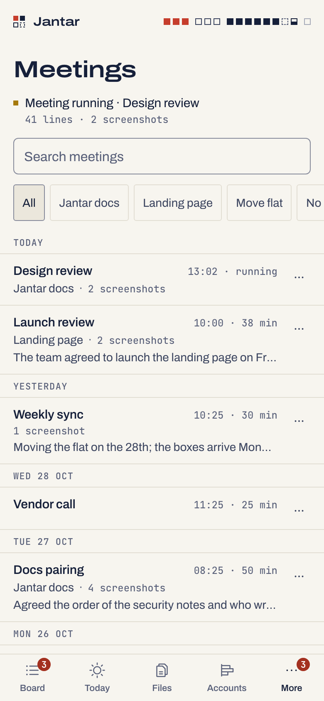
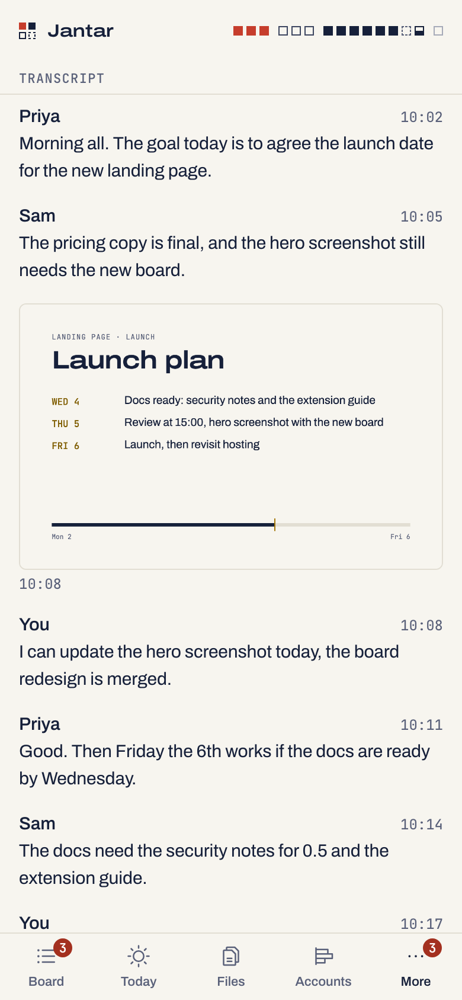

# Meetings: the Jantar Chrome extension

The Jantar extension keeps two things from a Google Meet or Microsoft Teams
call in Chrome: the call's **live captions** (Google's and Microsoft's own
transcription, with the speakers' names) and the **screenshots you click**.
Both go to Jantar on your Mac. After the meeting, one headless Claude run
writes a short summary, the decisions and the action items, and the phone
shows it all under More > Meetings.

There is no audio, no recording and no video. Nothing is read from a call
until you press **Start notes**, and nothing is photographed until you click.

<p align="center">
  <picture><source media="(prefers-color-scheme: dark)" srcset="img/meetings-phone-dark.png"></picture>
  <picture><source media="(prefers-color-scheme: dark)" srcset="img/meeting-phone-dark.png"></picture>
  <picture><source media="(prefers-color-scheme: dark)" srcset="img/meeting-transcript-phone-dark.png"></picture>
</p>

## In short

- **The transcript** is the meeting's own live captions: the words Google
  or Microsoft already show you on screen, with the speaker's name and the
  time, each line kept once in its final form as the site revises it.
  Nothing is read before you press **Start notes**, and captions must be on
  (the page tells you how when they are not).
- **Screenshots**: a small round camera button at the edge of the call, the
  toolbar icon's Screenshot, or Option+Shift+S. The button hides itself,
  the tab is taken, "Saved" flashes. A screenshot before Start still saves,
  into a meeting made for that call.
- **Assign before you start**: the Jantar icon opens a small sheet with the
  name (from the page), a project, the people, and whether action items go
  to that project's todos on their own.
- **After the call** (End, closing the tab, or a minute after you leave),
  one headless Claude run writes a short summary, the decisions and the
  action items. On the phone, under More > Meetings: newest first, project
  chips and search, a "Meeting running" line, and each meeting with its
  summary, its action items one tap from your todos (with Undo), the whole
  transcript with the screenshots at their moment, Export text, Edit and
  Delete with Undo.

Transcripts and screenshots stay in Jantar on this Mac (`meetings.db` and
`meetings/` in the state folder). The summary sends the transcript text,
never a screenshot, to Claude through Claude Code on your account. The
extension talks only to the daemon on this Mac, with a key it gets by
pairing, and only this extension's ID can pair.

```sh
pnpm -r build                 # builds packages/extension/dist too
# Chrome: chrome://extensions > Developer mode > Load unpacked > packages/extension/dist; pin Jantar
jantar meetings on            # says what stays on the Mac and what the summary sends
jantar pair --extension       # paste the line into the Jantar popup; it waits for "Paired."
jantar meetings               # on, open, the extension paired
jantar meetings export last   # a folder with meeting.md and the screenshots
```

Status: on the first real calls, captions and a summary worked, but no
screenshot from the extension reached Jantar, and the cause is not known
yet. See [the Meetings checks](real-mac-checks.md#meetings-v05).

## What it keeps, and what it never does

For each meeting Jantar keeps: its name, the site (Meet or Teams), the
project and people you gave it, when it started and ended, every caption
line with its speaker and time, your screenshots (JPEG) at the moment you
took them, and the summary with its decisions and action items. All of it
lives in your Jantar state folder (`~/.jantar`, or `JANTAR_HOME`):
`meetings.db` for the text and `meetings/<meeting>/` for the images.

The extension never:

- records audio or video, or reads the call's media;
- switches captions on for you (it tells you how; see Captions below);
- reads the page before you press Start notes, except whether you are in a
  call and the page title (to fill in the meeting's name); at Start it reads
  the captions already on screen, then each new one;
- takes a screenshot without your click, your shortcut or the popup's
  **Screenshot**, and never of a tab other than the meeting's;
- talks to anything but Jantar on this Mac (`http://127.0.0.1:<port>`);
- loads code or images from anywhere, or runs on pages other than Google
  Meet (`meet.google.com`) and Teams on the web (`teams.microsoft.com`,
  `teams.live.com`, `teams.cloud.microsoft`).

## What leaves the Mac

One thing, because the summary needs it: after a meeting ends, **its
transcript text** (the name, day, project, people and the caption lines)
goes to Anthropic through Claude Code on your own account, the same way
any Claude Code use does. **Screenshots never leave the Mac.**

The summary runs once per meeting, on Sonnet at medium effort with Haiku as
the fallback, one meeting at a time, through the same shared runner as
Rewrite. It never uses an account you keep for other work or one that is
held, and it never runs while Jantar is read-only. A meeting with too little
said (under 200 characters of captions) gets no summary; the phone offers
**Summarize** for it.

The extension itself sends nothing anywhere but this Mac. Jantar logs, audit
rows and live events never carry a meeting's text, names or images.

## Set it up (once, at the Mac)

You need Chrome 120 or later, on the Mac that runs Jantar. Other browsers
and the Teams desktop app are not covered.

1. **Build** the repo (this also builds the extension into
   `packages/extension/dist`):

   ```sh
   pnpm -r build                              # or only the extension:
   pnpm --filter @jantar/extension build
   ```

2. **Load it.** In Chrome open `chrome://extensions`, turn on **Developer
   mode** (top right), click **Load unpacked** and pick
   `packages/extension/dist`, then reload any Meet or Teams tab already
   open: Chrome adds the extension's page script only to pages loaded after
   it (until then the popup there says to open a call). A Chrome managed by
   an organisation that blocks developer mode cannot load it.
3. **Pin it.** Click the puzzle piece in Chrome's toolbar and pin **Jantar**,
   so its icon is one click away during a call.
4. **Turn Meetings on:**

   ```sh
   jantar meetings on
   ```

   It says what stays on the Mac and what the summary sends.
5. **Pair it:**

   ```sh
   jantar pair --extension
   ```

   It prints one line, `jantar-ext:<port>:<code>`, and waits. Click the
   Jantar icon in Chrome, paste the line into **Pairing code** and press
   **Pair**. The terminal says `Paired.` The code works once, within 10
   minutes; if it runs out, the command says so and you run it again.
6. **Let the screenshot button work** (the popup asks once, right after
   pairing): **Allow**, then accept Chrome's prompt. See the next section
   for what that permission is. **Not now** is fine too; the popup's
   **Settings** offers it again.

`jantar meetings` shows the switch, how many meetings are kept, the
screenshots' size, whether summaries can run, and whether the extension is
paired and when it was last used.

### Only this extension can pair

The pairing line goes through your clipboard, and other extensions can read
a clipboard. So Jantar accepts the code only from this extension's own
Chrome ID, **`ggpbdkmaknhkccjoalpmfnjbbljigagi`**, calling from this Mac. The
ID comes from the public `key` in `packages/extension/manifest.json`; no
extension from the Chrome Web Store can carry it. A fork that makes its own
key gets another ID and changes `EXTENSION_ID` in
`packages/protocol/src/constants.ts` and
`packages/extension/src/shared/wire.ts` with it (a test ties the three).

The extension keeps its key in its own storage, out of reach of the meeting
pages, and sends it only to Jantar on this Mac. The key reaches only the
extension's own routes (projects to pick from, a meeting's start and end,
caption lines, screenshots), and only from this Mac: Jantar refuses it from
any other address, through a tunnel or from another Origin.

### The screenshot button's permission

Chrome lets an extension photograph a tab without a click on its toolbar
icon only when it holds "all sites". So the one-time **Allow** asks for
that, and Chrome words its prompt for the widest case: "Read and change all
your data on all websites". What the extension does with it is narrower: its
page script still runs only on Meet and Teams pages, and it photographs only
the meeting tab, only when you click.

Without it, the page's camera button works in a tab once you have used the
Jantar icon or the shortcut there (starting notes from the popup counts).
Before that it says "Click the Jantar icon once to allow screenshots here."
To take the permission back, open `chrome://extensions` > Jantar >
**Details** > **Site access**, choose **On specific sites** and keep
`meet.google.com`, `teams.microsoft.com`, `teams.live.com`,
`teams.cloud.microsoft` and `127.0.0.1` in the list. Avoid **On click**:
Chrome may then hold back those sites too, and the extension could neither
reach Jantar nor read a call's captions by itself.

## During a call

1. Join the call in Chrome. Once you are in the call (not the waiting room)
   a small round camera button sits at the left edge of the page.
2. Click the Jantar icon. Fill in the sheet: **Name** (from the page),
   **Project** (your Jantar projects; hidden while Todos are off), **People**
   (optional), and **Action items go to this project's todos** (off unless
   you turn it on). Then **Start notes**. A small dot on the camera button
   means notes are on in that tab.
3. Take a screenshot whenever the screen matters: the camera button, the
   shortcut **Option+Shift+S**, or **Screenshot** in the popup. The button
   hides itself for the shot and flashes "Saved". A screenshot before Start
   notes is kept too, in a meeting made for that call that you can name
   later. **Screenshot** in the popup closes the popup, so whatever was
   typed in the sheet is not kept: fill the sheet after the screenshot, or
   edit the meeting on the phone.
4. End with **End** in the popup, by closing the tab, or by leaving the call.

The screenshot is of the visible meeting tab, so that tab must be the one in
front in its window ("Not saved: open the meeting tab first."). Meet's
picture-in-picture window is not the tab and is not photographed.

### The shortcut

Option+Shift+S is the suggested key. Change it, or set it if another
extension already holds that key (Chrome then leaves it empty), at
`chrome://extensions/shortcuts`.

### Leaving, and the one-minute grace

When the call's controls disappear, Jantar waits a minute before it counts
the call as left: a toolbar redraw, Teams shrinking the call while you open
Chat, a layout or screen-share change, or a quick rejoin keeps the same
meeting. Closing the tab, **End**, or a different Meet call in the same tab
ends it at once. If Chrome quits or crashes, or the tab goes to another
site, Jantar ends the meeting by itself ten minutes after it last heard from
the tab.

Each tab and call is one meeting: the same call open in two tabs makes two
meetings.

## Captions

### What the transcript is

The transcript is the site's own live captions: machine transcription by
Google or Microsoft, the words you would see on screen yourself, so a word
can be wrong and a name can be missing. The sites rewrite a caption while
someone is still speaking (a word corrected, the start of a long turn
trimmed away); Jantar follows those changes and keeps each line once, in its
final form, with the speaker and the time it was first shown. A long turn
is split into lines at a sentence end. Nothing is added: no audio is heard,
so what the captions missed, the transcript misses.

Captions must be on in that tab. Turning them on is for you only; nobody
else in the call sees a change. When notes are on and no captions show, the
camera button's bubble tells you how:

- **Google Meet:** the **CC** button (Captions) at the bottom of the call, or
  press **c**.
- **Microsoft Teams:** More (…) > **Language and speech** > **Live
  captions**, or **Cmd+Shift+A**. Newer Teams layouts also have a
  **Captions** button.

Things to know:

- **"Can't read captions on this page. Screenshots still work."** means
  captions are on screen but the site changed its page in a way this
  version cannot read. Screenshots keep working; update the extension
  (below) when a newer version is out.
- **Other languages:** the transcript is in whatever language the captions
  show. Meet lets you pick the captions' language next to them. Teams
  follows the meeting's spoken language, which the organizer sets; if it
  does not match what people speak, the captions, and so the transcript,
  are wrong. Translated captions need paid plans on both sites.
- **Captions turned off by an admin:** an organisation can switch live
  captions off for its meetings. Then there is nothing to keep, and only
  screenshots are saved.
- **Guests:** joining Teams as a guest without an account may offer no
  captions; the same then applies.
- **The Teams desktop app** is not covered. Open the meeting in Chrome
  instead (Teams offers to continue in the browser).
- Speakers are named as the site names them; your own lines say "You". A
  caption with no name gets the speaker before it, else "Unknown".

## What can be lost

Caption lines wait in the tab until Jantar has them, and are sent about
every second and a half. Jantar keeps no copy anywhere else, so:

- lines said in the last second or two before you close the tab may not
  arrive;
- while Jantar is not running (a restart takes seconds), lines wait in the
  tab and arrive when it is back, but if the tab is closed before then,
  they are lost. The bubble says "Jantar is not answering. Notes wait in
  this tab until it is back.";
- a screenshot while Jantar is not running is not saved, and says so ("Not
  saved: Jantar is not running on this Mac.").

## After the meeting, on the phone

More > **Meetings** lists them newest first, with project chips and search,
and a "Meeting running" line while one is live. A meeting shows its summary,
decisions, action items, then the whole transcript with the screenshots at
their moment (tap one for full screen). **Export text** shares it as
Markdown, **Edit** changes the name, project and people, and **Delete**
removes the meeting and its screenshots, with five seconds to Undo.

Meetings need a phone with control: a read-only device never sees them.

### Action items into todos

Each action item has **Add to &lt;project&gt; todos**. When the sheet's toggle was
on, the meeting has a project that still exists, and Todos are on, the items
are added by themselves once the summary is written. They come from what
**anyone** in the call said (someone can say "action item: ..."), so every
added item is listed with **Remove**, and Undo. Once added they are ordinary
todos: deleting the meeting leaves them in Todos.

## Limits

- Screenshots: 4 MB each (Chrome's shot is retried smaller once), 500 per
  meeting, and **5 GB for all meetings together**; past that a new one is
  refused with "Screenshots fill 5 GB in Jantar. Delete some meetings to take
  more." One extension may also send at most 1 GB of screenshots a day.
- 5,000 meetings, and 20,000 caption lines per meeting.
- At most five paired extensions; pairing a sixth unpairs the oldest. A key
  unused for 90 days stops working.

Meetings are kept until you delete them. There is no nightly backup of
`meetings.db` (a deleted meeting would live on in the copies): your copies
are Time Machine and an export.

## At the Mac

```sh
jantar meetings                          # on or off, counts, screenshots of 5 GB, summaries, the extension
jantar meetings on | off                 # off keeps every meeting; the extension saves nothing meanwhile
jantar meetings export <id> [--out DIR]  # one meeting: DIR/<yyyy-mm-dd>-<name>-<id end>/meeting.md and shots/
jantar meetings export last [--out DIR]  # the newest
jantar meetings export --all [--out DIR] # every meeting, a folder each; skips folders already there
jantar meetings unpair                   # revoke every paired extension
jantar pair --extension                  # pair (again)
```

An export writes a new folder (only you can open it) with `meeting.md` and
the screenshots as `shots/<HHMMSS>-<n>.jpg`. Days and times are in Life's
time zone when you set one (`jantar life set timezone`), else the Mac's: the
zone the summary was written in. The phone's **Export text** shows the
command with the meeting's id filled in.

- It never writes into a folder that is already there. One meeting's export
  refuses it; `--all` leaves it as it is and goes on, so an `--all` that
  stopped part way (Jantar restarted, say) can run again into the same
  folder and do the rest.
- A screenshot Jantar cannot give (its file is gone or will not read) is
  left out: `meeting.md` shows its time only, the command says which, and it
  exits 1. To try it again, delete that meeting's folder and export again.
- Export needs Meetings on (while off, Jantar shows no meeting), so export
  before `jantar meetings off`.

## Updating the extension

After pulling a new version of Jantar: build again (`pnpm -r build`), then
in `chrome://extensions` press the reload arrow on the Jantar card, then
reload any open meeting tabs. A tab left as it was says "Jantar was updated.
Reload this page to keep notes." If the extension and Jantar were built from
different versions, the popup says "Jantar and this extension don't match.
Build the extension again and press reload in chrome://extensions."

Reloading keeps the pairing. Removing the extension forgets it.

## Unpairing

- `jantar meetings unpair` revokes every paired extension at the Mac: its
  key stops working at once, and the popup asks to pair again.
- **Unpair** in the popup's Settings first ends every meeting it keeps notes
  for (as **End** does, so their summaries follow), then makes Chrome forget
  the key; Jantar stops accepting it after 90 days unused, or at once with
  the command above.

## Deleting everything

One meeting: **Delete** on the phone removes its text and its screenshots.
Its text is overwritten inside `meetings.db` as well, not only marked free
(and a summary still being written for it stops). Todos already added from
its action items stay in Life, with their titles taken from the call;
remove them in Todos.

Everything, at the Mac. To keep a copy, export first, while Meetings is
still on: `jantar meetings export --all --out <dir>`. Then:

```sh
jantar meetings off
jantar meetings unpair
J="${JANTAR_HOME:-$HOME/.jantar}"   # the Jantar state folder
rm -f "$J/meetings.db" "$J/meetings.db-wal" "$J/meetings.db-shm"
rm -rf "$J/meetings" "$J/meeting-summary"
```

Every path names the state folder, so these lines delete nothing anywhere
else. If Jantar runs with a `JANTAR_HOME` this terminal does not have, set
`J` to that folder first. This leaves the todos added from action items
(remove them in Todos) and any `meetings-aside-...` folders you set aside
(below). Then remove the extension in `chrome://extensions`. Time Machine
may still hold older copies of these files.

## If meetings.db will not open

Jantar never resets or repairs `meetings.db`. If it cannot open the file,
the phone, `jantar meetings` and `jantar meetings on` say "Meetings data
could not be opened. The file is untouched. Move meetings.db aside at your
Mac to start again (docs/extension.md)." To start again with an empty one,
move the database **and the screenshots folder** aside together (a new
`meetings.db` does not know the old folders, and Jantar clears screenshot
folders that no meeting owns):

```sh
jantar meetings off
J="${JANTAR_HOME:-$HOME/.jantar}"   # the Jantar state folder
A="$J/meetings-aside-$(date +%Y%m%d-%H%M%S)"
mkdir "$A" && for f in meetings.db meetings.db-wal meetings.db-shm meetings; do [ -e "$J/$f" ] && mv "$J/$f" "$A/"; done
ls "$J"
```

Each run makes its own `meetings-aside-<date>-<time>` folder and moves only
what is there; if that folder cannot be made, nothing moves. Check that the
listing shows neither `meetings.db` nor `meetings`, and only then:

```sh
jantar meetings on
```

Keep the `meetings-aside-...` folders until you know you do not need them.

## Telling people you keep notes

Captions show only on your screen, and the sites tell no one that you keep
them. The assign sheet says "Let people know you keep notes." Say so at the
start of the call, and check what your workplace and the law where the
people are expect before you keep anyone's words.

Jantar is not affiliated with Google or Microsoft. Google Meet and
Microsoft Teams are named only to say what the extension works with.
