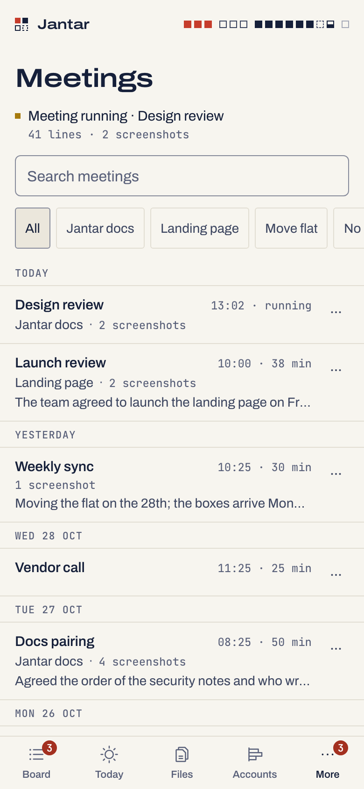
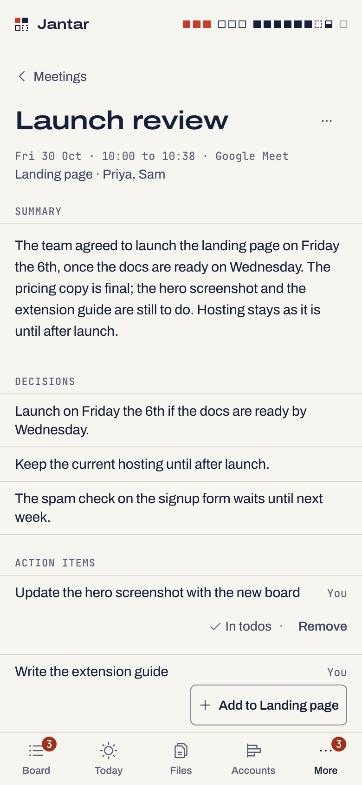
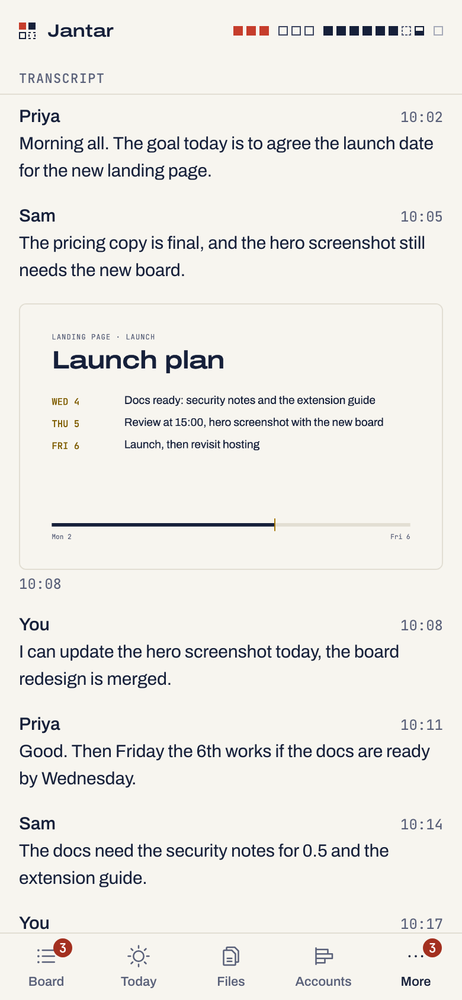

# Meetings: the Jantar Chrome extension

The Jantar extension keeps two things from a Google Meet or Microsoft Teams
call in Chrome: the call's **live captions** (Google's and Microsoft's own
transcription, with the speakers' names) and the **screenshots you click**.
Both go to Jantar on your Mac. After the meeting, one headless Claude run
writes a short summary, the decisions and the action items, and the phone
shows it all under More > Meetings.

There is no audio, no recording and no video. Nothing is read from a call
until you press **Start notes**, or, if you chose **Start when I join**, until
you are in the call; and nothing is photographed until you click.

<p align="center">
  <picture><source media="(prefers-color-scheme: dark)" srcset="img/meetings-phone-dark.png"></picture>
  <picture><source media="(prefers-color-scheme: dark)" srcset="img/meeting-phone-dark.png"></picture>
  <picture><source media="(prefers-color-scheme: dark)" srcset="img/meeting-transcript-phone-dark.png"></picture>
</p>

## In short

- **The transcript** is the meeting's own live captions: the words Google
  or Microsoft already show you on screen, with the speaker's name and the
  time, each line kept once in its final form as the site revises it.
  Nothing is read before you press **Start notes**, or, if you chose
  **Start when I join**, before you are in the call. Captions must be on:
  since 0.10 Jantar turns them on for you when notes start, and when none
  come in the page says how ([Captions](#captions)).
- **Screenshots**: a small round camera button at the edge of the call, the
  toolbar icon's Screenshot, or Option+Shift+S. The button hides itself,
  the tab is taken, "Saved" flashes. A screenshot before Start still saves,
  into a meeting made for that call.
- **Assign before you start**: the Jantar icon opens a small sheet with the
  name (from the page), a project, the people, and whether action items go
  to that project's todos on their own.
- **Start when I join** (since 0.10): open the Jantar icon on the call's
  join screen or in its waiting room, fill the same sheet and press **Start
  when I join**. Notes start by themselves once you are let in, never
  before, and only in that tab ([Start when I join](#start-when-i-join)).
- **After the call** (End, closing the tab, or a minute after you leave),
  one headless Claude run writes a short summary, the decisions and the
  action items. On the phone, under More > Meetings: newest first, project
  chips and search, a "Meeting running" line, and each meeting with its
  summary, its action items one tap from your todos (with Undo), the whole
  transcript with the screenshots at their moment, Export text, Edit and
  Delete with Undo.

Transcripts and screenshots stay in Jantar on this Mac (`meetings.db` and
`meetings/` in the state folder). The summary sends the transcript text,
never a screenshot, to Claude through Claude Code on your account. The
extension talks only to the daemon on this Mac, with a key it gets by
pairing, and only this extension's ID can pair.

```sh
pnpm -r build                 # builds packages/extension/dist too
# Chrome: chrome://extensions > Developer mode > Load unpacked > packages/extension/dist; pin Jantar
jantar meetings on            # says what stays on the Mac and what the summary sends
jantar pair --extension       # paste the line into the Jantar popup; it waits for "Paired."
jantar meetings               # on, open, the extension paired
jantar meetings export last   # a folder with meeting.md and the screenshots
```

Since 0.8 the extension can also **read posts you save to Intel** in your
own Chrome, as you, when you turn on **Read saved links** in its popup:
[Read saved links](#read-saved-links). Off by default.

Status: on the first real calls, captions and a summary worked, but no
screenshot from the extension reached Jantar, and the cause is not known
yet. Since 0.5.3 the popup's **Settings › Last screenshot** says how each
try ended ([When a screenshot is not saved](#when-a-screenshot-is-not-saved)).
See [the Meetings checks](real-mac-checks.md#meetings-v05).

## What it keeps, and what it never does

For each meeting Jantar keeps: its name, the site (Meet or Teams), the
project and people you gave it, when it started and ended, every caption
line with its speaker and time, your screenshots (JPEG) at the moment you
took them, and the summary with its decisions and action items. All of it
lives in your Jantar state folder (`~/.jantar`, or `JANTAR_HOME`):
`meetings.db` for the text and `meetings/<meeting>/` for the images.

The extension never:

- records audio or video, or reads the call's media;
- clicks anything in the call, except, when notes start, the call's own
  captions control to turn captions on (since 0.10, a Settings switch, on by
  default; see [Captions](#captions)); it never turns captions off;
- reads the page before notes start, except whether you are on the call's
  join screen, in its waiting room or in the call (fixed controls only,
  never what anyone says), and the page title (to fill in the meeting's
  name); when notes start it reads the captions already on screen, then
  each new one;
- takes a screenshot without your click, your shortcut or the popup's
  **Screenshot**, and never of a tab other than the meeting's;
- talks to anything but Jantar on this Mac (`http://127.0.0.1:<port>`);
- loads code or images from anywhere, or runs on pages other than Google
  Meet (`meet.google.com`) and Teams on the web (`teams.microsoft.com`,
  `teams.live.com`, `teams.cloud.microsoft`); with **Read saved links** on,
  it also opens one post at a time in a tab of its own
  ([below](#read-saved-links)) and reads that post once it has loaded.

## What leaves the Mac

One thing, because the summary needs it: after a meeting ends, **its
transcript text** (the name, day, project, people and the caption lines)
goes to Anthropic through Claude Code on your own account, the same way
any Claude Code use does. **Screenshots never leave the Mac.**

The summary runs once per meeting, on Sonnet at medium effort with Haiku as
the fallback, one meeting at a time, through the same shared runner as
Rewrite. It never uses an account you keep for other work or one that is
held, and it never runs while Jantar is read-only. A meeting with too little
said (under 200 characters of captions) gets no summary; the phone offers
**Summarize** for it.

The extension itself sends nothing anywhere but this Mac. Jantar logs, audit
rows and live events never carry a meeting's text, names or images.

## Set it up (once, at the Mac)

You need Chrome 120 or later, on the Mac that runs Jantar. Other browsers
and the Teams desktop app are not covered.

1. **Build** the repo (this also builds the extension into
   `packages/extension/dist`):

   ```sh
   pnpm -r build                              # or only the extension:
   pnpm --filter @jantar/extension build
   ```

2. **Load it.** In Chrome open `chrome://extensions`, turn on **Developer
   mode** (top right), click **Load unpacked** and pick
   `packages/extension/dist`, then reload any Meet or Teams tab already
   open: Chrome adds the extension's page script only to pages loaded after
   it (until then the popup there says to open a call). A Chrome managed by
   an organisation that blocks developer mode cannot load it.
3. **Pin it.** Click the puzzle piece in Chrome's toolbar and pin **Jantar**,
   so its icon is one click away during a call.
4. **Turn Meetings on:**

   ```sh
   jantar meetings on
   ```

   It says what stays on the Mac and what the summary sends.
5. **Pair it:**

   ```sh
   jantar pair --extension
   ```

   It prints one line, `jantar-ext:<port>:<code>`, and waits. Click the
   Jantar icon in Chrome, paste the line into **Pairing code** and press
   **Pair**. The terminal says `Paired.` The code works once, within 10
   minutes; if it runs out, the command says so and you run it again.
6. **Let the screenshot button work** (the popup asks once, right after
   pairing): **Allow**, then accept Chrome's prompt. See the next section
   for what that permission is. **Not now** is fine too; the popup's
   **Settings** offers it again.

`jantar meetings` shows the switch, how many meetings are kept, the
screenshots' size, whether summaries can run, and whether the extension is
paired and when it was last used.

### Only this extension can pair

The pairing line goes through your clipboard, and other extensions can read
a clipboard. So Jantar accepts the code only from this extension's own
Chrome ID, **`ggpbdkmaknhkccjoalpmfnjbbljigagi`**, calling from this Mac. The
ID comes from the public `key` in `packages/extension/manifest.json`; no
extension from the Chrome Web Store can carry it. A fork that makes its own
key gets another ID and changes `EXTENSION_ID` in
`packages/protocol/src/constants.ts` and
`packages/extension/src/shared/wire.ts` with it (a test ties the three).

The extension keeps its key in its own storage, out of reach of the meeting
pages, and sends it only to Jantar on this Mac. The key reaches only the
extension's own routes (projects to pick from, a meeting's start and end,
caption lines, screenshots), and only from this Mac: Jantar refuses it from
any other address, through a tunnel or from another Origin.

### The screenshot button's permission

Chrome lets an extension photograph a tab without a click on its toolbar
icon only when it holds "all sites". So the one-time **Allow** asks for
that, and Chrome words its prompt for the widest case: "Read and change all
your data on all websites". What the extension does with it is narrower: its
page script still runs only on Meet and Teams pages, and it photographs only
the meeting tab, only when you click.

Without it, the page's camera button works in a tab once you have used the
Jantar icon or the shortcut there (starting notes from the popup counts),
until that tab goes to another site. Before that, and after such a trip, it
says "Not saved: click the Jantar icon once in this tab, then try again."
To take the permission back, open `chrome://extensions` > Jantar >
**Details** > **Site access**, choose **On specific sites** and keep
`meet.google.com`, `teams.microsoft.com`, `teams.live.com`,
`teams.cloud.microsoft` and `127.0.0.1` in the list. Avoid **On click**:
Chrome may then hold back those sites too, and the extension could neither
reach Jantar nor read a call's captions by itself.

## During a call

1. Join the call in Chrome. Once you are in the call (not the waiting room)
   a small round camera button sits at the left edge of the page.
2. Click the Jantar icon. Fill in the sheet: **Name** (from the page),
   **Project** (your Jantar projects; hidden while Todos are off), **People**
   (optional), and **Action items go to this project's todos** (off unless
   you turn it on). Then **Start notes**. A small dot on the camera button
   means notes are on in that tab.

   Or, before you join: open the Jantar icon on the call's join screen or in
   its waiting room. The same sheet has **Start when I join**, and notes
   start by themselves once you are in the call
   ([Start when I join](#start-when-i-join)).
3. Take a screenshot whenever the screen matters: the camera button, the
   shortcut **Option+Shift+S**, or **Screenshot** in the popup. The button
   hides itself for the shot and flashes "Saved". A screenshot before Start
   notes is kept too, in a meeting made for that call that you can name
   later. **Screenshot** in the popup closes the popup, so whatever was
   typed in the sheet is not kept: fill the sheet after the screenshot, or
   edit the meeting on the phone.
4. End with **End** in the popup, by closing the tab, or by leaving the call.

The screenshot is of the visible meeting tab, so that tab must be the one in
front in its window ("Not saved: open the meeting tab first."). Meet's
picture-in-picture window is not the tab and is not photographed.

### The shortcut

Option+Shift+S is the suggested key. Change it, or set it if another
extension already holds that key (Chrome then leaves it empty), at
`chrome://extensions/shortcuts`. The popup's **Settings** shows the key
Chrome holds ("Shortcut: ⌥⇧S", or "Shortcut: not set"), and its **Change**
or **Set** opens that page. The shortcut works only while Chrome is the app
in front.

### When a screenshot is not saved

The bubble beside the camera button says why. The popup keeps the last
try, whichever control took it: open **Settings** and read **Last
screenshot**, for example "Last screenshot: 12:41 · camera button · Not
saved: click the Jantar icon once in this tab, then try again." A second
line gives Chrome's own words when Chrome refused ("Chrome said: …"), or
the status Jantar answered with ("Jantar answered 409"). When the last try
in the tab you are on failed in the last ten minutes, the popup's first
view says so too, and its **Screenshot** takes the tab from there (opening
the popup lets Chrome take that tab). The record stays in Chrome's memory
only: it is gone when Chrome quits and when the extension is reloaded or
updated, so read it before either. It holds no page address, title or
image, and is never sent to Jantar. Its time tells you which try it is:
when it is older than your click (or says "none yet"), the extension never
got that click.

- **"Not saved: click the Jantar icon once in this tab, then try again."**
  Chrome lets the extension take a tab only once the toolbar icon or the
  shortcut was used in it (until the tab goes to another site), or after
  **Allow** in Settings. Click the icon and try again, or use the popup's
  **Screenshot**.
- **"Not saved: Chrome could not take it."** Read "Chrome said" in
  Settings. "Chrome did not answer" means no picture came within 5
  seconds: a minimized or covered window can do that. A Chrome managed by
  an organisation may forbid screenshots (`chrome://policy`).
- **"Not saved: open the meeting tab first."** The meeting tab was not the
  one in front of its window when the shot was taken (another tab, or
  Meet's picture-in-picture window).
- **"Not saved: the Jantar extension did not answer."** The camera button
  heard nothing back, at once or within 65 seconds, and shows again. When
  Settings › Last screenshot has the time of that click, it says how the
  try ended (a slow one may still have saved); when its time is older, the
  extension never got the click: try the popup's **Screenshot**.
- **Last screenshot does not change after the shortcut:** Chrome never ran
  it. Check Settings › Shortcut, and that Chrome was in front.

At the Mac, every screenshot upload that reaches Jantar, saved or refused,
leaves one line in `~/.jantar/logs/daemon.err.log`: `meetings: screenshot
upload` with its status and size, nothing else.

### Leaving, and the one-minute grace

When the call's controls disappear, Jantar waits a minute before it counts
the call as left: a toolbar redraw, Teams shrinking the call while you open
Chat, a layout or screen-share change, or a quick rejoin keeps the same
meeting. Closing the tab, **End**, or a different Meet call in the same tab
ends it at once. If Chrome quits or crashes, or the tab goes to another
site, Jantar ends the meeting by itself ten minutes after it last heard from
the tab.

With **Always start when I join a call** on, **End** also keeps that call
from starting again in that tab: leave and rejoin it and notes stay off
until you press **Start notes**. Another call starts as usual.

Each tab and call is one meeting: the same call open in two tabs makes two
meetings.

## Start when I join

Since 0.10. Open the Jantar icon while a Meet or Teams call shows its join
screen (Meet's "Ready to join?", Teams' pre-join screen) or its waiting
room (Meet's "Asking to be let in", Teams' "Someone will let you in when the
meeting starts"). The popup says **Not in the call yet.** or **Waiting to be
let in.** above the same sheet as Start notes: Name, Project, People and the
todos switch. Press **Start when I join**. Leave the Name as it is and the
meeting takes the page's title once you are in the call (some calls show
their title only then).

Once you are let in, notes start by themselves exactly as if you had pressed
**Start notes**: the same meeting with the same project, people and todos,
the same dot on the camera button, and the captions already on screen are
read first. The page says "Jantar started notes. Let people know you keep
notes." Notes never start before you are in the call, and only in the tab
you armed. Until then nothing of the call reaches Jantar, and the waiting
room is never read: Jantar counts you in the call on the same controls Start
notes trusts (Meet's captions button or caption area, Teams' Leave button
or caption area), seen on two checks a second apart, so a control that
flashes up in the waiting room starts nothing. If captions are off, Jantar
turns them on as it does after Start notes ([Captions](#captions)).

The toolbar icon shows, per tab:

| Icon | Means |
|---|---|
| **ARM** | Notes start when you are in the call. |
| **ON** | Notes are on in this tab, however they started. |
| **!** | Notes did not start by themselves, or notes are on but no captions came in yet. Open the Jantar icon for why. |

An armed tab's popup says **Armed: starts when you join** (or **when you're
let in**, or **when you rejoin** after leaving), with the name (the page's
title, "(from the page)", until you type one), the project and whether action
items go to its todos, **Change** and **Cancel**. Left open, it turns into
the notes view by itself once notes start, which then says "Started when you
joined, 10:02".

Start when I join ends, and notes do not start, on:

- **Cancel** in the popup;
- closing the tab;
- the tab leaving the meeting: another Meet call in the same tab ends it at
  once, and a page that shows no join screen, waiting room or call for a
  minute (Teams' Chat, Meet's home page, another site) ends it then, also
  after you left the call;
- two hours unused, for a call that never starts;
- **Unpair**, reloading or updating the extension, or Chrome quitting.

A reload of the join screen or the waiting room keeps it, as long as the
page is back within the minute.

### Always start when I join a call

**Settings › Always start when I join a call** (off by default) arms every
Meet or Teams call you join in this Chrome: on each join screen or waiting
room the page says "Jantar starts notes when you join. Not this call: the
Jantar icon.", and notes start once you are in the call, with the page's
title as the name and no project. **Not this call** in the popup skips that
call in that tab: the popup then says "Always is on, but not for this call.
Notes will not start by themselves." above the sheet, where you can still
press Start when I join, or Start notes once in. After **End**, leaving and
rejoining the same call in that tab does not start notes again; another call
does. It starts only a call you join: a page first seen already in the call
(a reload mid-call, an instant meeting with no join screen) waits for
**Start notes**, and leaving a call for a page that shows nothing of it
(Teams' Chat) arms nothing. When another tab already keeps notes for the
same Meet call, it does not start a second one. **Unpair** turns it off.

While the extension is not paired (never, or since Jantar asked to "Pair
again"), Always arms nothing and the icon never shows ARM: each join screen
says once "Notes will not start by themselves: the extension is not paired.
Click the Jantar icon to pair.", and the pairing view says so too, with
**Turn off** to switch Always off without pairing. Pairing again arms the
join screens open then.

### When notes do not start

The page says why in a bubble, the icon shows **!**, and the popup's sheet
says "Notes did not start when you joined: …" for ten minutes:

- "Notes did not start: Meetings are off. Turn them on at your Mac: jantar
  meetings on"
- "Notes did not start: Jantar is not running on this Mac." Jantar is tried
  again for two minutes first ("Trying again for 2 minutes.").
- "Notes did not start: Pair again: jantar pair --extension" when Jantar
  no longer knows the extension's key. Every arm ends then; later join
  screens are not armed (Always above).
- "Notes did not start: they are already on for this call in another tab."
- "Notes will not start by themselves: Jantar can't see this call's join
  screen or the call." The page left its join screen or waiting room for a
  minute without Jantar seeing the call. Press **Start notes** once you are
  in the call, and send the Call check below with a report. (Not said when
  Jantar takes a call it does not know for its waiting room: see Limits.)

Before you join, the popup arms nothing while the extension is not paired,
Meetings are off at the Mac or Jantar is not running: it says so instead. A
tab armed before that keeps its ARM, and its popup says why under "Start when
I join is on for this tab, but notes can't start until this is fixed.", with
**Cancel** (or **Not this call**). With Always on, a join screen is still
armed while Meetings are off or Jantar is not running: notes then do not
start, as above, once you are let in.

### Limits

- A tab in the background may notice you were let in up to about two
  minutes late (Chrome wakes a hidden tab about once a minute, and Jantar
  waits for two checks); the captions on screen then are read.
- A call with no join screen or waiting room needs **Start notes**.
- Teams' waiting room after **Join now** counts as one only on a meeting's
  join link (Teams light meetings, the meetup-join and launcher links).
  Teams' own app keeps one address for everything, so there it is not told
  apart from Chat: arm on the pre-join screen and the arm ends a minute
  after Join now, saying "Notes will not start by themselves…"; press
  **Start notes** once you are in.
- Not checked on a real Mac yet ([R12](real-mac-checks.md#meetings-v010-start-when-i-join)):
  Teams' waiting room and Teams light meetings (joining as a guest from a
  link), so neither is claimed to work. If a Teams waiting room shows a
  Leave button, Jantar would count you in the call there, for Start notes
  too. If light meetings' call has controls Jantar does not know, Jantar
  keeps taking it for the waiting room: the icon keeps showing ARM and the
  popup "Armed: starts when you're let in" while you are in the call (up to
  two hours), and no bubble says notes did not start. If the icon still
  shows ARM once you are in, press **Start notes** and send the Call check.
- Two tabs on the same call armed by hand make two meetings, as two Start
  notes do.

### Call check

**Settings › Call check** names what the page shows as Jantar sees it, and
the control that decided it, for example "Call check: waiting to be let in ·
teams:after-join". It is Jantar's own name for the control, never page
text. Send it with a report when notes did not start by themselves.

## Captions

### What the transcript is

The transcript is the site's own live captions: machine transcription by
Google or Microsoft, the words you would see on screen yourself, so a word
can be wrong and a name can be missing. The sites rewrite a caption while
someone is still speaking (a word corrected, the start of a long turn
trimmed away); Jantar follows those changes and keeps each line once, in its
final form, with the speaker and the time it was first shown. A long turn
is split into lines at a sentence end. Nothing is added: no audio is heard,
so what the captions missed, the transcript misses.

Captions must be on in that tab. Meet and Teams start every call with
them off, and turning them on is for you only: nobody else in the call
sees a change, and nothing is recorded.

### Captions on when notes start

Since 0.10, when notes start (**Start notes**, **Start when I join**, or
notes going on again after a reload), Jantar turns the call's captions on
in that tab if they are off. **Settings › Turn on captions when notes
start** switches this off (it is on by default; it only changes what you
see in your own call). What it does, and nothing else:

- It reads the captions control first and clicks only a control that says
  captions are off. If the control says they are on, nothing is clicked.
- **Google Meet:** the captions button; since Meet's redesign of 22 October
  2026, **Captions and translation (CC)** › **Turn on captions**, closing
  the pop-up again. Meet's own key **c** is the last resort, only when the
  button says captions are off.
- **Microsoft Teams:** the toolbar's **Captions** button when it is there;
  else **More (…)** › **Captions** (Teams 2026, and a guest in Teams light
  meetings), or **More (…)** › **Language and speech** › **Show live
  captions**; it closes More again. A guest's **Captions** item does not say
  whether captions are on, so Jantar clicks it once, only when nothing on
  the page shows captions, and never a second time (Teams shows captions
  only once someone speaks).
- At most three tries, ten seconds apart. It waits while you have More or
  Meet's captions pop-up open yourself. If More has no captions item (the
  organiser switched captions off), it stops at once.
- It never turns captions off, and once they were on it never touches them
  again: if you turn them off, they stay off.
- **Settings › Call check** says how it went, with Jantar's own name for
  the control: "Captions: turned on by Jantar · teams:cc-more-item", "were
  on", "Jantar clicked Captions; none on screen yet", or "Jantar could not
  turn them on".

### No captions yet

If no caption line has come in during the first minute of notes, the page
says so, the icon shows **!**, and the popup's notes view says the same
until a line comes in:

- **Google Meet:** "No captions yet: Jantar writes notes from the call's
  live captions. Turn them on: Captions and translation (CC) › Turn on
  captions, or press c."
- **Microsoft Teams:** "… Turn them on: More (…) › Captions (in some
  meetings: More (…) › Language and speech › Show live captions)."
- **Teams light meetings** (a guest): "… Turn them on: More (…) ›
  Captions."

It says it once more three minutes later if there is still nothing, then
never again: Jantar cannot tell a quiet call from one without captions, so
in a call where nobody speaks for the first minute it says this too. After
lines came in, it speaks up again only if the captions vanish from the page
for a minute (turned off, or lost on a reconnect). The first line clears the
**!**. A meeting that ended with notes on and no line says on the phone
"Notes ran 10:00-10:42 but no captions came in."

Things to know:

- **"Can't read captions on this page. Screenshots still work."** means
  captions are on screen but the site changed its page in a way this
  version cannot read. Screenshots keep working; update the extension
  (below) when a newer version is out.
- **Other languages:** the transcript is in whatever language the captions
  show. Meet lets you pick the captions' language next to them. Teams
  follows the meeting's spoken language, which the organizer sets; if it
  does not match what people speak, the captions, and so the transcript,
  are wrong. Translated captions need paid plans on both sites.
- **Captions turned off by an admin:** an organisation can switch live
  captions off for its meetings. Then there is nothing to keep, and only
  screenshots are saved.
- **Guests:** joining Teams as a guest without an account opens Teams
  light meetings (`/light-meetings/launch?…`), which has live captions under
  More (…) › Captions; Jantar turns them on there too. Not checked on a real
  Mac yet ([R-C4](real-mac-checks.md#meetings-v010-captions-on-when-notes-start)).
  Teams' **Cmd+Shift+A** is not said any more: it is reported not to work
  for guests, and Chrome may take it.
- **The Teams desktop app** is not covered. Open the meeting in Chrome
  instead (Teams offers to continue in the browser).
- Speakers are named as the site names them; your own lines say "You". A
  caption with no name gets the speaker before it, else "Unknown".

## What can be lost

Caption lines wait in the tab until Jantar has them, and are sent about
every second and a half. Jantar keeps no copy anywhere else, so:

- lines said in the last second or two before you close the tab may not
  arrive;
- while Jantar is not running (a restart takes seconds), lines wait in the
  tab and arrive when it is back, but if the tab is closed before then,
  they are lost. The bubble says "Jantar is not answering. Notes wait in
  this tab until it is back.";
- a screenshot while Jantar is not running is not saved, and says so ("Not
  saved: Jantar is not running on this Mac.").

## After the meeting, on the phone

More > **Meetings** lists them newest first, with project chips and search,
and a "Meeting running" line while one is live. A meeting shows its summary,
decisions, action items, then the whole transcript with the screenshots at
their moment (tap one for full screen). **Export text** shares it as
Markdown, **Edit** changes the name, project and people, and **Delete**
removes the meeting and its screenshots, with five seconds to Undo.

Meetings need a phone with control: a read-only device never sees them.

### Action items into todos

Each action item has **Add to &lt;project&gt; todos**. When the sheet's toggle was
on, the meeting has a project that still exists, and Todos are on, the items
are added by themselves once the summary is written. They come from what
**anyone** in the call said (someone can say "action item: ..."), so every
added item is listed with **Remove**, and Undo. Once added they are ordinary
todos: deleting the meeting leaves them in Todos.

## Limits

- Screenshots: 4 MB each (Chrome's shot is retried smaller once), 500 per
  meeting, and **5 GB for all meetings together**; past that a new one is
  refused with "Screenshots fill 5 GB in Jantar. Delete some meetings to take
  more." One extension may also send at most 1 GB of screenshots a day.
- 5,000 meetings, and 20,000 caption lines per meeting.
- At most five paired extensions; pairing a sixth unpairs the oldest. A key
  unused for 90 days stops working.

Meetings are kept until you delete them. There is no nightly backup of
`meetings.db` (a deleted meeting would live on in the copies): your copies
are Time Machine and an export.

## At the Mac

```sh
jantar meetings                          # on or off, counts, screenshots of 5 GB, summaries, the extension
jantar meetings on | off                 # off keeps every meeting; the extension saves nothing meanwhile
jantar meetings export <id> [--out DIR]  # one meeting: DIR/<yyyy-mm-dd>-<name>-<id end>/meeting.md and shots/
jantar meetings export last [--out DIR]  # the newest
jantar meetings export --all [--out DIR] # every meeting, a folder each; skips folders already there
jantar meetings unpair                   # revoke every paired extension
jantar pair --extension                  # pair (again)
```

An export writes a new folder (only you can open it) with `meeting.md` and
the screenshots as `shots/<HHMMSS>-<n>.jpg`. Days and times are in Life's
time zone when you set one (`jantar life set timezone`), else the Mac's: the
zone the summary was written in. The phone's **Export text** shows the
command with the meeting's id filled in.

- It never writes into a folder that is already there. One meeting's export
  refuses it; `--all` leaves it as it is and goes on, so an `--all` that
  stopped part way (Jantar restarted, say) can run again into the same
  folder and do the rest.
- A screenshot Jantar cannot give (its file is gone or will not read) is
  left out: `meeting.md` shows its time only, the command says which, and it
  exits 1. To try it again, delete that meeting's folder and export again.
- Export needs Meetings on (while off, Jantar shows no meeting), so export
  before `jantar meetings off`.

## Read saved links

Since 0.8 the Mac reads links you save to Intel
([Add post](intel.md#add-post-reading-links)). Some posts only show
everything to a signed-in person (an Instagram reel's caption behind a
login wall, a Reddit thread Reddit won't serve the Mac). With **Read saved
links** on, the Mac asks this extension to open such a post in **your own
Chrome**, as you, read it, and close it.

Turn it on in the popup: **Settings › Read saved links**. Chrome then asks,
once, for six sites, exactly:

- `https://www.instagram.com/*`
- `https://www.youtube.com/*`
- `https://www.tiktok.com/*`
- `https://x.com/*`
- `https://www.reddit.com/*`
- `https://www.linkedin.com/*`

No other site, no subdomain (not `l.instagram.com`, not
`m.youtube.com`), and no Threads or Facebook (those links are read
without your Chrome). The extension's new permissions for this are
`alarms` (to ask the Mac every 30 seconds while the switch is on) and
`scripting` (to run the reader in the post's tab); Chrome shows neither at
install. It still has no `tabs`, `cookies`, `webRequest`, `debugger`,
`history` or `downloads` permission.

How one read goes:

1. Every 30 seconds while the switch is on, the extension asks Jantar on
   this Mac for the next post. Jantar uses your Chrome only while it asked
   in the last 90 seconds; otherwise it reads the link another way.
2. The post's address comes from Jantar, **rebuilt from the post's id** on
   the platform's own host (`https://www.instagram.com/reel/<id>/`,
   `https://x.com/i/status/<id>`, ...): never the link as you typed or
   shared it. The extension checks its shape again and refuses anything
   that is not a post: a profile, a login page, a link shim
   (`l.instagram.com`, `out.reddit.com`, `youtube.com/redirect`), another
   site.
3. It opens its own tab in the background (never in front, never your
   tab), muted, and watches it: the moment the tab goes anywhere that is
   not that post (another site, a sign-in page, a profile), it closes it.
4. Loaded, and 2.5 seconds later, it checks the address once more, reads
   **the post, not the page** (the caption or text, the creator, the time,
   the post's own pictures, top comments on Reddit and LinkedIn, and up to 4
   frames of the video when Chrome draws them), and closes the tab. Always,
   within 40 seconds.

It never clicks, types, scrolls, likes, follows or posts, and never reads
your feed, your notifications, the page's header or menus, or anything with
your own name. Your cookies stay in Chrome: the extension never reads or
copies them and never fetches the post's media; the Mac fetches any picture
or video the post names, without cookies.

What it means for you: the platform sees you open that post, as if you had
clicked it (a YouTube video read this way joins your watch history). With
Chrome closed, or the switch off, the Mac reads the public page instead.

To turn it off: the same switch. To take the six sites back as well:
`chrome://extensions` > Jantar > **Details** > **Site access**.

## Updating the extension

**0.10.0** (unreleased): build again and reload the extension. It changes
this time (Start when I join, the toolbar badge, captions turned on when
notes start). No new permission. Start when I join is forgotten on the
reload; reload open meeting tabs.

**0.9.0**: build again and press the reload arrow on the Jantar card (the
extension itself does not change). Coming from 0.7 or older, Chrome grants
the `alarms` and `scripting` permissions on that reload without asking;
the six post sites are asked only when you turn on Read saved links.

After pulling a new version of Jantar: build again (`pnpm -r build`), then
in `chrome://extensions` press the reload arrow on the Jantar card, then
reload any open meeting tabs. A tab left as it was says "Jantar was updated.
Reload this page to keep notes." If the extension and Jantar were built from
different versions, the popup says "Jantar and this extension don't match.
Build the extension again and press reload in chrome://extensions."

Reloading keeps the pairing. Removing the extension forgets it.

## Unpairing

- `jantar meetings unpair` revokes every paired extension at the Mac: its
  key stops working at once, and the popup asks to pair again.
- **Unpair** in the popup's Settings first ends every meeting it keeps notes
  for (as **End** does, so their summaries follow), then makes Chrome forget
  the key; Jantar stops accepting it after 90 days unused, or at once with
  the command above.

## Deleting everything

One meeting: **Delete** on the phone removes its text and its screenshots.
Its text is overwritten inside `meetings.db` as well, not only marked free
(and a summary still being written for it stops). Todos already added from
its action items stay in Life, with their titles taken from the call;
remove them in Todos.

Everything, at the Mac. To keep a copy, export first, while Meetings is
still on: `jantar meetings export --all --out <dir>`. Then:

```sh
jantar meetings off
jantar meetings unpair
J="${JANTAR_HOME:-$HOME/.jantar}"   # the Jantar state folder
rm -f "$J/meetings.db" "$J/meetings.db-wal" "$J/meetings.db-shm"
rm -rf "$J/meetings" "$J/meeting-summary"
```

Every path names the state folder, so these lines delete nothing anywhere
else. If Jantar runs with a `JANTAR_HOME` this terminal does not have, set
`J` to that folder first. This leaves the todos added from action items
(remove them in Todos) and any `meetings-aside-...` folders you set aside
(below). Then remove the extension in `chrome://extensions`. Time Machine
may still hold older copies of these files.

## If meetings.db will not open

Jantar never resets or repairs `meetings.db`. If it cannot open the file,
the phone, `jantar meetings` and `jantar meetings on` say "Meetings data
could not be opened. The file is untouched. Move meetings.db aside at your
Mac to start again (docs/extension.md)." To start again with an empty one,
move the database **and the screenshots folder** aside together (a new
`meetings.db` does not know the old folders, and Jantar clears screenshot
folders that no meeting owns):

```sh
jantar meetings off
J="${JANTAR_HOME:-$HOME/.jantar}"   # the Jantar state folder
A="$J/meetings-aside-$(date +%Y%m%d-%H%M%S)"
mkdir "$A" && for f in meetings.db meetings.db-wal meetings.db-shm meetings; do [ -e "$J/$f" ] && mv "$J/$f" "$A/"; done
ls "$J"
```

Each run makes its own `meetings-aside-<date>-<time>` folder and moves only
what is there; if that folder cannot be made, nothing moves. Check that the
listing shows neither `meetings.db` nor `meetings`, and only then:

```sh
jantar meetings on
```

Keep the `meetings-aside-...` folders until you know you do not need them.

## Telling people you keep notes

Captions show only on your screen, and the sites tell no one that you keep
them. The assign sheet says "Let people know you keep notes." Say so at the
start of the call, and check what your workplace and the law where the
people are expect before you keep anyone's words. With **Always start when I
join a call** on, notes start in every call you join: say so each time.

Jantar is not affiliated with Google or Microsoft. Google Meet and
Microsoft Teams are named only to say what the extension works with.
