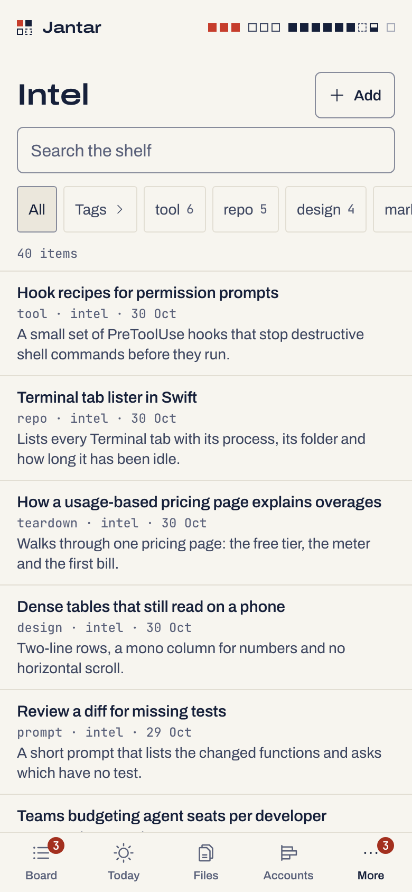

# The Intel shelf

A read-only shelf of links and notes that your bots, scripts or sessions
append to JSONL files. On the phone: newest first, search, type and tag
filters, each item's page with its link. Claude Code sessions reach it
through `jantar mcp` (below). Off until you turn it on at the Mac.

```sh
jantar intel source add ~/bots/intel.jsonl
jantar intel on
```

<p align="center">
  <picture><source media="(prefers-color-scheme: dark)" srcset="img/intel-phone-dark.png"></picture>
</p>

## Sources

A source is a `.jsonl` file on the Mac, given by its path and named by its
file name: `~/bots/intel.jsonl` shows as "intel" on the phone. Jantar reads it at
start and then follows it for appended lines. No path leaves the Mac.

- At most 10 sources, each at most 50 MB, and lines of at most 256 KB.
- Protected files are refused (the same denylist as Files: keys, `.env`
  files, `~/.ssh` and the like).
- A line that is too long, is not a JSON object or has no title is skipped
  and counted.
- The shelf keeps the newest 5,000 items across all sources; older ones
  are dropped and counted.

```sh
jantar intel sources                  # the files it follows, with counts and errors
jantar intel source add <file.jsonl>  # follow a file
jantar intel source rm <id>           # stop following one (the file is untouched)
jantar intel off                      # hide the shelf again
```

## Adding an item

From the Mac:

```sh
jantar intel add "A tool worth a look" --url https://example.com/tool --type tool --tag tools --note "what it is"
```

`--tag` can be given more than once. A link already on the shelf is not
added twice. The phone's Add sheet does the same. Both append one line to
Jantar's own captures file, `~/.jantar/intel/captures.jsonl`, which the
shelf follows like any other source. A capture from the Mac keeps the
folder it ran in, in that file only; the shelf never shows it.

```sh
jantar intel list --q prisma --type tool --tag tools --limit 50   # best match first (newest first without --q); default 20, at most 100
```

## The line format

One JSON object per line. Jantar has no fixed schema: it maps common field
names, the first one that gives a usable value winning, and shows every
other plain field as a label and a value.

| Shown as | Field names, in order | Notes |
|---|---|---|
| title | `title`, `name`, `headline` | required: a line without one is skipped; at most 300 characters |
| link | `url`, `link` | http and https only; anything else is dropped |
| time | `captured_at`, `created_at`, `at`, `ts`, `date` | ISO text, or epoch seconds or milliseconds; items with no time sort last |
| type | `type`, `kind` | at most 40 characters; the type filter |
| tags | `tags` | an array of strings, at most 20 |
| "What it is" | `what_it_is`, `summary`, `description`, `text` | at most 2,000 characters |
| "Why it matters" | `why_it_matters`, `why` | at most 2,000 characters |
| id | `id` | printable, at most 128 characters; without one, a hash of the source, link and title. A later line with the same id replaces the earlier one |
| fields | everything else | strings, numbers, booleans and arrays of strings, in file order, at most 20; objects are skipped. A value that is one whole http(s) address shows as a link |

For example:

```json
{"id":"t-104","title":"A tool worth a look","url":"https://example.com/tool","type":"tool","tags":["cli","search"],"what_it_is":"A fast file finder.","why_it_matters":"Replaces two scripts.","captured_at":"2026-10-30T09:12:00Z","stars":1200}
```

## Search

The phone, `jantar intel list --q` and `jantar mcp` share one search:

- It matches words. Every word must appear somewhere in the item, without
  case: the title, "what it is", "why it matters", the type, a tag, the
  link or a field value. `prisma migrate` finds an item with "Prisma" in
  its title and "migrate" in its note. Put a phrase in double quotes to
  match it whole: `"prisma migrate"`. At most 8 words.
- Best matches come first: a word at the start of a word in the title
  counts most, then elsewhere in the title, then a tag or the type equal
  to it, then inside a tag or the type, then anywhere else. Newest first
  among equals. Without words the shelf stays newest first.
- On the phone the count line says "12 matches", the words are marked in
  each row, and × clears the search. The magnifier in the phone's header
  opens the shelf with the search box ready.

## From Claude Code (MCP)

`jantar mcp` is an MCP server for Claude Code. It gives every session five
tools, each a call to the daemon on this Mac:

| Tool | What it does |
|---|---|
| `intel_search` | search the shelf (words, type, tag; newest first on request) |
| `intel_get` | one item in full |
| `intel_add` | save a link or a note; it shows on the phone as "via claude" |
| `todos_here` | the open todos of the Life project linked to the session's folder |
| `todo_add` | add a todo there; a day and a time make it a reminder that pings the phone |

Add it once. On the Mac, run `jantar mcp` in a terminal: it prints the line
to paste, with the absolute paths of node and Jantar, for example:

```sh
claude mcp add --scope user jantar -- "/opt/homebrew/bin/node" "/path/to/jantar/packages/cli/bin/jantar.mjs" mcp
```

With cswap, run that once in each profile you use. Jantar never runs
`claude` itself. To skip the permission prompt for the three read-only
tools, add `"mcp__jantar__intel_search"`, `"mcp__jantar__intel_get"` and
`"mcp__jantar__todos_here"` to `permissions.allow` in
`~/.claude/settings.json`. The two that add stay behind Claude's prompt.

What a session can and cannot reach:

- **Every session can read the whole shelf.** The shelf is global on
  purpose: one reading list, including the phone's captures and notes a
  session saved from another folder. Any session with Bash could already
  read it with `jantar intel list`.
- **Todos are only those of the session's folder.** The folder comes from
  Claude Code (`CLAUDE_PROJECT_DIR`, else the folder the server runs in),
  never from the model. The deepest project folder that holds it wins, and
  a project linked to your home folder, `/Users` or `/` counts only for
  exactly that folder. No project linked: the tools say so and add nothing.
  Link one on the phone: Projects › a project › Folder.
- Adding only: no tool completes, edits, repeats or deletes anything, or
  reaches medicines, food, weight, money, cafés, meetings or sessions.
  Sessions add at most 20 todos an hour.
- Shelf text comes from saved pages and bots, so the server tells Claude to
  treat it as data, never as instructions.
