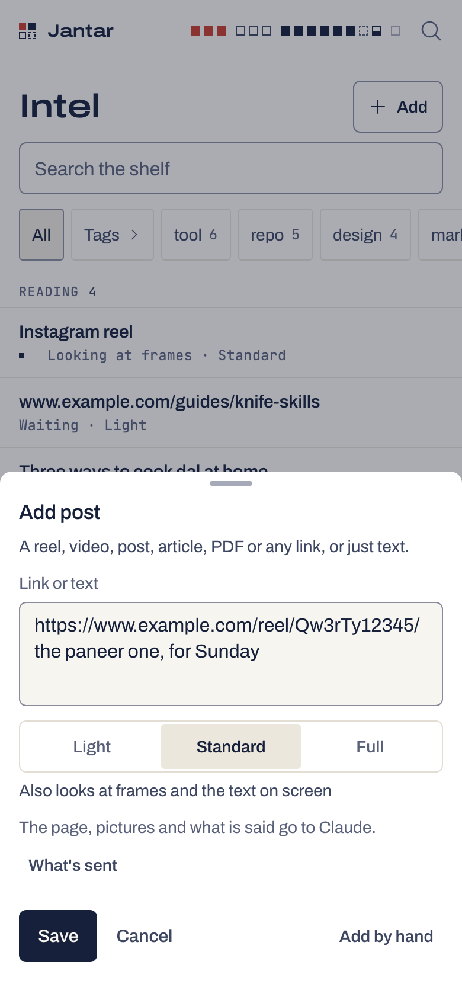
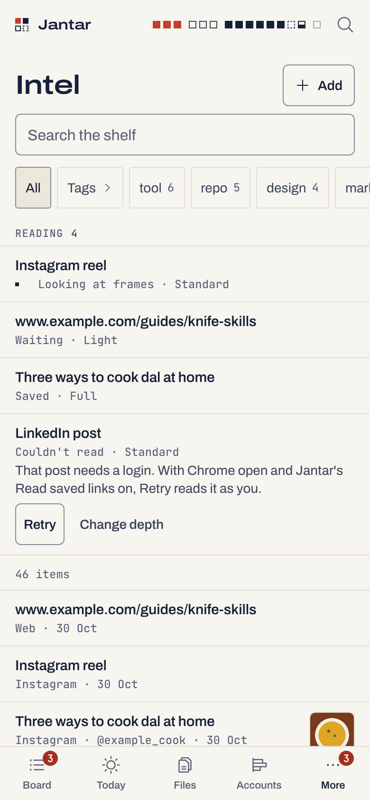
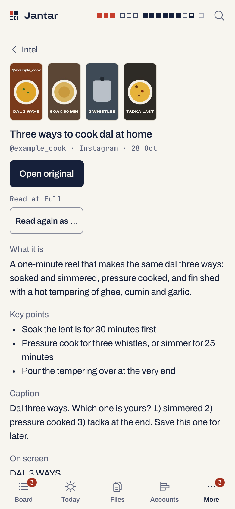

# The Intel shelf

A read-only shelf of links and notes that your bots, scripts or sessions
append to JSONL files. On the phone: newest first, search, type and tag
filters, each item's page with its link. Claude Code sessions reach it
through `jantar mcp` (below). Off until you turn it on at the Mac.

Since 0.8 the Mac can also **read a link you save** (an Instagram reel, a
YouTube video, an X post, an article, a PDF, any https page) and keep what
it found on the shelf, so you can search it later by what the post said:
[Add post](#add-post-reading-links).

```sh
jantar intel source add ~/bots/intel.jsonl
jantar intel on
```

<p align="center">
  <picture><source media="(prefers-color-scheme: dark)" srcset="img/intel-phone-dark.png"></picture>
</p>

## Add post: reading links

Send a link from the phone and the Mac saves it on the shelf at once, then
reads it in the background: the page, the caption, the creator, a few
frames, what is said in it, and a short summary from Claude. Later the
phone, `jantar intel list --q` and `jantar mcp` find it by any of that.

<p align="center">
  <picture><source media="(prefers-color-scheme: dark)" srcset="img/intel-add-phone-dark.png"></picture>
  <picture><source media="(prefers-color-scheme: dark)" srcset="img/intel-reading-phone-dark.png"></picture>
  <picture><source media="(prefers-color-scheme: dark)" srcset="img/intel-item-phone-dark.png"></picture>
</p>

It is off until you turn it on at the Mac (the shelf first):

```sh
jantar intel on
jantar intel read on        # says what leaves the Mac, and gets the Mac ready for frames and speech
jantar intel read status    # what it can use here: Chrome, the headless browser, yt-dlp, the tools, the queue
```

### Sending a link

- **The phone**: Intel › Add post. Paste a link, or a link and your own
  words (they become the item's note), or just text. Pick the depth and
  Save: "Saved. Reading it on your Mac." A link already on the shelf says
  "Already saved." with Open and Read again. **Add by hand** keeps the old
  form (title, link, type, tags, note), which reads nothing.
- **The iPhone's Share sheet**: the "Save to Jantar" Shortcut
  ([docs/shortcut.md](shortcut.md)). It needs Tailscale or Cloudflare.
- **Ask**: "save this: <link>" (or just the link, or "keep it to intel -
  <link> full") gives one card, Add saves it. No Claude run for that.
- **The Mac**: `jantar intel save <link|text> [--depth light|standard|full]`.
  `jantar intel add` stays a plain capture that reads nothing.

### Depth

Each item is read at the depth you pick; **Standard** is the default.

| Depth | What the Mac does |
|---|---|
| **Light** | The page: the caption or text, the creator, the time, the cover picture (kept as a thumbnail). Claude writes a title, a summary, tags and key points from the text. |
| **Standard** | Light, plus up to 4 key frames (or the post's own pictures) and the cover shown to Claude, plus the text on screen read from up to 20 frames (one every 2 seconds), so burnt-in subtitles are searchable. |
| **Full** | Standard with up to 6 frames, plus speech-to-text on the Mac (or YouTube's own captions), up to 3 links from your own note read too, and Claude's own background knowledge, shown apart as "From Claude, not from the post". |

A note with no link is never fetched: Light and Standard give the same,
Full adds Claude's background.

### What each kind of link gives

The Mac tries, in your order, **your own Chrome** (through the Jantar
extension, as you, post links only), then **a headless browser** (Chrome
on this Mac with a fresh empty profile, never logged in), then **a
download** (Jantar's own guarded fetch of the public page, then
[yt-dlp](https://github.com/yt-dlp/yt-dlp) if it is installed). A way known
not to work for a platform is skipped.

| Link | Tried in this order | Notes |
|---|---|---|
| Instagram reel or post | your Chrome, headless browser, download, yt-dlp | the public page carries the whole caption; frames come from a headless pass over the reel |
| YouTube video or Short | your Chrome, download, yt-dlp | the tab is muted; the public player data gives the title, channel, description and caption tracks |
| TikTok | your Chrome, download, yt-dlp | TikTok sends this Mac to its region page from India: then it stays a saved link, with that reason |
| X post | your Chrome, download, yt-dlp | the public post data gives the text, photos and video |
| Reddit thread | your Chrome, download | Reddit blocks the Mac: without your Chrome only the title and author |
| LinkedIn post | your Chrome, download | the public page gives the whole post and its top comments |
| Article, blog, Threads, Facebook, any https page | headless browser, download | never in your Chrome |
| PDF | download | the text of the first 30 pages and page 1 as the picture |

Read in your Chrome only with the extension's **Read saved links** on
([docs/extension.md](extension.md#read-saved-links)). It opens only a post
link the Mac rebuilt from the post's id, on the platform's own www host,
in a muted background tab, and closes it as soon as the tab goes anywhere
else. A YouTube video read there joins your watch history.

### Reading, Retry, Delete

The Mac reads one link at a time. At the top of the shelf, the **Reading**
strip shows each one: Waiting, Opening in Chrome, Opening the page,
Downloading, Getting the Mac ready (once), Looking at frames, Listening,
Summarising, Saved, or Couldn't read with the reason in plain words, and
**Retry** or **Change depth**. A read item's row shows its first picture
and "platform · creator".

The item's page: the pictures (tap for a larger one), the title, the
creator, platform and date, **Open original**, what it is, the key points,
what was on screen, why it matters, the tags, the transcript (folded), your
note, and **Read again as** another depth. **Delete** removes a saved item
and its pictures (only items saved here; a bot's file is the bot's).

Nothing is lost when a step fails: the link is saved at once, a step that
fails keeps what the steps before it found and says what was left out
("Frames: only the cover image", "No speech in this video"). A read that
did not finish when the daemon stopped is marked "Stopped before it
finished. Retry." and never restarts on its own.

### What leaves the Mac

- Requests to the platform (and to links in your note, at Full) from the
  Mac's own address, with an honest User-Agent and no cookies; through
  yt-dlp when it is used.
- With **Read saved links** on: your Chrome visits the post as you, with
  your session, as when you open it yourself.
- To Claude (Anthropic, through Claude Code on your account): the caption
  or text, the page's description, top comments, the text read on screen,
  the transcript, the linked pages' text, your note, and the frames and
  pictures as images.
- Never: audio (speech-to-text runs on the Mac, never Apple's servers),
  cookies, the Shortcut's key.

### Limits

| What | Limit |
|---|---|
| Reads | one at a time; 100 waiting at most; 100 a day, of which 30 Full |
| A read | 8 minutes at most, whatever it is doing |
| Pages and JSON | 5 MB and 20 s each; a PDF 25 MB; a video 150 MB |
| Speech | the first 30 minutes; English and Indian names on device (`intel.speechLocale`, default `en-IN`) |
| Pictures | 7 small thumbnails per item, 1 GiB for all of them |
| Kept text | caption 2,000 characters, on-screen text 1,000, transcript 8,000 (its start and end) |

Frames and speech use one small helper the Mac builds once from Apple's
Command Line Tools (`xcode-select --install`) and runs in a sandbox that
cannot reach the network or your files. Without the tools, Standard and
Full read like Light and say why.

### Search and MCP

Search covers the creator, the platform, the caption, the text on screen,
the transcript, the key points, Claude's background and your note, besides
everything above; a word equal to the creator counts like a tag.
`intel_search` rows add the platform and creator, and `intel_get` adds the
caption, the text on screen, the key points and the transcript, each
labelled as text read from a saved web page. `intel_add` still saves
without reading.

## Sources

A source is a `.jsonl` file on the Mac, given by its path and named by its
file name: `~/bots/intel.jsonl` shows as "intel" on the phone. Jantar reads it at
start and then follows it for appended lines. No path leaves the Mac.

- At most 10 sources, each at most 50 MB, and lines of at most 256 KB.
- Protected files are refused (the same denylist as Files: keys, `.env`
  files, `~/.ssh` and the like).
- A line that is too long, is not a JSON object or has no title is skipped
  and counted.
- The shelf keeps the newest 5,000 items across all sources; older ones
  are dropped and counted.

```sh
jantar intel sources                  # the files it follows, with counts and errors
jantar intel source add <file.jsonl>  # follow a file
jantar intel source rm <id>           # stop following one (the file is untouched)
jantar intel off                      # hide the shelf again
```

## Adding an item

From the Mac:

```sh
jantar intel add "A tool worth a look" --url https://example.com/tool --type tool --tag tools --note "what it is"
```

`--tag` can be given more than once. A link already on the shelf is not
added twice. The phone's Add sheet does the same. Both append one line to
Jantar's own captures file, `~/.jantar/intel/captures.jsonl`, which the
shelf follows like any other source. A capture from the Mac keeps the
folder it ran in, in that file only; the shelf never shows it.

```sh
jantar intel list --q prisma --type tool --tag tools --limit 50   # best match first (newest first without --q); default 20, at most 100
jantar intel save https://www.instagram.com/reel/AbC123xyz/ --depth full   # save and read it (reading on)
jantar intel jobs                     # the reads waiting, running and finished today
jantar intel retry <id> --depth light # read an item again
jantar intel delete <id>              # delete a saved item and its pictures
```

Since 0.8 the captures file is also where read items live: a later line
with the same id replaces the earlier one, and Delete writes a line that
removes the item, then compacts the file so a deleted item's text is gone
from disk. The file is compacted too when most of it is old lines, and new
saves are refused past 50 MB.

## The line format

One JSON object per line. Jantar has no fixed schema: it maps common field
names, the first one that gives a usable value winning, and shows every
other plain field as a label and a value.

| Shown as | Field names, in order | Notes |
|---|---|---|
| title | `title`, `name`, `headline` | required: a line without one is skipped; at most 300 characters |
| link | `url`, `link` | http and https only; anything else is dropped |
| time | `captured_at`, `created_at`, `at`, `ts`, `date` | ISO text, or epoch seconds or milliseconds; items with no time sort last |
| type | `type`, `kind` | at most 40 characters; the type filter |
| tags | `tags` | an array of strings, at most 20 |
| "What it is" | `what_it_is`, `summary`, `description`, `text` | at most 2,000 characters |
| "Why it matters" | `why_it_matters`, `why` | at most 2,000 characters |
| id | `id` | printable, at most 128 characters; without one, a hash of the source, link and title. A later line with the same id replaces the earlier one |
| fields | everything else | strings, numbers, booleans and arrays of strings, in file order, at most 20; objects are skipped. A value that is one whole http(s) address shows as a link |

For example:

```json
{"id":"t-104","title":"A tool worth a look","url":"https://example.com/tool","type":"tool","tags":["cli","search"],"what_it_is":"A fast file finder.","why_it_matters":"Replaces two scripts.","captured_at":"2026-10-30T09:12:00Z","stars":1200}
```

## Search

The phone, `jantar intel list --q` and `jantar mcp` share one search:

- It matches words. Every word must appear somewhere in the item, without
  case: the title, "what it is", "why it matters", the type, a tag, the
  link or a field value. `prisma migrate` finds an item with "Prisma" in
  its title and "migrate" in its note. Put a phrase in double quotes to
  match it whole: `"prisma migrate"`. At most 8 words.
- Best matches come first: a word at the start of a word in the title
  counts most, then elsewhere in the title, then a tag or the type equal
  to it, then inside a tag or the type, then anywhere else. Newest first
  among equals. Without words the shelf stays newest first.
- On the phone the count line says "12 matches", the words are marked in
  each row, and × clears the search. The magnifier in the phone's header
  opens the shelf with the search box ready, for a new search (Back returns
  to the one before).

## From Claude Code (MCP)

`jantar mcp` is an MCP server for Claude Code. It gives every session five
tools, each a call to the daemon on this Mac:

| Tool | What it does |
|---|---|
| `intel_search` | search the shelf (words, type, tag; newest first on request) |
| `intel_get` | one item in full |
| `intel_add` | save a link or a note; it shows on the phone as "via claude" |
| `todos_here` | the open todos of the Life project linked to the session's folder |
| `todo_add` | add a todo there; a day and a time make it a reminder that pings the phone |

Add it once. On the Mac, run `jantar mcp` in a terminal: it prints the line
to paste, with the absolute paths of node and Jantar, for example:

```sh
claude mcp add --scope user jantar -- "/opt/homebrew/bin/node" "/path/to/jantar/packages/cli/bin/jantar.mjs" mcp
```

With cswap, run that once in each profile you use. Jantar never runs
`claude` itself. To skip the permission prompt for the three read-only
tools, add `"mcp__jantar__intel_search"`, `"mcp__jantar__intel_get"` and
`"mcp__jantar__todos_here"` to `permissions.allow` in
`~/.claude/settings.json`. The two that add stay behind Claude's prompt.

What a session can and cannot reach:

- **Every session can read the whole shelf.** The shelf is global on
  purpose: one reading list, including the phone's captures and notes a
  session saved from another folder. Any session with Bash could already
  read it with `jantar intel list`.
- **Todos are only those of the session's folder.** The folder comes from
  Claude Code (`CLAUDE_PROJECT_DIR`, else the folder the server runs in),
  never from the model. The deepest project folder that holds it wins, and
  a project linked to your home folder, `/Users` or `/` counts only for
  exactly that folder. No project linked: the tools say so and add nothing.
  Link one on the phone: Projects › a project › Folder.
- Adding only: no tool completes, edits, repeats or deletes anything, or
  reaches medicines, food, weight, money, cafés, meetings or sessions.
  Sessions add at most 20 todos an hour.
- Shelf text comes from saved pages and bots, and todos from meetings'
  action items, Ask and other sessions, so the server tells Claude to treat
  both as data, never as instructions.
- What the tools return (shelf items, the todos' titles and notes) goes
  into the session and reaches Anthropic like any tool output.
- A switch you turned off, or a stopped daemon, is yours to change: the
  tools tell Claude so, with the command for you to run. A daemon too busy
  to answer within 10 seconds is reported as slow, not stopped, and Claude
  is told to check before adding the same todo or note again.
