# Life

A small life list next to your sessions. Each module has its own switch,
off until you turn it on at the Mac; take only what you want.

```sh
jantar life on todos medicines food places finance posts   # or: jantar life on all
jantar life set currency EUR
jantar life status
```

<p align="center">
  <picture><source media="(prefers-color-scheme: dark)" srcset="img/today-phone-dark.png">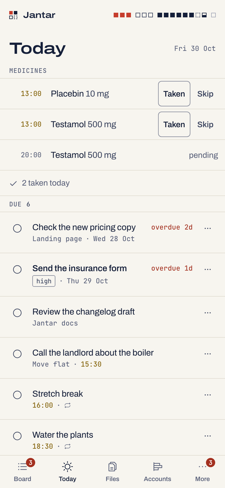</picture>
  <picture><source media="(prefers-color-scheme: dark)" srcset="img/todos-phone-dark.png">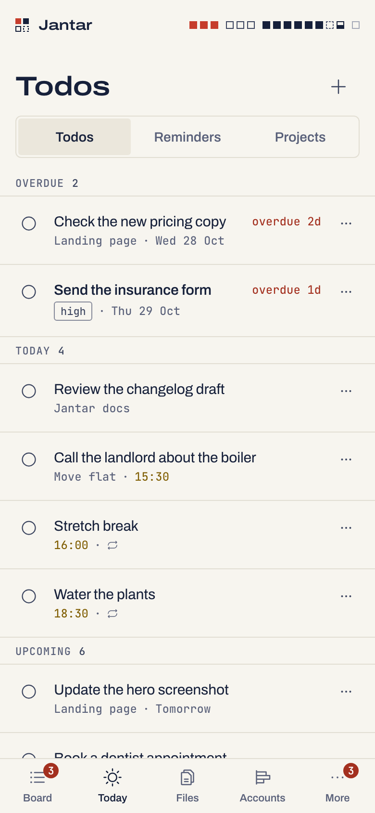</picture>
  <picture><source media="(prefers-color-scheme: dark)" srcset="img/reminders-phone-dark.png">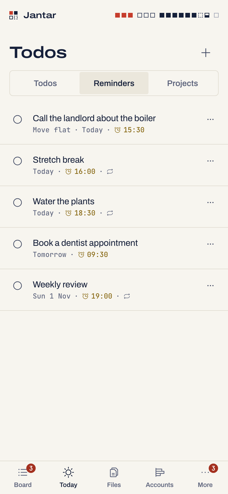</picture>
</p>

## The modules

- **Today**: medicines due, todos due and overdue, bills in the next three
  days, calories against the target, how many posts are due today or late,
  and how many sessions need you. Add a
  todo due today from there, and tap the weight line to log today's weight
  ("Log weight" until you do).
- **Todos** (`todos`), with **Reminders** (a todo with a time pings your
  phone) and small **Projects** (a project can be linked to a folder, and
  the Board shows it on that folder's sessions). Repeats every day, week,
  month or year (birthdays, renewals; a 29 February one falls on the 28th
  in other years), and snooze. A repeating reminder keeps its own time: a
  daily 11:00 snoozed an hour still rings at 11:00 the next day. Change
  the time in the todo sheet to move it. Three limits: a reminder made
  before 0.5.3 learns its time once you change it in the todo sheet (until
  then a snooze still moves it); a repeating todo with no time keeps a
  snooze's time after Done, and rings, until you clear the time in the
  sheet; a yearly one snoozed more than a month after its date moves to
  the snooze's month, so set its date back in the sheet.
- **Medicines** (`medicines`): dose times, every day or chosen weekdays or
  every N days; Taken, Skip or "Took it at…"; a pill count with a refill
  warning and 30 days of adherence. The lock screen says "Medicine due",
  without the name.
- **Food** (`food`): what you ate with calories, saved foods for one tap,
  "Ask Claude" to estimate a meal you type (you edit before it is saved),
  and your weight with its change over 7 and 30 days. The calorie target
  (1,500 kcal until you change it) and the goal weight are set on the
  phone.
- **Cafés** (`places`): your places, tried or want to try. A café has its
  own stars, six optional ratings (food, coffee and drinks, vibe, service,
  value, work), a price level (shown in your currency's symbol), would go
  again, and tags: Wi-Fi, sockets, quiet and the rest, or your own. Its
  dishes have stars (or none yet, to try), a price and would order again;
  its visits keep the day, what you spent and had, and how it was. Sort by
  best, recent, most visited, name, price or work; filter by tags, price,
  stars, would go again and area, or search. Each café has its own screen,
  and `jantar place list` and `show` read them at the Mac (never change
  them).
- **Finance** (`finance`): expenses and income by category, monthly
  budgets, and bills that remind you.
- **Posts** (`posts`): what you plan to post on social media (a Reddit
  post, an Instagram reel, an X thread), with its text ready to copy, a
  reminder at the time, and a weekly goal per platform; and a log of the
  comments you make, with their links. Jantar never posts anything: you
  copy, open and post it yourself ([Posts](#posts)).

<p align="center">
  <picture><source media="(prefers-color-scheme: dark)" srcset="img/projects-phone-dark.png">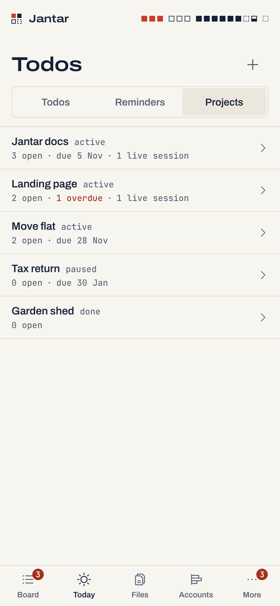</picture>
  <picture><source media="(prefers-color-scheme: dark)" srcset="img/meds-phone-dark.png">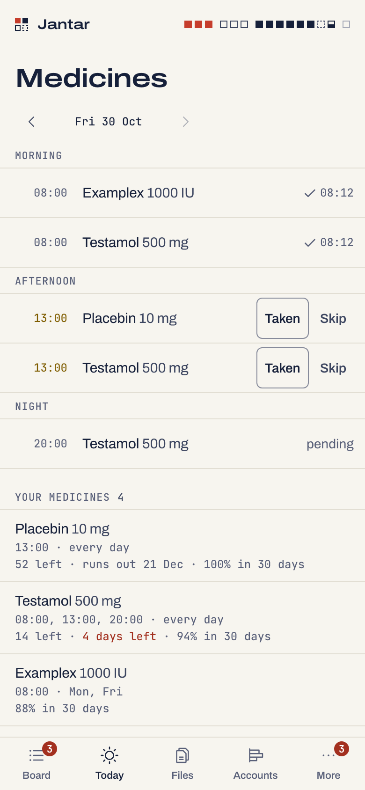</picture>
  <picture><source media="(prefers-color-scheme: dark)" srcset="img/dose-phone-dark.png">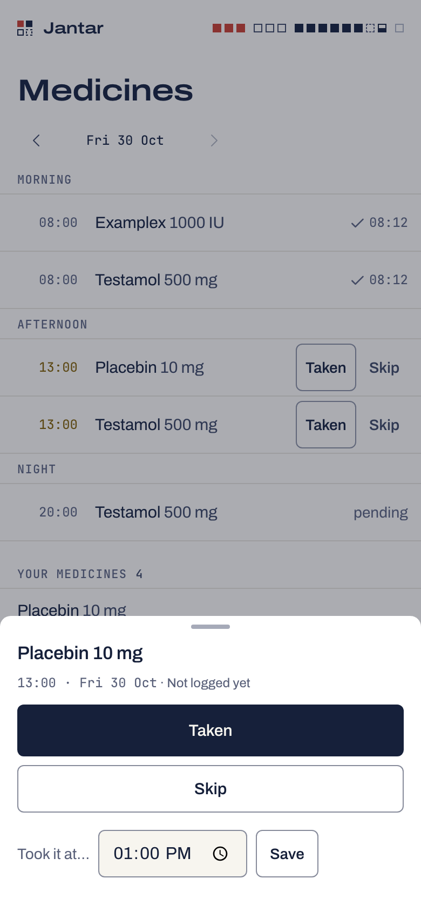</picture>
</p>
<p align="center">
  <picture><source media="(prefers-color-scheme: dark)" srcset="img/food-phone-dark.png">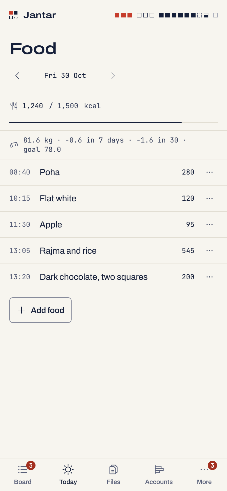</picture>
  <picture><source media="(prefers-color-scheme: dark)" srcset="img/places-phone-dark.png">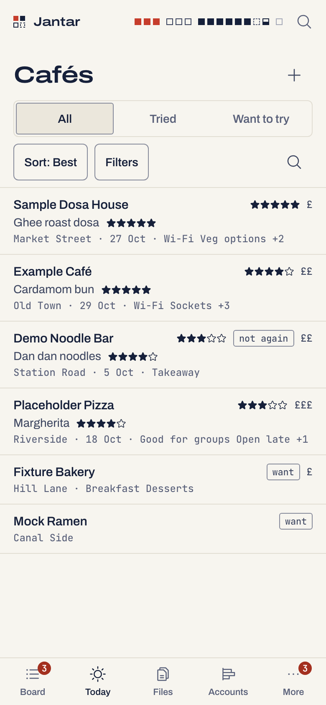</picture>
  <picture><source media="(prefers-color-scheme: dark)" srcset="img/money-phone-dark.png">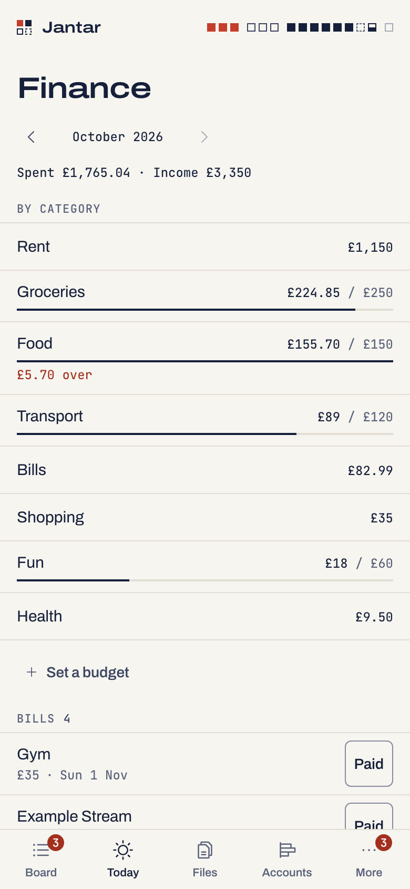</picture>
</p>
<p align="center">
  <picture><source media="(prefers-color-scheme: dark)" srcset="img/place-phone-dark.png">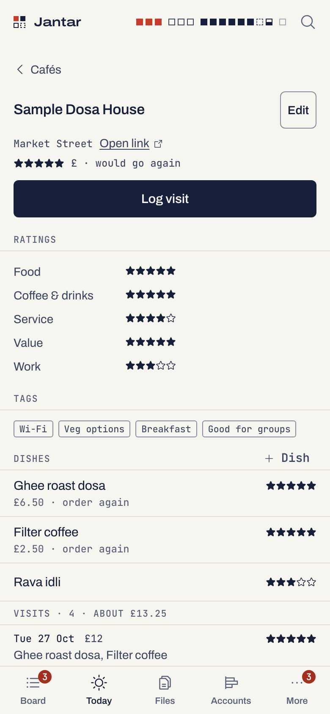</picture>
  <picture><source media="(prefers-color-scheme: dark)" srcset="img/place-filters-phone-dark.png">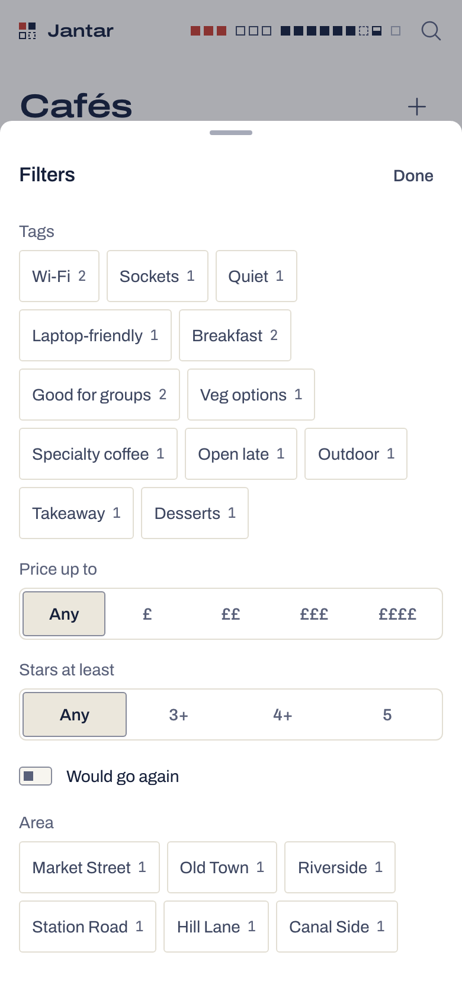</picture>
</p>

## How it behaves

- **Amounts** use a dot for decimals and commas only for thousands, on
  every phone: `1,240` is 1240 and `1,240.50` is 1240.50. The currency is
  a label only; there is one currency.
- **Undo instead of a confirm.** Deleting a todo, a meal, a weight, a saved
  food, a café with no visits, a café's visit or dish, a money entry or a
  post happens at once, with Undo for five seconds. A medicine, a project, a
  bill or a café with visits still asks first ("Delete Example Café and its
  3 visits?"), because deleting one also drops its dose history, its todos'
  link to it, its reminders or its visits.
- **Pings need the Mac awake.** Medicine, reminder and post pings come from
  the daemon, so a sleeping Mac sends none. Keep your phone's own alarm for a
  dose you must not miss. Muting pushes under Alerts holds a todo's ping,
  never a medicine's. A ping the Mac could not send for lack of network
  (asleep, Wi-Fi off) goes out, marked late, as soon as it has network
  again, up to 6 hours late. A medicine's is skipped when its next dose is
  under 3 hours away. On Wi-Fi that reaches nothing (a hotel's sign-in
  page), a ping is tried five times over a few minutes, then dropped,
  never sent twice.
- **Todos from Claude sessions.** `jantar mcp` lets a Claude session list
  and add todos of the project linked to its folder (the deepest linked
  folder wins). A project linked to your home folder, `/Users` or `/`
  counts only for a session started in exactly that folder, not for every
  folder below it. Sessions add at most 20 todos an hour; add more on the
  phone. With no project linked to the folder they add nothing: link one
  on the phone under Projects › a project › Folder.
- **Ask Claude** runs one headless Claude on an account with room (never a
  kept one) and is refused while Jantar runs read-only.
- **Chat** (its own switch, `jantar chat on`) adds and changes todos,
  reminders, medicines, meals, cafés, money and posts from plain words or a
  photo, each change with Undo for a day; a delete waits for your tap
  ([Chat](assistant.md)).

## Posts

Posts is for what you post by hand: "Reddit on Monday, three reels a
week". Turn it on at the Mac with `jantar life on posts`.

<p align="center">
  <picture><source media="(prefers-color-scheme: dark)" srcset="img/posts-phone-dark.png">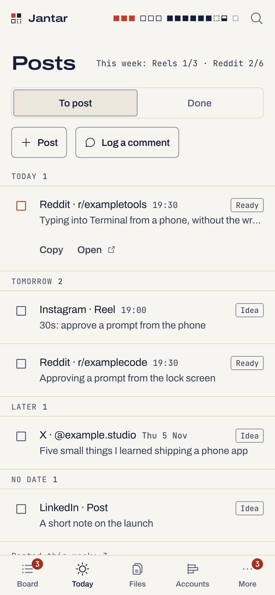</picture>
</p>

- **A post** has a platform (Reddit, Instagram, X, LinkedIn, YouTube,
  TikTok, Threads, Facebook, Hacker News or Other), where it goes (a
  subreddit, an account or a handle), a kind (post, comment, reel, story,
  thread, short, video or link), a title, the text or caption, notes, a
  link to the page where you post it, and a day and time. Notes hold what
  you need besides the text (the flair, the media to attach, the sub's
  rules) and are never copied.
- **Idea, Ready, Posted.** A post starts as an idea; mark it Ready when
  the text is done. Tap its square once you have posted it, with Undo for
  five seconds. Open the post to add the link to what you posted, or to
  Skip one you won't make. Done lists the newest 300 you posted and
  skipped, each with Open for its link.
- **Log a comment.** Made a comment? Tap Log a comment at the top of
  Posts, under To post and Done, and paste the link to it (on Reddit:
  Share, then Copy link); the keyboard's Done saves it. The
  platform and where come from the link as you paste it: a Reddit link
  gives `r/<sub>`; X, LinkedIn, YouTube and the rest give the platform,
  and you can type the where. Add what you wrote if you like, then Log
  comment, with Undo for five seconds. It counts as posted at the moment
  you log it, so log it when you post it. The same link twice is refused.
  Done shows each one's where in full, with Open. Jantar never opens or
  fetches the link; it only reads it as text, and Open in Done is your
  tap.
- **The reminder** rings at the post's time, like a todo's. Posts due in
  the same minute come as one push. The lock screen says "Post due" and
  the time; with `lock-screen-details` on it also says the platform and
  where ("Post on Reddit · r/exampletools · 19:30"), never the title or
  the text. A post with a day and no time is listed under that day and
  does not ring.
- **The weekly goal**: a number a week per platform, or per platform and
  kind ("Reels 3 a week", "Reddit 6 a week"). The top of Posts counts this
  week, Monday to Sunday in the Life zone: "This week: Reels 1/3 ·
  Reddit 2/6", on more lines when there are more goals. Two goals that
  would read the same name their platform too ("X threads" beside
  "Threads"), and a comment goal always does ("Reddit comments 12/35"),
  as does another kind's goal on its platform ("Reddit posts 0/2").
  With a comment goal, Today shows "Comments today 3/5": the weekly
  comment goals divided by 7, rounded up; with none, "Comments today 3"
  once you log one that day. Tip: a goal with no kind counts comments
  too, so set Reddit posts as kind Post ("Reddit posts 2 a week") and
  comments as kind Comment.
- **Jantar never posts.** It keeps the text, rings at the time and gives
  you Copy (the title, the text) and Open (the link). You post it
  yourself, then tap Posted. It never fetches a link and talks to no
  social network.

Scripts and Claude sessions on the Mac can add and list posts and log
comments, at most 30 adds and logs an hour; Posted, Skip, edits, deletes
and goals are on the phone. `--at` is in the Life zone and must be a real
day; a time already gone is still added, and the line says it won't
ring. An empty `--text-file` is refused. `jantar post log` takes the link
in quotes (in zsh an unquoted `?` or `&` breaks the command); `post list
--done` prints each posted link. Chat does not log a comment's link unless
you wrote it in your message: use Log a comment or `jantar post log`.

```sh
jantar post add --platform reddit --where r/exampletools --at "2026-11-02 19:30" \
  --title "Typing into Terminal from a phone" --text-file draft.md \
  --link https://www.reddit.com/r/exampletools/submit --status ready
jantar post log 'https://www.reddit.com/r/exampletools/s/AbCdEf1234' --text-file said.md
jantar post list                         # this week, then the posts to make (--done: posted and skipped, with links)
```

## Spaces and shared lists (People, v0.12)

Every Life row has a space: `''` is yours (every row from before 0.12),
`<id>` a person's own space, and `s:<id>` a space you share with them (one
per person). Your screens, the CLI and `jantar mcp` read your own space; your
Cafés and Chat also read the cafés you share, each marked shared. A shared
list is a project in a shared space with its kind, and its items are to-dos
there (no new table). Limits count per space. See [People](people.md).

## Settings

All of these change only at the Mac.

```sh
jantar life on medicines food            # any of: todos medicines food places finance posts, or all
jantar life off finance                  # its data stays in life.db
jantar life set timezone Europe/Berlin   # days and ping times (default, or none: the Mac's zone)
jantar life set currency EUR             # a label for amounts (none: plain numbers)
jantar life set lock-screen-details on   # names on the lock screen (default off: "Medicine due", "Bill due", "Post due")
jantar life status                       # modules, zone, currency, who gets medicine pings, backups, life.db's schema
```

## Backup and restore

Life lives in its own file, `~/.jantar/life.db`. It is copied into
`~/.jantar/backups` every night at 03:30, and the newest 30 copies are
kept.

```sh
jantar life backup                       # a copy now
jantar life restore life-2026-10-29.db   # asks first, and keeps the current life.db beside it (--yes: no question)
```

A file that fails its checks is refused, never reset: Life says so on the
phone, the rest of Jantar keeps working, and `jantar life restore` brings
a backup back.

From 0.10.0 the daemon keeps a copy for you before it changes life.db's
layout: `life-pre-<version>.db` in the same folder, written before the
change and kept until 30 newer backups exist (`jantar life status` names
it). 0.10.0 adds a table for cafés' visits, and 0.9.1 can't open life.db
after that; `jantar life restore life-pre-0.10.0.db` on 0.9.1 brings the
old file back ([Upgrading](upgrading.md#0100-lifes-second-schema-change)).

Before upgrading to 0.7.0, copy a fresh backup to `life-pre-0.7.0.db` in
the same folder. 0.7.0 adds the posts table, and 0.6.1 can't open
life.db after that; `jantar life restore life-pre-0.7.0.db` on 0.6.1 brings
the old file back ([Upgrading](upgrading.md#070-lifes-first-schema-change)).

## Privacy

Life's text stays in `life.db`. Events, audit rows, logs, error messages
and write replies never carry it, and the lock screen shows no names unless
you turn `lock-screen-details` on. [SECURITY.md](../SECURITY.md#v04-life-the-intel-shelf-resume-one-login-and-the-primer)
has the details.
