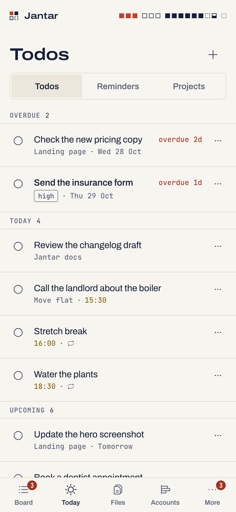
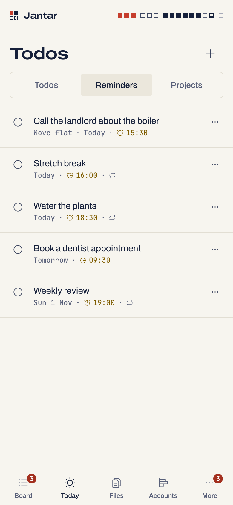
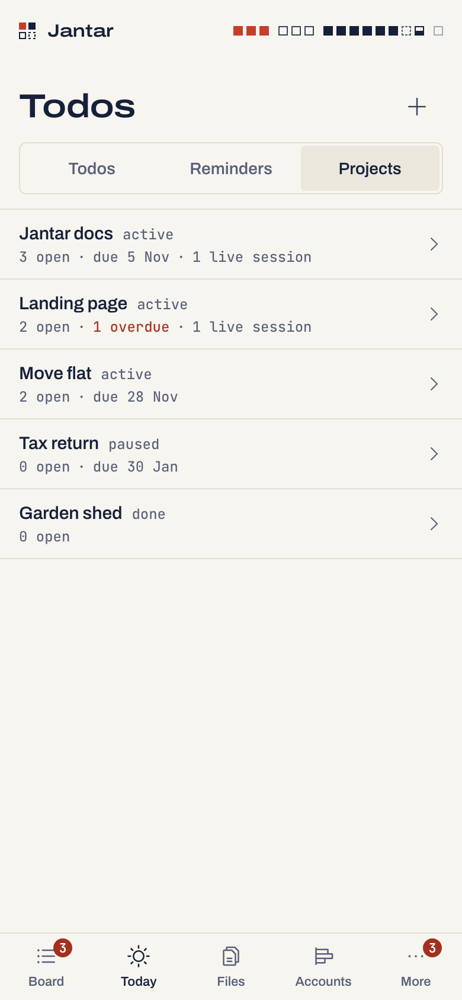
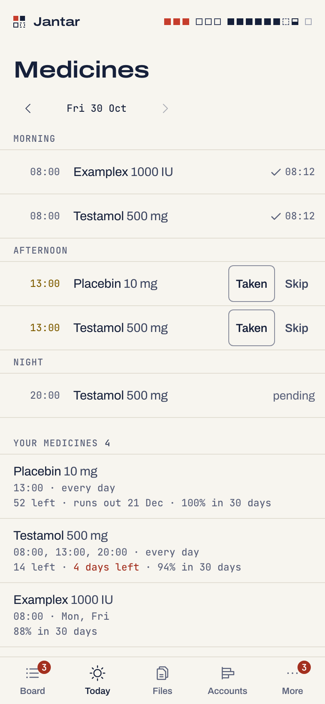
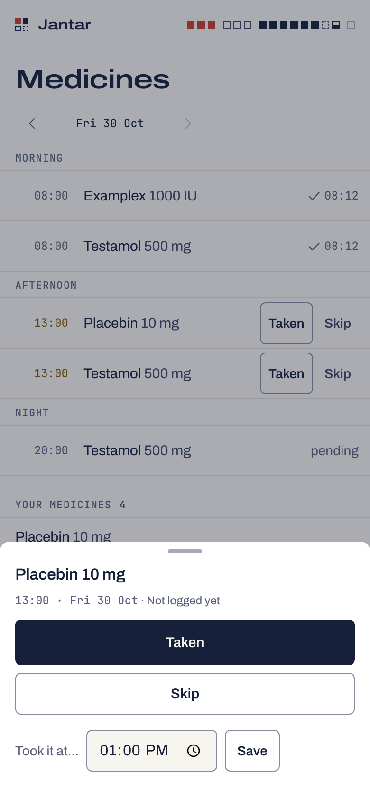
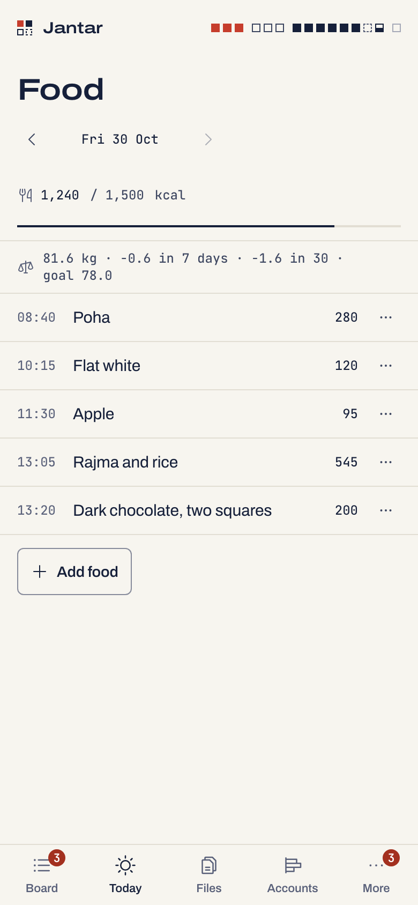
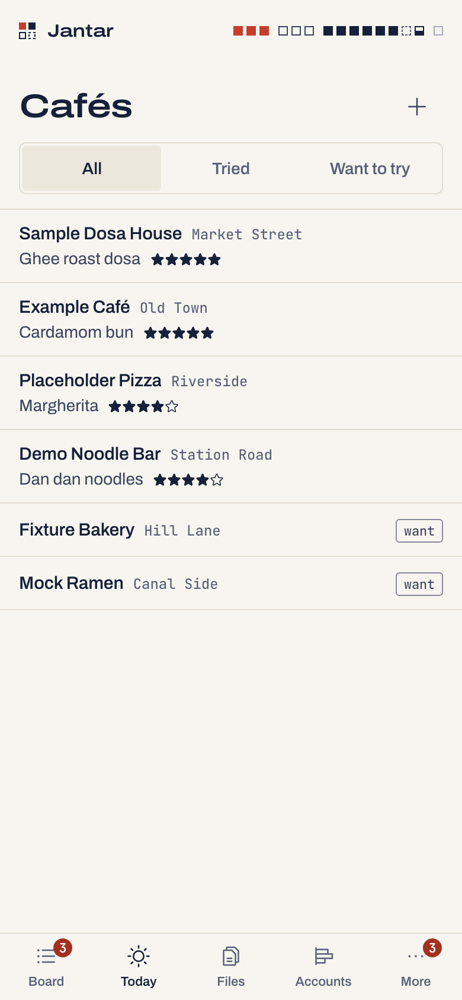
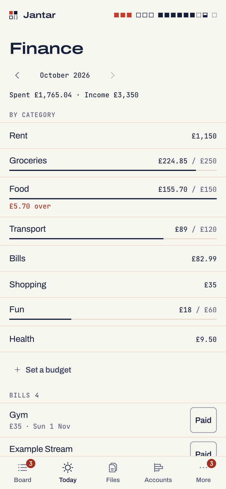

# Life

A small life list next to your sessions. Each module has its own switch,
off until you turn it on at the Mac; take only what you want.

```sh
jantar life on todos medicines food places finance   # or: jantar life on all
jantar life set currency EUR
jantar life status
```

<p align="center">
  <picture><source media="(prefers-color-scheme: dark)" srcset="img/today-phone-dark.png"></picture>
  <picture><source media="(prefers-color-scheme: dark)" srcset="img/todos-phone-dark.png"></picture>
  <picture><source media="(prefers-color-scheme: dark)" srcset="img/reminders-phone-dark.png"></picture>
</p>

## The modules

- **Today**: medicines due, todos due and overdue, bills in the next three
  days, calories against the target, and how many sessions need you. Add a
  todo due today from there, and tap the weight line to log today's weight
  ("Log weight" until you do).
- **Todos** (`todos`), with **Reminders** (a todo with a time pings your
  phone) and small **Projects** (a project can be linked to a folder, and
  the Board shows it on that folder's sessions). Repeats every day, week,
  month or year (birthdays, renewals; a 29 February one falls on the 28th
  in other years), and snooze. A repeating reminder keeps its own time: a
  daily 11:00 snoozed an hour still rings at 11:00 the next day. Change
  the time in the todo sheet to move it. Three limits: a reminder made
  before 0.5.3 learns its time once you change it in the todo sheet (until
  then a snooze still moves it); a repeating todo with no time keeps a
  snooze's time after Done, and rings, until you clear the time in the
  sheet; a yearly one snoozed more than a month after its date moves to
  the snooze's month, so set its date back in the sheet.
- **Medicines** (`medicines`): dose times, every day or chosen weekdays or
  every N days; Taken, Skip or "Took it at…"; a pill count with a refill
  warning and 30 days of adherence. The lock screen says "Medicine due",
  without the name.
- **Food** (`food`): what you ate with calories, saved foods for one tap,
  "Ask Claude" to estimate a meal you type (you edit before it is saved),
  and your weight with its change over 7 and 30 days. The calorie target
  (1,500 kcal until you change it) and the goal weight are set on the
  phone.
- **Cafés** (`places`): your places and their best dishes, rated, tried or
  want to try.
- **Finance** (`finance`): expenses and income by category, monthly
  budgets, and bills that remind you.

<p align="center">
  <picture><source media="(prefers-color-scheme: dark)" srcset="img/projects-phone-dark.png"></picture>
  <picture><source media="(prefers-color-scheme: dark)" srcset="img/meds-phone-dark.png"></picture>
  <picture><source media="(prefers-color-scheme: dark)" srcset="img/dose-phone-dark.png"></picture>
</p>
<p align="center">
  <picture><source media="(prefers-color-scheme: dark)" srcset="img/food-phone-dark.png"></picture>
  <picture><source media="(prefers-color-scheme: dark)" srcset="img/places-phone-dark.png"></picture>
  <picture><source media="(prefers-color-scheme: dark)" srcset="img/money-phone-dark.png"></picture>
</p>

## How it behaves

- **Amounts** use a dot for decimals and commas only for thousands, on
  every phone: `1,240` is 1240 and `1,240.50` is 1240.50. The currency is
  a label only; there is one currency.
- **Undo instead of a confirm.** Deleting a todo, a meal, a weight, a saved
  food, a café or a money entry happens at once, with Undo for five
  seconds. A medicine, a project or a bill still asks first, because
  deleting one also drops its dose history, its todos' link to it or its
  reminders.
- **Pings need the Mac awake.** Medicine and reminder pings come from the
  daemon, so a sleeping Mac sends none. Keep your phone's own alarm for a
  dose you must not miss. Muting pushes under Alerts holds a todo's ping,
  never a medicine's. A ping the Mac could not send for lack of network
  (asleep, Wi-Fi off) goes out, marked late, as soon as it has network
  again, up to 6 hours late. A medicine's is skipped when its next dose is
  under 3 hours away. On Wi-Fi that reaches nothing (a hotel's sign-in
  page), a ping is tried five times over a few minutes, then dropped,
  never sent twice.
- **Todos from Claude sessions.** `jantar mcp` lets a Claude session list
  and add todos of the project linked to its folder (the deepest linked
  folder wins). A project linked to your home folder, `/Users` or `/`
  counts only for a session started in exactly that folder, not for every
  folder below it. Sessions add at most 20 todos an hour; add more on the
  phone. With no project linked to the folder they add nothing: link one
  on the phone under Projects › a project › Folder.
- **Ask Claude** runs one headless Claude on an account with room (never a
  kept one) and is refused while Jantar runs read-only.
- **Ask** (its own switch, `jantar ask on`) turns plain words into todos,
  reminders, meals and money entries, each added only by your tap, with
  Undo until a day after you asked ([Ask](assistant.md)).

## Settings

All of these change only at the Mac.

```sh
jantar life on medicines food            # any of: todos medicines food places finance, or all
jantar life off finance                  # its data stays in life.db
jantar life set timezone Europe/Berlin   # days and ping times (default, or none: the Mac's zone)
jantar life set currency EUR             # a label for amounts (none: plain numbers)
jantar life set lock-screen-details on   # names on the lock screen (default off: "Medicine due", "Bill due")
jantar life status                       # modules, zone, currency, who gets medicine pings, backups
```

## Backup and restore

Life lives in its own file, `~/.jantar/life.db`. It is copied into
`~/.jantar/backups` every night at 03:30, and the newest 30 copies are
kept.

```sh
jantar life backup                       # a copy now
jantar life restore life-2026-10-29.db   # asks first, and keeps the current life.db beside it (--yes: no question)
```

A file that fails its checks is refused, never reset: Life says so on the
phone, the rest of Jantar keeps working, and `jantar life restore` brings
a backup back.

## Privacy

Life's text stays in `life.db`. Events, audit rows, logs, error messages
and write replies never carry it, and the lock screen shows no names unless
you turn `lock-screen-details` on. [SECURITY.md](../SECURITY.md#v04-life-the-intel-shelf-resume-one-login-and-the-primer)
has the details.
