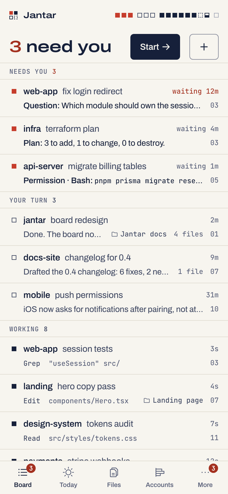
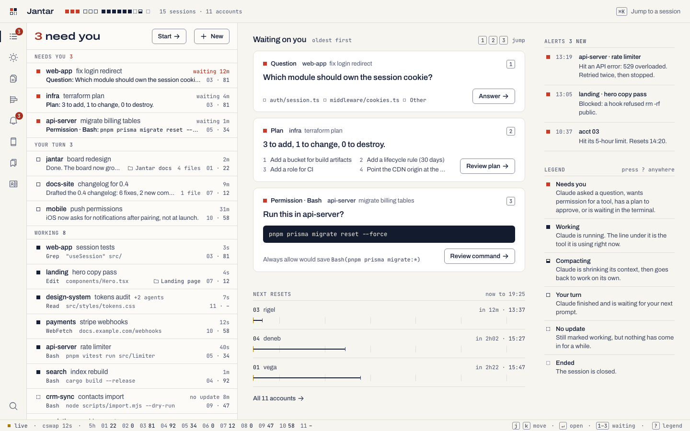
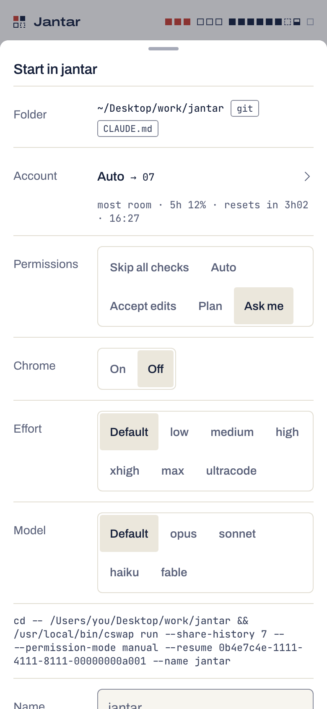
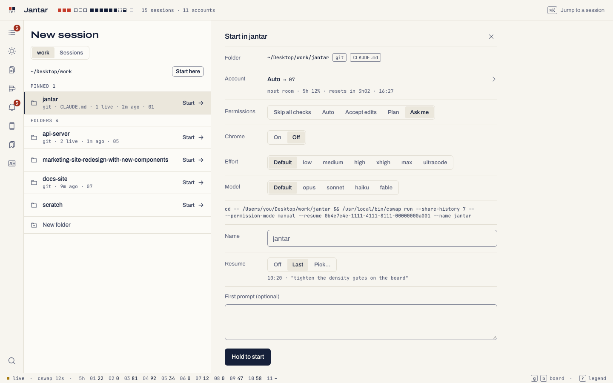

# The app, on the phone and the Mac

One web app serves the Mac and the phone, and installs on the phone as a
Home Screen app (a PWA). This page goes screen by screen and lists the
commands that turn each part on. How the phone answers Claude's prompts is
its own page: [Answering from the phone](phone-control.md).

The day theme (cream and navy) is the default, with a deep-navy night
theme. Red means "needs you" and nothing else; mustard marks time ("now",
the live dot, `next →`). The name shown in the app is one constant,
`packages/web/src/brand.ts`.

<p align="center">
  <picture><source media="(prefers-color-scheme: dark)" srcset="img/board-phone-dark.png"></picture>
</p>

## The screens

| Screen | What you see |
|---|---|
| **Board** | "3 need you" and **Start**, then every session in rails: NEEDS YOU (oldest wait first), YOUR TURN, WORKING, ENDED. Each row: what it is waiting on (the question, the command, the plan), the tool it is running, or its last reply, with its account and that account's 5-hour % (with cswap) and its project (with Life). On a Mac the **Desk** beside it shows up to three cards to answer, the next resets and new alerts |
| **Session** | The transcript (or the terminal screen), and a dock for whatever is waiting, in Claude's own words. After you answer, "Next: infra · Plan". With no card, the dialog on the terminal as buttons, or the keypad ([details](phone-control.md)). Otherwise a box to send a prompt, with **+** for photos and files, which says "delivered" only when the transcript proves it |
| **Accounts** | With cswap: every account's 5-hour bar against the ceiling, a runway to the reset, weekly %, its sessions, its flags and the primer's line; with the legacy ccw tool also burn rates, red dashes where an account fills up before its reset, `next →`, held flags and moves in progress. On one login: that login and its sessions ([Accounts](accounts.md)) |
| **Alerts** | Limits, API errors, blocked tools and prompts that were not delivered, by day; mute pushes for 1 or 8 hours (medicine pings still come) |
| **Devices** | This device (theme, install, which notifications), paired devices, and **Show pairing code** for a phone |
| **Files** | Which files the live sessions created or changed, newest first; a browser over the folders set on the Mac; a read-only viewer |
| **New session** | A folder, an account (with cswap) and the flags, the exact command line it will type, Resume, then hold to start |
| **Today** and **Life** | Today, Todos (with Reminders and Projects), Medicines, Food, Cafés and Finance; on a phone they sit behind Today and More ([Life](life.md)) |
| **Intel** | The shelf, newest first, with search, type and tag filters and each item's page ([Intel](intel.md)) |
| **Meetings** | Under More: your Meet and Teams calls with their summaries ([Meetings](extension.md)) |
| **Ask** | Right after Today: tell it what to add in plain words, and add its suggestions with a tap ([Ask](#ask)) |

On a phone the tab bar holds Board, Today, Files, Accounts and More. With
Ask on it holds Board, Today, Ask, Files and More, and Accounts moves into
More. On a Mac a session opens beside the board from 1024 px wide.

<picture><source media="(prefers-color-scheme: dark)" srcset="img/board-desktop-dark.png"></picture>

### Keys on a Mac

`⌘K` jumps to any session or account, `j`/`k` and `↵` move through the
board, `1`-`9` open the nth session that needs you, and `?` shows the
legend. `g b`, `g a`, `g l` and `g d` go to the Board, Accounts, Alerts and
Devices. In a session, `a` allows (or sends the answer, or approves), `d`
denies, `r` puts the cursor in the composer, `n` goes to the next one and
`esc` back to the Desk.

## Turn it on at your Mac

Everything past the Board is off until you switch it on at the Mac, one
part at a time, and a phone can never change a switch. While one is off,
the phone shows the command that turns it on. Controls are on by default.

```sh
jantar folders add-root ~/Desktop     # a folder Files and New session may browse
jantar files on                       # changed files and the read-only viewer
jantar launch on                      # starting sessions from the phone
jantar devices grant iPhone launch    # let one device start them
jantar rewrite on                     # dictated text into a prompt
jantar controls on                    # keys, mode switching and slash commands (on by default)
jantar screenshots on                 # a Picture view of the session's window
jantar life on all                    # Life: todos, medicines, food, cafés, finance
jantar intel on                       # the Intel shelf
jantar meetings on                    # Meetings from the Chrome extension
jantar ask on                         # Ask: suggestions for todos, reminders, food and money
```

Every command and option is in [Configuration](configuration.md).

## Sending a prompt

The session's composer, or from the Mac:

```sh
jantar send <session> "run the tests again"
```

`<session>` is a session id (or its first 4+ characters), name or folder.
The command waits until the session's transcript proves the prompt
arrived, and says "Prompt NOT sent" (exit 1) otherwise. The phone's
composer does the same ("Not delivered", with Retry, or Edit and resend).

| Option | Effect |
|---|---|
| `-` as the text | read the prompt from stdin |
| `--` | before text that starts with a dash |
| `--no-wait` | return once it is queued |
| `--timeout S` | seconds to wait for the proof (default 60) |
| `--replace` | replace a draft in the input box instead of refusing (tmux sessions only) |
| `--json` | print the final job as JSON |

`!` shell lines and `/clear`, `/reset` and `/new` are refused from the
composer, because a send there can't be proven.

`jantar status` prints the board from the Mac: your turn first, then
cards, accounts and the last alerts (`--alerts N`, default 3; `--json` for
the raw state).

## New session and Resume

"New Claude session here" in any folder you allow. The start sheet shows
the exact command line it will type. The flags come from a fixed list:
permissions (from "Ask me" to "Skip all checks", with a 2-second hold for
the risky ones; each names its mode, so "Ask me" is
`--permission-mode manual`, which needs Claude Code 2.1.314 or newer),
Chrome, effort up to ultracode, and model. **Resume** opens an earlier
conversation of that folder instead: Last, or Pick from the list. Claude's
trust dialog for a new folder comes back as a card to answer.

<p align="center">
  <picture><source media="(prefers-color-scheme: dark)" srcset="img/start-phone-dark.png"></picture>
</p>

<picture><source media="(prefers-color-scheme: dark)" srcset="img/start-desktop-dark.png"></picture>

Turn it on, then give one device the launch scope:

```sh
jantar folders add-root ~/Desktop/work --id work --label work
jantar launch defaults --permission manual   # where the start sheet's picks begin
jantar launch mode cswap-run                 # with cswap; or claude, on one login
jantar launch on
jantar devices list
jantar devices grant iPhone launch           # applies at the phone's next request; no new pairing
```

From the Mac, `jantar new` starts a session the same way:

```sh
jantar new ~/Desktop/work/scratch --preview         # what a start would type, without starting
jantar new ~/Desktop/work/scratch --resume last     # the folder's last conversation
```

| `jantar new` option | Effect |
|---|---|
| `--account N` or `auto` | an account number, or the one with the most 5-hour room (the default) |
| `--permission P` | `manual`, `acceptEdits`, `plan`, `auto` or `skip` |
| `--chrome` / `--no-chrome` | start with or without `--chrome` |
| `--effort E` | `default`, `low`, `medium`, `high`, `xhigh`, `max` or `ultracode` |
| `--model M` | `default`, `opus`, `sonnet`, `haiku` or `fable` |
| `--name NAME` | the session name (default: the folder name, then -2, -3 when taken) |
| `--prompt TEXT` | a first prompt, sent with proof once the session is ready (`-` reads stdin) |
| `--resume ID` or `last` | a past conversation of this folder (last: the newest not running now); one kept on another account starts there |
| `--confirm-held` | start on an account held for other work anyway |
| `--preview` | show the account, the flags and the command line; start nothing |
| `--no-wait` | return once queued |
| `--timeout S` | seconds to wait (default 300) |
| `--json` | print the final launch as JSON |

The folder must lie under a root or a live session's folder. Exit status:
0 started (and the first prompt proven), 1 not started or the prompt not
sent, 3 daemon not running. There is no way to pass other `claude` flags.

`jantar launch` also has `status` (the switch, the mode, the default flags
and the limits), `defaults --reset` (back to Ask me, Chrome off, default
effort and model), `mode cs-shell` (types a `cs` shell function that wraps
`cswap run`, for older configs) and `pre-launch -- <argv...>` (a program,
by absolute path, run once per account before its first start in
cswap-run mode, `{n}` standing for the account; `pre-launch --clear` runs
nothing).

## Files

Which files the live sessions changed, a browser over the folders you
allow, and a read-only viewer for code (highlighted), Markdown, images, SVG
as source, PDFs and notebooks. No diffs and no git. A protected file (keys,
`.env` files and the like) shows its name only.

```sh
jantar folders add-root ~/Desktop --id desktop --label Desktop
jantar folders list         # roots, and any the daemon would refuse or can't find
jantar files on
```

`folders add-root` refuses `/`, `/Users`, `~/Library` and anything the
daemon's denylist protects, checked by name and by realpath. `folders
roots` shows what the running daemon serves now (live sessions' folders
included), `folders rm-root <id>` removes one, and `folders allow <path>`
opens a hidden home folder such as `~/.config/nvim` (never `~/.ssh`,
`~/.claude*` and the like; `rm-allow` hides it again). `jantar files roots`
(with `add <path>` and `remove <id>`) is the same list, and `jantar files
status` says whether Files is on.

## Rewrite

Dictate with the phone's keyboard; a headless Claude turns it into a prompt
you review before sending. Nothing is sent on its own.

```sh
jantar rewrite glossary add Ledger Fastify pnpm   # words it must spell exactly
jantar rewrite on                                 # Opus at low effort
jantar rewrite model sonnet                       # or opus, haiku
```

`rewrite status` shows the switch, the model and the glossary, and
`glossary rm <word...>` removes words. "Rewrite with Sonnet" stays on the
phone whatever the model. Rewrite runs on an account with room, never one
kept for other work. Attachments survive a Rewrite.

## Ask

A chat page that turns plain words into Life items. Type what you want
("todo add call the bank", "remind me to stretch at 6 pm", "had 2 rotis
and dal", "spent 250 on lunch") or ask about today ("calories left?").
The Mac makes one headless Claude run, on Rewrite's model at low effort,
and shows a short reply with up to 10 suggestions as cards. **Nothing is
added until you tap Add.**

```sh
jantar life on todos food finance   # Ask suggests only for Life parts that are on
jantar ask on                       # says what goes to Claude
jantar ask status                   # the switch, and the model (Rewrite's: jantar rewrite model <m>)
jantar ask off                      # hides it and forgets its history
```

| Card | What it adds |
|---|---|
| **Todo** or **Reminder** | a todo, with its day, time, repeat, priority and project when you said them (a todo with a time is a reminder and rings) |
| **Food** | what you ate with its calories, today or up to 7 days back |
| **Expense** or **Income** | a money entry in one of the usual categories, today or up to 7 days back |
| **Now** | nothing: what is due today, calories against your target, or today's medicines, filled in on the phone |

- **Add**, **Edit** (change the fields, then Save and add) or **Skip** each
  card. **Add all** adds the todo and food cards of one answer in one tap
  (a meal is often several cards); a money card always needs its own Add.
  A card over a day old can't be added: ask again.
- **Undo** on an added card works for 24 hours. It deletes the item **as
  it is now**, with any change made since (an edit, Done, a repeating todo
  moved on to its next day). After that, delete it in Todos, Food or
  Finance.
- **Times.** A time with no day is the next time it comes: "at 6" is 06:00
  or 18:00 today, else 06:00 tomorrow. A repeating reminder whose time has
  passed today starts on its next day. A one-off reminder for a time
  already gone says it won't ring.
- **Questions about today** never send your lists to Claude. Claude only
  picks a Now card, and the phone fills it from Today: the calories card
  uses your own target. Tapping a dose on the medicines card is the only
  way Ask logs one.
- **What it can't do:** change, finish or delete items you already have,
  log a dose or change a medicine, or touch sessions, files, settings or
  the shelf. It says so in the reply and suggests nothing.
- **What goes to Claude**, as the page says under the box: only what you
  type there (medicine names or amounts you type do go), the date and
  time, and which Life parts are on. Your saved lists, medicines and money
  stay on the Mac.
- **History** lives in the daemon's memory only: the last 30 messages per
  phone, for up to 7 days. **Clear history** forgets this phone's, `jantar
  ask off` forgets everyone's, and a restart of the daemon forgets it too.
  Items you added stay in Life.
- One answer at a time per phone (Cancel stops it), 10 messages a minute
  and 100 a day. Ask needs the `control` scope, runs on an account with
  room (never one kept or held for other work), and is refused while
  Jantar runs `--read-only`.

## Controls and screenshots

The session screen's control bar has the permission mode chip, Interrupt,
Clear draft and a menu of slash commands. The Screen tab shows the terminal
as **Text**, or as a **Picture** with screenshots on.

```sh
jantar controls status
jantar controls on | off
jantar controls clear-draft on    # and escape on: a config.json saved by 0.4.0 holds both off
jantar screenshots on
jantar screenshots allow-select   # optional: briefly switch to a background tab to capture it
```

- Mode changes step Shift+Tab one press at a time and read the status line
  after each. A switch to a mode where Claude runs commands without asking
  takes a 2-second hold.
- Interrupt sends Ctrl+C, or Escape when `controls.interruptKey` is
  `escape`. Clear draft empties a draft left in Claude's input box, and
  refuses when it can't see every row (see [SECURITY.md](../SECURITY.md#controls-keys-modes-slash-commands)).
- `/clear` and `/rewind` need a confirmation. `/model` and `/effort` save a
  default for every session, and the menu says so.
- A screenshot shows whatever the window shows, secrets included, so they
  are off by default. `jantar screenshots allow-select off` never switches
  tabs for a picture.

## Devices and scopes

Devices lists this device and every paired one; **Show pairing code** pairs
another. From the Mac:

```sh
jantar devices list                     # --all includes revoked ones; --json for scripts
jantar devices grant iPhone launch      # let the iPhone start sessions
jantar devices revoke-scope iPhone launch   # take it back (admin goes with it)
jantar devices revoke iPhone            # sign the device out for good
```

`<device>` is a device id, a unique id prefix (4+ characters) or a unique
device name. Scopes form a chain: read < control < launch < admin. Only
the Mac grants `launch`. `launch off`, `files off`, `rewrite off`,
`screenshots off` and `ask off` stop each feature at once.

## Notifications

Pushes go to each device that turned them on under Devices. A permission,
question, plan or failed send stays on screen until you act on it. On an
iPhone, notifications need the Home Screen app (iOS 16.4 or newer). Alerts
can mute pushes for 1 or 8 hours; medicine pings still come.
