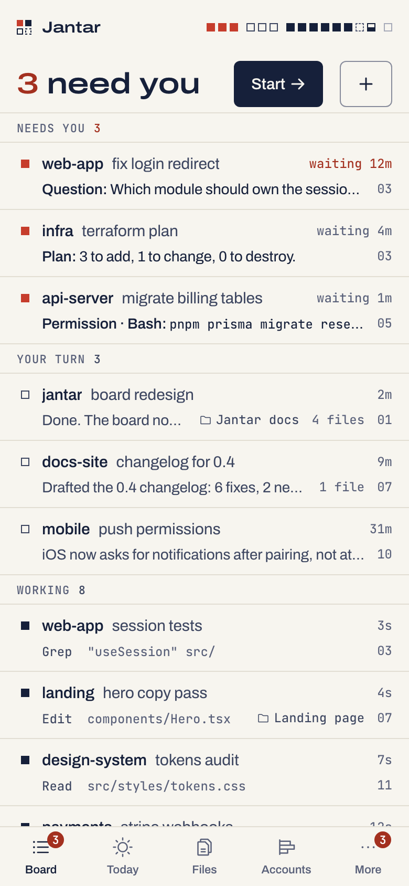
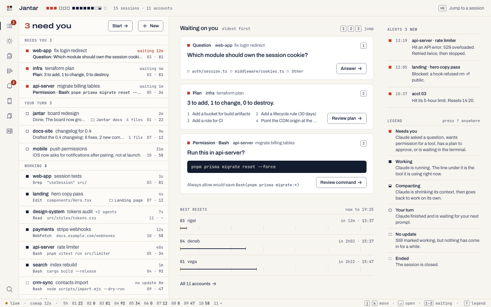
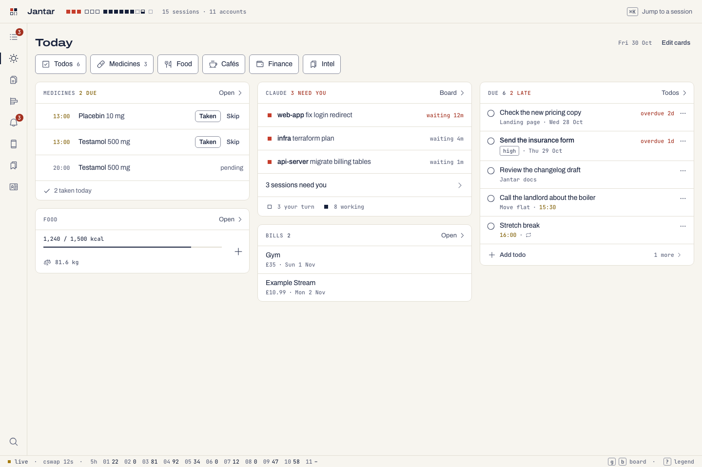
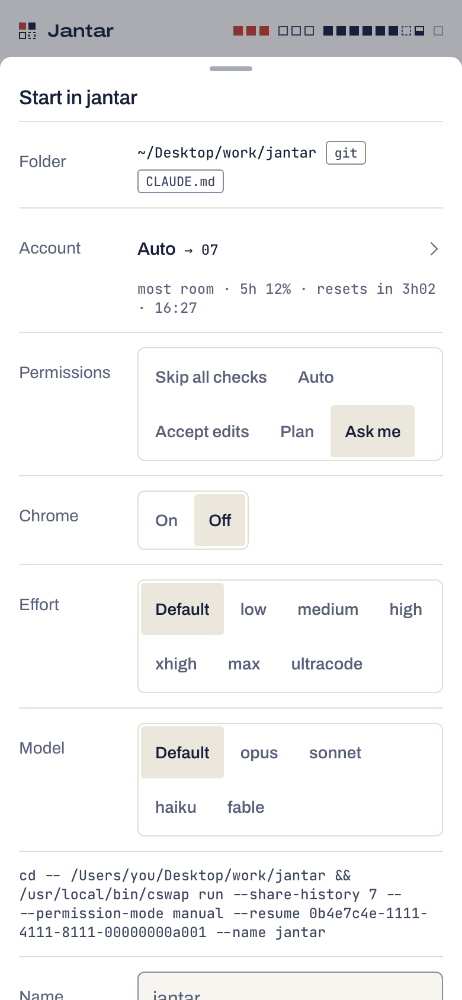
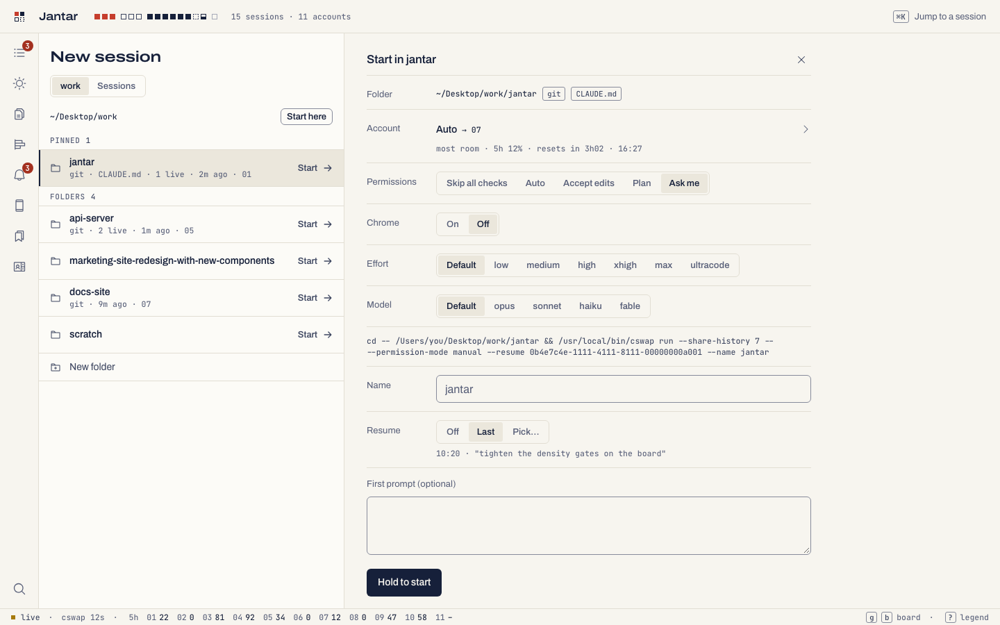

# The app, on the phone and the Mac

One web app serves the Mac and the phone, and installs on the phone as a
Home Screen app (a PWA). This page goes screen by screen and lists the
commands that turn each part on. How the phone answers Claude's prompts is
its own page: [Answering from the phone](phone-control.md).

The day theme (cream and navy) is the default, with a deep-navy night
theme. Red means "needs you" and nothing else; mustard marks time ("now",
the live dot, `next →`). The name shown in the app is one constant,
`packages/web/src/brand.ts`.

<p align="center">
  <picture><source media="(prefers-color-scheme: dark)" srcset="img/board-phone-dark.png"></picture>
</p>

## The screens

| Screen | What you see |
|---|---|
| **Board** | "3 need you" and **Start**, then every session in rails: NEEDS YOU (oldest wait first), YOUR TURN, WORKING, ENDED. Each row: what it is waiting on (the question, the command, the plan), the tool it is running or what it is running in the background, or its last reply, with its account and that account's 5-hour % (with cswap), its project (with Life) and, with [Fleet](fleet.md), the server it runs on. On a Mac the **Desk** beside it shows up to three cards to answer, the next resets and new alerts |
| **Session** | The transcript (or the terminal screen), and a dock for whatever is waiting, in Claude's own words. After you answer, "Next: infra · Plan". With no card, the dialog on the terminal as buttons, or the keypad ([details](phone-control.md)). Otherwise a box to send a prompt, with **+** for photos and files, which says "delivered" only when the transcript proves it |
| **Accounts** | With cswap: every account's 5-hour bar against the ceiling, a runway to the reset, weekly %, its sessions, its flags and the primer's line; with the legacy ccw tool also burn rates, red dashes where an account fills up before its reset, `next →`, held flags and moves in progress. On one login: that login and its sessions ([Accounts](accounts.md)) |
| **Alerts** | Limits, API errors, blocked tools and prompts that were not delivered, by day; mute pushes for 1 or 8 hours (medicine pings still come) |
| **Devices** | This device (theme, install, which notifications), paired devices, and **Show pairing code** for a phone; with Fleet, **Machines**: each paired server, online or not, and its version |
| **Files** | Which files the live sessions created or changed, newest first; a browser over the folders set on the Mac; a read-only viewer |
| **New session** | A folder, an account (with cswap) and the flags, the exact command line it will type, Resume, then hold to start; with Fleet, a **Where** row picks the Mac or a server |
| **Today** and **Life** | Today, Todos (with Reminders and Projects), Medicines, Food, Cafés, Finance and Posts (what you plan to post on social media, with a reminder, Copy and Open, and log the comments you make, with their links; Jantar never posts); on a phone they sit behind Today and More ([Life](life.md)) |
| **Intel** | The shelf, newest first, with search, type and tag filters and each item's page ([Intel](intel.md)) |
| **Meetings** | Under More: your Meet and Teams calls with their summaries ([Meetings](extension.md)) |
| **Chat** | Right after Today: ask Jantar anything, or tell it what to add or change; each change has Undo, deletes wait for your tap ([Chat](assistant.md)) |
| **Work** | With [Work](work.md) on (0.13.0), right after Chat on a device paired with `control`: your projects under Active, Paused and Done, each with its client and next due todo, and a project as one screen (its client, status, a health line, milestones, its deal, todos, the sessions in its folder with **New session here**, its meetings, the log, notes and **Open folder in Files**). With no project yet: **Start from your client folders**. A Board row inside a project's folder has **Open project** in its long-press menu, and a session's screen names its project under the title. **Clients** (its second segment): your clients by Needs a step, Clients, Leads and Past; a client's page with **Call**, **WhatsApp** and **Email** (your phone's own apps), its next step, follow-ups, deals, projects, log and details; **Log a call or meeting** with its next step in one save (kept on the phone if the Mac can't be reached); add a client in about ten seconds; import a CSV or vCard from Files, export to the share sheet, merge duplicates. **Deals** (its third segment): a strip of stages and one stage's deals at a time, with each stage's open and weighted value per currency; a card's **···** (or a long press) moves it, logs, sets a next step or opens its client; **Won** offers to make the project, **Lost** asks why; a deal's page; **Insights ›** (win rate, cycle, forecast, revenue, sources, losses; "—" with nothing to count). A project's milestones tick done with a tap |
| **Accountability partner** | With [Accountability partner](people.md) on: Accountability partner in More (on the rail on a wide screen, on a device paired with control), a line for the person you share with on Today, and `/people` with their status, progress, Plan (the plan editor and Quick plan, Send in a bar at the bottom), Assign (a to-do for them, with a repeat) and Alert, and tabs for Today, To-do, Health (their medicines at the level they share, with Add, Edit and Stop where they allow it; weight, with Correct where they allow it; sleep), Journal, Chat, Lists, Alerts, Sharing (what they agreed to, Ask for more, their devices, your pushes about them) and Activity (the row wraps; a new alert from them shows in the header). Someone invited is a row with the link's expiry. Opened from More, from that line or from a notification about them |

A session waiting on a dynamic workflow or a background agent it started
shows under Working ("1 workflow running", the workflow's name and how
long), even though its turn is over. Its header says "1 workflow running ·
52m · demo-sweep", with the quiet count of background shells and monitors
("6 shells"), and it returns to Your turn when the last one finishes.

On a phone the tab bar holds Board, Today, Files, Accounts and More. With
Chat on it holds Board, Today, Chat, Files and More, and Accounts moves into
More. With Chat and Work on it holds Board, Today, Chat, Work and More, and
Files moves into More (with Chat off, Files keeps its tab). On a Mac a
session opens beside the board once the board's pane is 800 px wide (a
window of about 856).

**Search** (0.13.0): the magnifier in the phone's header, on every screen,
opens the search sheet, the same one ⌘K opens on a Mac and "Search or
jump" in the iPad's sidebar. Type two letters or more and it finds
clients, projects, deals, todos, meetings, sessions, Intel items, cafés and
posts (each while it is on), then the places and the accounts; **Search
Intel only**, its last row, opens the shelf's own search with your words.

<picture><source media="(prefers-color-scheme: dark)" srcset="img/board-desktop-dark.png"></picture>

### Wide windows and the iPad

Every screen lays itself out by the room it has, on a Mac or an iPad
(0.12). Where a place shows one item at a time (Alerts, Intel, Meetings,
Cafés, Posts, Files), the list fills the window as a table or cards, and
opening an item turns the list into a column beside it; Close or Esc goes
back. Today is a page of cards, Todos, Medicines, Food and Finance put
their sections side by side, and Chat keeps its days on the left and,
from about 1180 px, what it changed and its photos on the right. With
[Accountability partner](people.md) on, it is "Partner" in the iPad's
sidebar and rail, the first of Today's cards, and its screen keeps their
name, Plan, Assign, Alert and the tabs in a column on the left with the
tab beside them (their Today as cards).

| | Mac (a mouse or trackpad) | iPad (touch) |
|---|---|---|
| The frame | The rail, the top bar and the status bar from 768 px; a phone's tabs below | From 640 px: a sidebar with names from 1024 px (⌘\ folds it to a rail), a labelled rail below, the accounts strip and ⋯ (Devices, Keyboard shortcuts, the theme, Reload app) at its foot; a phone's tabs below 640 |
| Text and targets | The Mac's type and density | The phone's type, and every control at least 44 pt |
| Forms | A sheet near the top, 540 px wide | The same; a phone keeps its bottom sheet |
| Chat beside the screen | The Chat button in the top bar, or ⌘J | The Chat button at the end of a screen's header, or ⌘J |

Rotating an iPad or resizing a window keeps what you typed, a card's pick
and its own answer, the open session and where you were in the list. With
the on-screen keyboard up, the app fits above it. In the Home Screen app
nothing sits under the status bar, the home indicator or the window
controls.

<picture><source media="(prefers-color-scheme: dark)" srcset="img/today-mac-1440-dark.png"></picture>

### Keys

Keys work at any width once you have used a keyboard (a Mac from the
start, an iPad after its first key press), and only then show their
keycaps. **?** lists them all, the place you are in first; it is also in
the iPad sidebar's ⋯ and in Devices. Every key has a control on screen.

| Where | Keys | What it does |
|---|---|---|
| Anywhere | ⌘K (⌃K outside a text field) | Search or jump |
| | ⌘J | Chat beside this screen |
| | ⌘\ | Show or hide the iPad's sidebar |
| | ⌘1 … ⌘9 | Board, Today, Chat, Files, Accounts, Alerts, Devices, Intel, Meetings (one that is off says so) |
| | g then b t c l a d i m f w | Board, Today, Chat, Alerts, Accounts, Devices, Intel, Meetings, Files, Work |
| | Esc, ⌘. | Back: close what is open |
| | ⌘Z (outside a text field) | Undo the change shown on screen, never one you can't see |
| Board | j / k, 1-9, ↵ | Next / previous session; open the nth waiting; open the first |
| Session | a / d | Allow, approve or send the answer / deny |
| | ⌥1-⌥4, ⌘↵ | Pick a question's option; send |
| | r, n | Type to Claude; the next session needing you |
| | t / s / f | Transcript, Screen, Files |
| | ⌘↑ / ⌘↓ | Previous / next session waiting on you |
| | ↑ ↓ ↵ | With Keys open on the screen: move and Enter |
| Lists | ↑ / ↓ (or j / k), ↵, Esc | Move, open beside the list, back to the row |
| | c, / | New; search this list |
| Todos | e / x / ⌫ | Edit, done, delete (with Undo) |
| Cafés | 1-5, v | The open café's stars (with Undo); log a visit |
| Posts | ⌘C, m, l | Copy the open post, mark it posted, log a comment |
| Chat | ↵ / ⇧↵, ⌘⇧A | Send / new line; add a photo |
| Sheets | ⌘↵, Esc | Save, cancel |

In a text field only ⌘K, ⌘J, ⌘\, ⌘1-⌘9, ⌘↵, Esc and ⌘. reach Jantar;
the field keeps ⌘Z, ⌘ and ⌥ with an arrow, and every ⌃ key (⌃K deletes to
the end of the line there). In a browser tab, the browser may keep ⌘1-⌘9
(its tabs) and ⌘J (Safari's Jump to Selection): g then a letter and the
Chat button always work. To turn the keys on or off on one device:
Devices › This device › Keyboard.

## Their app (Accountability partner)

The person you share with uses a separate app at `/p` on their own
hostname ([Accountability partner](people.md)), named "Accountability
partner" ("Partner" under its Home Screen icon): it holds none of your
screens. Its tab bar
is Today, To-do, Journal, Chat and More (Health, Alerts, Lists, Me). Today runs
their day plan, with a tick on every row, a 5-second Undo and one button at
the bottom for the thumb (Got it, then Done: the Now step, or Start: on a
focus step); it lists the day's doses with Taken and Skip; from their
review time it shows the evening review, and in the evening Going to sleep.
Health opens on Medicines: the day's doses, their medicines (Add, Edit,
Stop; "added by Sam" on yours), then Sleep and Weight.
Chat is their own assistant: "N messages left today" under the box, Undo on
each change, cards for deletes and alerts, ⓘ for who can read it, and, while
you can, "Sam can read this chat" above the box on every visit. Journal,
Chat, Health and Alerts load when opened. After joining, it walks them
through Add to Home Screen (iPhone) and turning on notifications, and Today
keeps a card until they're on. Me › Sharing has "See what Sam sees" for
each area they share.

On your Accountability partner screen, the Chat tab shows their thread read only (no box,
no Undo, no buttons) while they share it, and their messages a day. Lists
shows the cafés you share (Share, Share all, Just me) and your shared lists,
with ticks and Assign to them. Your Cafés list marks shared cafés "shared".
Their Lists (in More) has Cafés (add, rate, log a visit, delete with a
Confirm for both) and Lists (tick circles, "Ticked by Sam · 18:20").

## Turn it on at your Mac

Everything past the Board is off until you switch it on at the Mac, one
part at a time, and a phone can never change a switch. While one is off,
the phone shows the command that turns it on. Controls are on by default.

```sh
jantar folders add-root ~/Desktop     # a folder Files and New session may browse
jantar files on                       # changed files and the read-only viewer
jantar launch on                      # starting sessions from the phone
jantar devices grant iPhone launch    # let one device start them
jantar rewrite on                     # dictated text into a prompt
jantar controls on                    # keys, mode switching and slash commands (on by default)
jantar screenshots on                 # a Picture view of the session's window
jantar life on all                    # Life: todos, medicines, food, cafés, finance, posts
jantar intel on                       # the Intel shelf
jantar meetings on                    # Meetings from the Chrome extension
jantar chat on                        # Chat: ask Jantar anything; changes with Undo, deletes on your tap
```

Every command and option is in [Configuration](configuration.md).

## Sending a prompt

The session's composer, or from the Mac:

```sh
jantar send <session> "run the tests again"
```

`<session>` is a session id (or its first 4+ characters), name or folder.
The command waits until the session's transcript proves the prompt
arrived, and says "Prompt NOT sent" (exit 1) otherwise. The phone's
composer does the same ("Not delivered", with Retry, or Edit and resend).

| Option | Effect |
|---|---|
| `-` as the text | read the prompt from stdin |
| `--` | before text that starts with a dash |
| `--no-wait` | return once it is queued |
| `--timeout S` | seconds to wait for the proof (default 60) |
| `--replace` | replace a draft in the input box instead of refusing (tmux sessions only) |
| `--json` | print the final job as JSON |

`!` shell lines and `/clear`, `/reset` and `/new` are refused from the
composer, because a send there can't be proven.

`jantar status` prints the board from the Mac: your turn first, then
cards, accounts and the last alerts (`--alerts N`, default 3; `--json` for
the raw state).

## New session and Resume

"New Claude session here" in any folder you allow. The start sheet shows
the exact command line it will type. The flags come from a fixed list:
permissions (from "Ask me" to "Skip all checks", with a 2-second hold for
the risky ones; each names its mode, so "Ask me" is
`--permission-mode manual`, which needs Claude Code 2.1.314 or newer),
Chrome, effort up to ultracode, and model. **Resume** opens an earlier
conversation of that folder instead: Last, or Pick from the list. Claude's
trust dialog for a new folder comes back as a card to answer. New folder
at the foot of the browser makes an empty folder there and opens the start
sheet for it, as [Files](#files)' New folder does from there.

<p align="center">
  <picture><source media="(prefers-color-scheme: dark)" srcset="img/start-phone-dark.png"></picture>
</p>

<picture><source media="(prefers-color-scheme: dark)" srcset="img/start-desktop-dark.png"></picture>

Turn it on, then give one device the launch scope:

```sh
jantar folders add-root ~/Desktop/work --id work --label work
jantar launch defaults --permission manual   # where the start sheet's picks begin
jantar launch mode cswap-run                 # with cswap; or claude, on one login
jantar launch on
jantar devices list
jantar devices grant iPhone launch           # applies at the phone's next request; no new pairing
```

From the Mac, `jantar new` starts a session the same way:

```sh
jantar new ~/Desktop/work/scratch --preview         # what a start would type, without starting
jantar new ~/Desktop/work/scratch --resume last     # the folder's last conversation
```

| `jantar new` option | Effect |
|---|---|
| `--account N` or `auto` | an account number, or the one with the most 5-hour room (the default) |
| `--permission P` | `manual`, `acceptEdits`, `plan`, `auto` or `skip` |
| `--chrome` / `--no-chrome` | start with or without `--chrome` |
| `--effort E` | `default`, `low`, `medium`, `high`, `xhigh`, `max` or `ultracode` |
| `--model M` | `default`, `opus`, `sonnet`, `haiku` or `fable` |
| `--name NAME` | the session name (default: the folder name, then -2, -3 when taken) |
| `--prompt TEXT` | a first prompt, sent with proof once the session is ready (`-` reads stdin) |
| `--resume ID` or `last` | a past conversation of this folder (last: the newest not running now); one kept on another account starts there |
| `--confirm-held` | start on an account held for other work anyway |
| `--preview` | show the account, the flags and the command line; start nothing |
| `--no-wait` | return once queued |
| `--timeout S` | seconds to wait (default 300) |
| `--json` | print the final launch as JSON |

The folder must lie under a root or a live session's folder. Exit status:
0 started (and the first prompt proven), 1 not started or the prompt not
sent, 3 daemon not running. There is no way to pass other `claude` flags.

`jantar launch` also has `status` (the switch, the mode, the default flags
and the limits), `defaults --reset` (back to Ask me, Chrome off, default
effort and model), `mode cs-shell` (types a `cs` shell function that wraps
`cswap run`, for older configs) and `pre-launch -- <argv...>` (a program,
by absolute path, run once per account before its first start in
cswap-run mode, `{n}` standing for the account; `pre-launch --clear` runs
nothing).

## Files

Which files the live sessions changed, a browser over the folders you
allow, and a read-only viewer for code (highlighted), Markdown, images, SVG
as source, PDFs and notebooks. No diffs and no git. A protected file (keys,
`.env` files and the like) shows its name only.

```sh
jantar folders add-root ~/Desktop --id desktop --label Desktop
jantar folders list         # roots, and any the daemon would refuse or can't find
jantar files on
```

`folders add-root` refuses `/`, `/Users`, `~/Library` and anything the
daemon's denylist protects, checked by name and by realpath. `folders
roots` shows what the running daemon serves now (live sessions' folders
included), `folders rm-root <id>` removes one, and `folders allow <path>`
opens a hidden home folder such as `~/.config/nvim` (never `~/.ssh`,
`~/.claude*` and the like; `rm-allow` hides it again). `jantar files roots`
(with `add <path>` and `remove <id>`) is the same list, and `jantar files
status` says whether Files is on and shows New folder.

**New folder**: in any folder you browse, New folder makes one empty
folder there (A–Z letters, digits, spaces, `.`, `_` and `-`; starting
with a letter or digit; at most 60) and opens it with **Start a session
here**, the start sheet for it. It needs launching on and a device with the launch
scope (`jantar launch on`, `jantar devices grant <device> launch`). A name
already used here, in any letter case, is refused. At most 10 new folders
an hour.

## Rewrite

Dictate with the phone's keyboard; a headless Claude turns it into a prompt
you review before sending. Nothing is sent on its own.

```sh
jantar rewrite glossary add Ledger Fastify pnpm   # words it must spell exactly
jantar rewrite on                                 # Opus at low effort
jantar rewrite model sonnet                       # or opus, haiku
```

`rewrite status` shows the switch, the model and the glossary, and
`glossary rm <word...>` removes words. "Rewrite with Sonnet" stays on the
phone whatever the model. Rewrite runs on an account with room, never one
kept for other work. Attachments survive a Rewrite.

## Chat

Chat (Ask until 0.10) does what you ask across Jantar. Type it, or send a
photo ("Add oat milk to my list", "How many calories today?", "Rate
Example Café 4 stars, great Wi-Fi", a picture of a receipt). One
headless Claude run on the Mac, with only Jantar's own tools, answers in
plain text, and under the answer is the list of what it did: **Added**,
**Changed**, **Logged**, each with **Undo** for a day. A delete, stopping a
medicine or anything that spends quota is a **Confirm** card; after it
reads someone else's text its writes wait as **Do it** cards. It reads
your sessions but never types into one.

```sh
jantar chat on       # says what goes to Claude
jantar chat off      # hides it and closes the Siri door; the history stays
jantar chat clear    # deletes the history (what it added stays)
```

The thread is one per Mac, the same on every phone and for Siri, kept on
the Mac for 30 days. Everything about it: [Chat](assistant.md).

On a wide window (0.12) Chat lists its days on the left, with a search,
and from about 1180 px what it changed that can still be undone and its
photos on the right; a narrow one keeps them behind **‹ Days**. The
**Chat** button, or ⌘J, opens the same thread beside any screen, on an
iPad or a Mac: a 360 px column where the screen keeps 560 beside it,
otherwise over its right edge. There a **Looking at** chip above the box
names the café, post, Intel item, meeting or session on screen, so "rate
this 4" knows what you mean; × takes it off.

## Controls and screenshots

The session screen's control bar has the permission mode chip, Interrupt,
Clear draft and a menu of slash commands. The Screen tab shows the terminal
as **Text**, or as a **Picture** with screenshots on.

```sh
jantar controls status
jantar controls on | off
jantar controls clear-draft on    # and escape on: a config.json saved by 0.4.0 holds both off
jantar screenshots on
jantar screenshots allow-select   # optional: briefly switch to a background tab to capture it
```

- Mode changes step Shift+Tab one press at a time and read the status line
  after each. A switch to a mode where Claude runs commands without asking
  takes a 2-second hold.
- Interrupt sends Ctrl+C, or Escape when `controls.interruptKey` is
  `escape`. Clear draft empties a draft left in Claude's input box, and
  refuses when it can't see every row (see [SECURITY.md](../SECURITY.md#controls-keys-modes-slash-commands)).
- `/clear` and `/rewind` need a confirmation. `/model` and `/effort` save a
  default for every session, and the menu says so.
- A screenshot shows whatever the window shows, secrets included, so they
  are off by default. `jantar screenshots allow-select off` never switches
  tabs for a picture.

## Devices and scopes

Devices lists this device and every paired one; **Show pairing code** pairs
another. From the Mac:

```sh
jantar devices list                     # --all includes revoked ones; --json for scripts
jantar devices grant iPhone launch      # let the iPhone start sessions
jantar devices revoke-scope iPhone launch   # take it back (admin goes with it)
jantar devices revoke iPhone            # sign the device out for good
```

`<device>` is a device id, a unique id prefix (4+ characters) or a unique
device name. Scopes form a chain: read < control < launch < admin. Only
the Mac grants `launch`. `launch off`, `files off`, `rewrite off`,
`screenshots off` and `ask off` stop each feature at once.

## Notifications

Pushes go to each device that turned them on under Devices. A permission,
question, plan or failed send stays on screen until you act on it. On an
iPhone, notifications need the Home Screen app (iOS 16.4 or newer). Alerts
can mute pushes for 1 or 8 hours; medicine pings still come.

**Sounds.** Under Devices, Sounds gives each kind of alert its own tone
while the app is open: Answer soon (Claude's 2-minute countdown), Needs
you, Done (a success tune), Medicines and reminders, and Problems, each
Alarm, Ding, Success, Bell, Low or None, with a Test button. "Speak a few
words" adds one fixed phrase ("Answer soon", "Claude needs you", "Done",
"Reminder" or "Something needs a look"), never what Claude asked, a folder
or a medicine. Tones and the voice play only while Jantar is open on
screen, after a tap, and follow the silent switch; each time the app
starts again, its first tap lets the voice speak. On the lock screen the
iPhone plays its one alert sound for every web app, whatever you pick here.
When the open app plays a push's tone, that push arrives without the
phone's sound, so you hear one, not two; if the app can't play it in time,
the push sounds as usual. Answer soon, medicine and Life pings always keep
the phone's sound (or its buzz with the silent switch on), with the app's
tone on top. On a session's countdown, Answer soon also plays at 60, 30
and 10 seconds left. The same alert twice within 3 seconds (the
countdown's repeat push and its 60-second mark, or several pings at once)
plays once. Sounds are on by default on a phone and off on the Mac's
dashboard, where the microphone could pick up a chime during a meeting you
are capturing; a Mac tab in the background plays none. The choices stay in
that browser. The success tune needs Done pushes: the Done kind on for
that device, and on the Mac, which sends none by default,
`jantar notify done on`.
