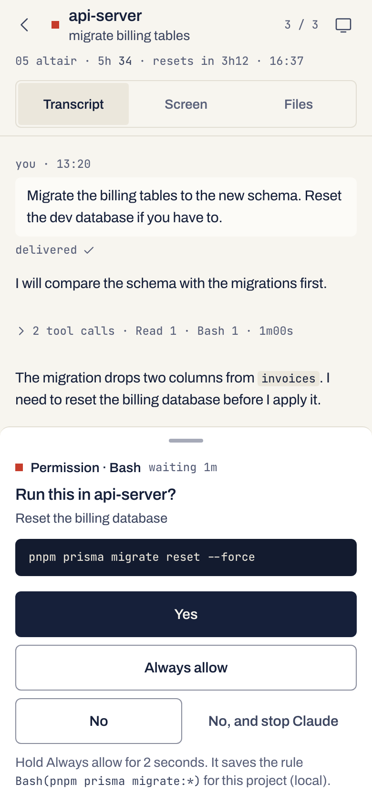
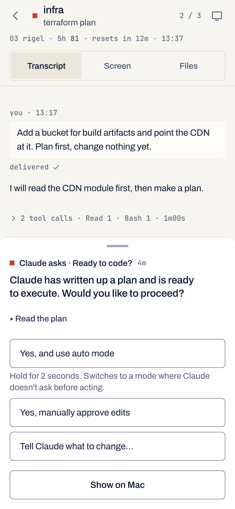
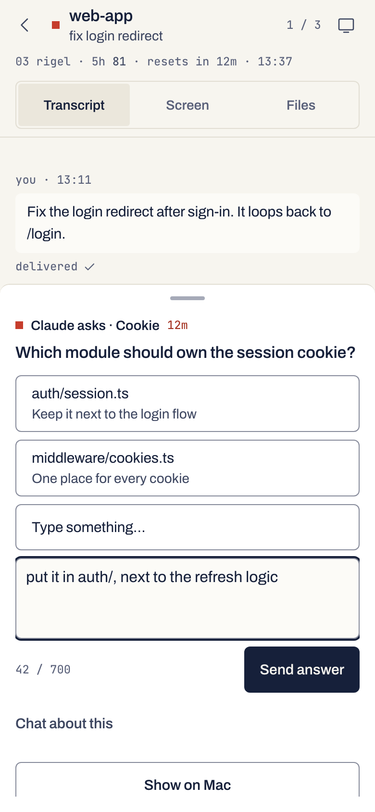
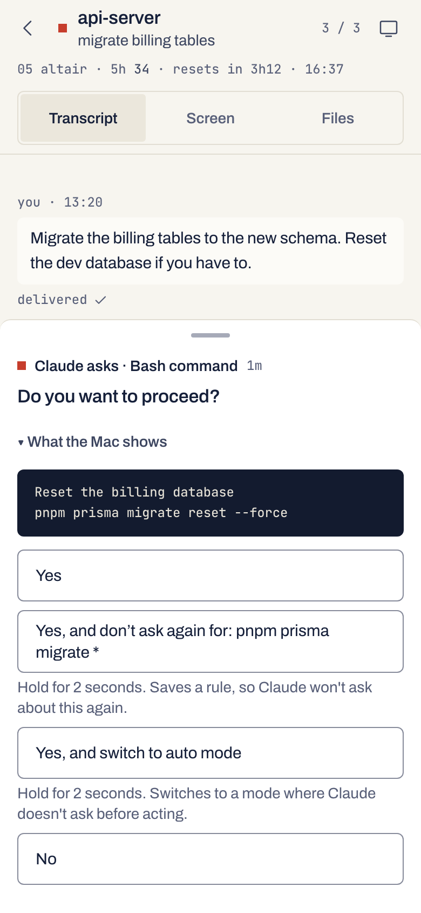
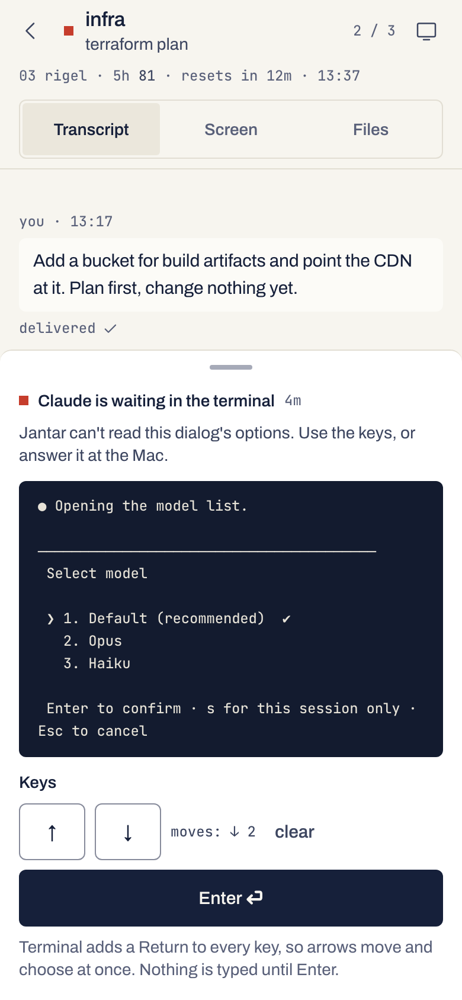
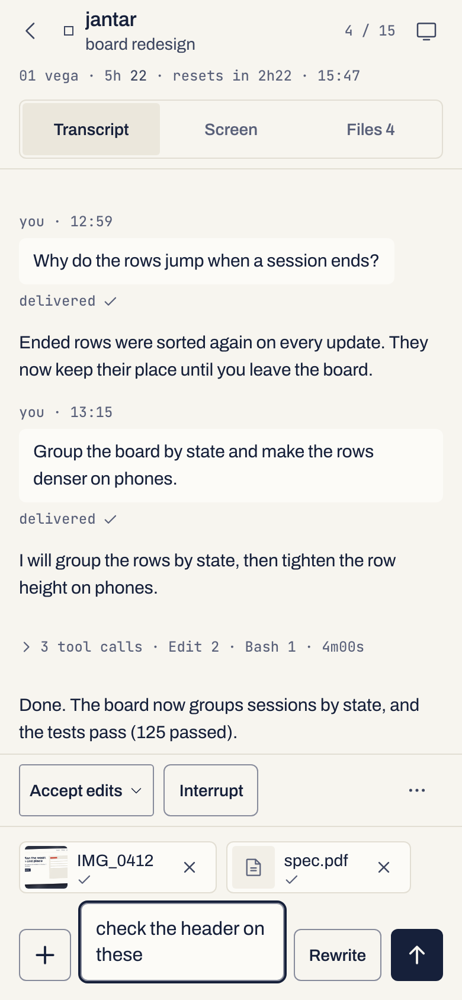

# Answering Claude Code from the phone

What the phone can answer, how a tap becomes keys in the terminal, what
stays at the Mac and why, and how files reach Claude. `SECURITY.md` has the
rules behind each part; [real-Mac checks](real-mac-checks.md) lists the
checks that would open more of it.

<p align="center">
  <picture><source media="(prefers-color-scheme: dark)" srcset="img/card-phone-dark.png"></picture>
  <picture><source media="(prefers-color-scheme: dark)" srcset="img/dialog-plan-phone-dark.png"></picture>
  <picture><source media="(prefers-color-scheme: dark)" srcset="img/dialog-question-phone-dark.png"></picture>
</p>

## Two paths to one dialog

When Claude Code stops to ask (a permission, a plan, a question), the phone
answers it one of two ways:

- **A hook card**, when Jantar's hooks are installed and the session started
  (or resumed) after that. Claude asks the hook, the card shows Claude's
  options, and the answer goes back through the hook exactly as chosen.
  Nothing is typed into the terminal.
- **The screen path**, for every other waiting session: one started before
  the hooks, one run with `JANTAR_SKIP_HOOKS=1`, or a subagent's prompt. The
  daemon reads the dialog off the Terminal tab's text and the dock shows its
  question and Claude's own options as buttons; a tap types the keys that
  choose that row. "Type something." and "Tell Claude what to change" open
  a text box. Show on Mac stays on every dock.

A card always comes first. While one is open for the session, the screen
path is refused (Claude's own dialog is live beside the card, and the card
answers it exactly). A subagent's note is not such a card. The Controls
switch covers the screen path and the keypad; there is no switch of their
own.

## Hook cards

Install the hooks once, at the Mac:

```sh
jantar hooks status
jantar hooks install           # dry run: shows the diff to Claude's settings.json
jantar hooks install --apply   # asks y/N, keeps a backup, writes atomically
jantar hooks uninstall --apply # restores the file minus our entries
```

`--yes` writes without asking, `--json` prints the result for scripts, and
`--settings FILE` edits another settings file (a copy, to try it, say).

- With cswap, every profile's `settings.json` is usually a link to
  `~/.claude/settings.json`, so the hooks apply to every account. `install`,
  `uninstall` and `status` edit or read that one file, and end with a line
  about the cswap profiles: how many share the file, and the slot number of
  any profile that keeps a `settings.json` of its own and so gets no hooks
  (link it to the main file, or run `jantar hooks install --settings <that
  file>`).
- **The hooks fail open.** When the daemon is not running, Claude behaves
  as if they were not there. `JANTAR_SKIP_HOOKS=1` in a session's
  environment turns them off for that session.
- **Sessions pick the hooks up on their next start or resume** (the resume
  half is still a [real-Mac check](real-mac-checks.md#still-open)). A session that was already running keeps going without
  cards; its dialogs are answered through the screen path.
- Cards use Claude's words. A permission: Yes, "Yes, and allow access to …
  for this session" (every session-wide suggestion Claude made, in one row,
  as Claude's own row does), No with an optional note, "No, and stop
  Claude". A question: its options, **Type something** and **Chat about
  this**. A plan: **Yes, auto-accept edits**, **Yes, manually approve
  edits** and **Tell Claude what to change**. Claude's own "Yes, and use
  auto mode" stays off the card until a
  [real-Mac check](real-mac-checks.md#still-open) shows that a tap leaves
  the session as the Mac's row does; on a plan with no card the phone
  answers that row through the screen.
- "Always allow" for a shell rule is a 2-second hold that shows the rule it
  saves.

## What the screen path answers

| Dialog | Buttons | What a tap types |
|---|---|---|
| Permission (Create, Write, Overwrite, Edit, Bash, a read outside the folders, a web fetch) | Yes; "Yes, and allow access to … for this session"; "Yes, and always allow …" or "don't ask again" (held 2 s: it saves a rule); "Yes, and switch to auto mode" or "Yes, and switch to accept edits" (held: it switches mode); No; "No, and tell Claude what to do instead…" | Down once per row below the highlighted one, Up once per row above it; Terminal adds the Return |
| "No, and tell Claude …" | a note box | chooses No, then puts the note in the composer for you to send when Claude is ready |
| Plan approval | "Yes, and use auto mode" (held), "Yes, manually approve edits", "Yes, clear context … and use auto mode" (held), "Tell Claude what to change…" | the arrows; for the last row the arrows and your note in the same write |
| A question | each option, "Type something…", "Chat about this" | the arrows; "Type something…" adds your answer (2 to 700 characters, one line) |
| Several questions | one question at a time, in order, with the tab bar shown | each answer moves Claude on to the next question |
| The review before submitting | "Submit answers"; "Cancel, decline all" (two taps: it throws every answer away) | the arrows |
| Multi-select | one button per box, ticked or not, and Submit | each tap ticks or unticks one box (the daemon reads the screen again before the next); Submit goes to the review |

Rows that save a rule, keep allowing or block reads outside the session's
folders, switch to a mode that doesn't ask (or to accept edits), or clear
the conversation take a 2-second hold, and the daemon wants a confirmation
with the tap.

Up and Down both passed on a real Mac on 31 October
([the record](real-mac-checks.md#verified-on-31-october-2026)): Up after
Downs in one write, and Down on a dialog whose body scrolls, so both are
on. Never a digit (a digit
chose an option of one question on a real Mac and its Return answered the
next), Tab, Shift+Tab, Left, Right or Ctrl+G.

<p align="center">
  <picture><source media="(prefers-color-scheme: dark)" srcset="img/dialog-permission-phone-dark.png"></picture>
</p>

### The guard

The phone answers with the fingerprint of the dialog it showed: a sha256 of
its kind, title, question, whole body, tab bar, rows, ticks and highlighted
row. Under the session's writer lock the daemon reads the screen again and
types nothing (409, "The dialog on the Mac changed") if anything differs.
The write itself is compare-and-type: in the same AppleScript run, Terminal
types only if the dialog's own lines, exactly as the daemon read them, are
still on the tab. Two queued Bash prompts that differ only in their command
have different fingerprints and different lines, so a stale tap meant for
the first never answers the second.

### After a tap

The daemon keeps reading the screen for about 1.5 s:

- **done**: the dialog closed, or another one took its place (seen twice
  in a row). The dock shows the next dialog, or "Answered · &lt;row&gt;" until the
  next screen read.
- **unchanged**: Jantar saw no change. The dock shows the live dialog again;
  there is no automatic retry. If what came back has another fingerprint (a
  queued twin drawn the same way), the dock shows it as new, with "The
  dialog on the Mac changed".
- **Long text**: Terminal swallows the Return after a long run of text, so
  the answer waits in its row. When two reads show the same dialog with the
  highlight on that row holding exactly your text, the daemon sends one lone
  Return, guarded the same way, once.

A tap that lands within 500 ms of a dialog appearing or changing is dropped,
and the dock says so: the finger was on its way to what was there before.

### Rows greyed, with the reason

A greyed row shows one line saying why (once under a run of rows that share
it). The highlighted row, which needs only the Return, still works.

| Note | Rows | Until |
|---|---|---|
| Moving off or past typed text | every row the arrows would reach only from or across a row holding typed text, such as "Chat about this" under an answer typed at the Mac, or any row while the highlight sits on that text | a [real-Mac check](real-mac-checks.md#still-open) |
| Text typed at the Mac | the row holding it | always: finish it at the Mac |
| Type extra answers at the Mac | a multi-select's "Type something" | always |

Two notes show only in a build with those moves switched off: "Moving up
isn't confirmed" (rows above the highlighted one) and "Taller than the
window" (every other row of a dialog whose body shows `↓` or `↑`). Both
passed on a real Mac on 31 October, so both ship on and those rows answer
from the phone. A plan box that scrolls
still says the Mac shows only part of the plan: read the rest there before
you approve.

Some screens get no buttons at all, only their note and the keypad: a list
with rows scrolled out of view, a question with previews, a No-first prompt
without numbers (not yet seen on a real Mac), and any shape Jantar can't read with certainty (a gap
in the numbers, a wrapped `Next` alone on a line, a rule drawn by the
dialog's own text, a plan quoting its own header). So does a dialog whose
top is off screen (taller than the window), whatever the gates: the next
queued prompt drawn alike below its top would share its fingerprint. And so
does dialog text with anything but blank lines and edges under it: a live
dialog ends the screen, so such text is Claude's output above another
screen (a saved screen printed over an MCP form's text field).

A permission's body shows open, whatever its length. Past 40 lines the phone
gets the first 19 (a command's start), a line saying how many more the Mac
shows, and the last 20.

When Claude's prompt box shows and no dialog (the session file still says
waiting after an answer at the Mac), the dock says Claude is ready for a
prompt and offers no keys.

## The keypad

Under a screen with no buttons (an MCP form, `/model`, a dialog from a newer
Claude Code), the dock shows **Keys**: ↓ and ↑ add a move, **Enter** sends
the moves and one Return in a single write. Terminal adds a Return to every
write, so an arrow always moves and chooses; nothing is typed until Enter.

<p align="center">
  <picture><source media="(prefers-color-scheme: dark)" srcset="img/keypad-phone-dark.png"></picture>
</p>

- The phone sends the screen key it was shown (a sha256 of the lines it
  displayed) with the moves. The write is compare-and-type against those
  lines, so it lands only on the screen you counted on. A newer screen, or a
  409, clears the moves, and you count again.
- Refused while a dialog with buttons is on screen, while Claude's prompt
  box shows (↑ would bring back the last prompt and the Return would send
  it), when no `❯` or `›` is visible, and when the list holding the last one
  isn't at the bottom of the screen (anything but blank lines and edges
  under it: a `❯` in Claude's output over a screen without one).
- No text field, so typed fields on those screens stay at the Mac. ↑ is on
  since it passed on a real Mac; Escape waits for its
  [real-Mac check](real-mac-checks.md#still-open).
- Two 409s in a row: "The terminal keeps changing", answer it at the Mac.

## What stays at the Mac

The phone answers terminal dialogs only where a wrong answer can't happen.
The rest stays at the Mac, each for a reason:

- **Rows greyed until a real Mac tries them** (above): rows past a row
  holding typed text, and the permission dialog with No first and no
  numbers, which gets the keypad
  ([still open](real-mac-checks.md#still-open)).
- **Always at the Mac in a dialog:** "Type something" in a multi-select
  question; a row that already holds text typed at the Mac; approving a
  plan with feedback (Shift+Tab) and Claude's editor (Ctrl+G); notes on a
  question and questions with previews; jumping between question tabs
  (answer them in order).
- **On a hook card:** a plan's "Yes, and use auto mode", until its
  real-Mac check passes; the card offers the other rows.
- **Dialogs taller than the window (their top off screen):** no buttons at
  all. Two queued prompts that differ only above what the Mac shows would
  look the same to every check, so a tap meant for one could answer the
  other. Make the Terminal window taller, or use the keypad, which shows
  exactly the lines it acts on, or Show on Mac.
- **Screens with no buttons:** MCP forms, `/model` and `/effort` lists,
  usage-limit and plan dialogs, the bypass and managed-settings warnings,
  `.mcp.json` server trust, a scrolled list, the screen-reader layout, and
  dialogs from a newer Claude Code. The keypad moves and chooses there.
- **Unchanged since v0.4, on purpose:** `!` shell lines and `/clear`,
  `/reset`, `/new` from the composer (a send there can't be proven); a
  `/rewind` restore point (a wrong pick loses work); quitting Claude; a mode
  switch Jantar can't confirm on screen; a re-login, a stalled start and the
  bypass warning while a session starts (once it runs, its dialogs use the
  screen path).
- **Mac-only by design:** every switch (controls, screenshots, files,
  launch, rewrite, folders, life, intel, accounts, meetings, bins, remote,
  and `controls.escapeVerified`, `clearVerified`, `interruptKey`,
  `screenshots.allowSelect`), pairing, scope grants, and Life backup and
  restore. A phone must not widen its own reach.

## Attachments

The composer's **+** (left of the box):

- **Photos, camera or files**: one picker (on an iPhone: Photo Library,
  Take Photo, Choose Files). You can also paste an image into the box, or
  drop files on it on an iPad or a Mac. Files dropped anywhere on the
  session screen are added, not opened by the browser.
- **From this session's folder** (with Files on): the Files browser at the
  session's folder; a file goes into the box as `@<path> `. Nothing is
  uploaded.

<p align="center">
  <picture><source media="(prefers-color-scheme: dark)" srcset="img/attach-phone-dark.png"></picture>
</p>

Each file from the phone becomes a chip with a thumbnail or its kind, is
uploaded to the Mac at once, and can be removed or retried. Send waits until
every chip is on the Mac.

- **Kinds**: images (PNG, JPEG, GIF, WebP; HEIC is drawn again as JPEG on
  the phone), PDF, Word, Excel and PowerPoint, text and code (an SVG goes as
  text). Video and audio are refused. The Mac decides the kind from the
  bytes, never from the name.
- **Photos**: JPEG and HEIC are drawn again as JPEG on the phone, at most
  2000 px on the long edge, which drops their location data; a JPEG the
  phone's browser can't decode is refused. PNG and WebP files small enough
  for Claude go as they are when they hold no metadata (EXIF, XMP, text),
  else they are drawn again too. GIF goes as it is, metadata included, and
  so does another photo the browser can't decode (the Mac then refuses a
  HEIC one).
- **Limits**: 10 files a prompt, 20 MB each (text 2 MB), 200 MB per device
  every 10 minutes, 1 GB on the Mac in all.
- **Where they go**: `~/.jantar/uploads/<session>/<id>.<ext>` (folders
  0700, files 0600), removed after 7 days or when you remove the chip.
- **What Claude gets**: your words, then the files by path:

  ```text
  check the header on these

  Attached files:
  - "IMG_0412": /Users/you/.jantar/uploads/<session>/<id>.jpg
  - "budget.pdf": /Users/you/.jantar/uploads/<session>/<id>.pdf
  ```

  With no words the block opens with "Please look at these files:". Claude
  reads each file with its Read tool; Claude Code is expected to ask once
  before reading outside the session's folders (a real-Mac check will
  confirm it), and that dialog is answered from the phone like any other.
- Attachments survive a Rewrite, and a failed send keeps them for Retry or
  "Edit and resend". A slash command can't carry files.
- Uploads need the control scope, like sending a prompt. There is no switch
  of their own.

## Switches

The dialog answers and the keypad sit behind the Controls switch, set at the
Mac only (`jantar controls on` / `off`). While it is off, the phone still
shows the dialog with its rows greyed and the command that turns it on, and
the daemon answers 403 without typing. "From this session's folder" needs
Files on. Every switch, pairing and scope grant stays at the Mac by design:
a phone must not widen its own reach.
